# Manuale d'uso di plumeCMS

Versione del manuale: plumeCMS 1.7.0, 29 ottobre 2026.

## Prima di cominciare

Hai installato plumeCMS e hai davanti un sito che esiste già: pagine, menu, testi d'esempio. Adesso deve diventare tuo.
Questo manuale ti accompagna lì, un passo alla volta.

Ogni capitolo è fatto allo stesso modo:

- **a cosa serve**, in due righe;
- **un esempio vero**, fatto sul sito di prova "Studio Prova" (un negozio): le schermate che vedi sono quelle che
  vedrai tu;
- **i passi**, numerati come i pallini rossi sulle schermate;
- **una checklist**, per sapere quando hai finito;
- **se qualcosa non va**, le cose che capitano più spesso.

Non serve leggerlo tutto di fila. Se è la prima volta, fai i capitoli 1, 2 e 3: in mezz'ora sai muoverti nel pannello.
Poi scegli quello che ti serve.

Una parola sui nomi. **Il pannello** è la parte riservata, dove lavori tu. **Il sito** è quello che vedono le persone.
**Pubblicare** vuol dire rendere visibile sul sito quello che hai preparato nel pannello.

Questo manuale racconta come si usa plumeCMS. Per costruire un tema c'è il manuale dei temi.

---

## 1. Il pannello in cinque minuti

**A cosa serve.** Il pannello è il posto da cui cambi tutto: testi, pagine, immagini, aspetto, utenti. Qui impari a
entrare, a orientarti e a sceglierti i colori del pannello che ti stancano di meno.

### Entrare

Il pannello sta all'indirizzo del sito seguito da `/admin/`. Se il sito è `https://www.tuosito.it`, il pannello è
`https://www.tuosito.it/admin/`. Se hai installato plumeCMS in una cartella (per esempio `https://www.tuosito.it/nuovo`),
il pannello è `https://www.tuosito.it/nuovo/admin/`.

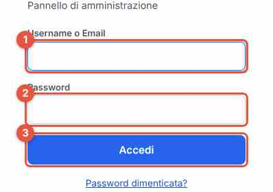

1. Scrivi il **nome utente** scelto durante l'installazione.
2. Scrivi la **password**.
3. Premi **Accedi**.

Se sbagli la password troppe volte di fila, il pannello ti fa aspettare qualche minuto: è una protezione contro chi
prova a indovinarla. Se l'hai dimenticata, sotto il modulo c'è il link per reimpostarla via email.

### La dashboard

Dopo l'accesso arrivi alla **Dashboard**: la pagina che ti dice come sta il sito e cosa c'è da fare.

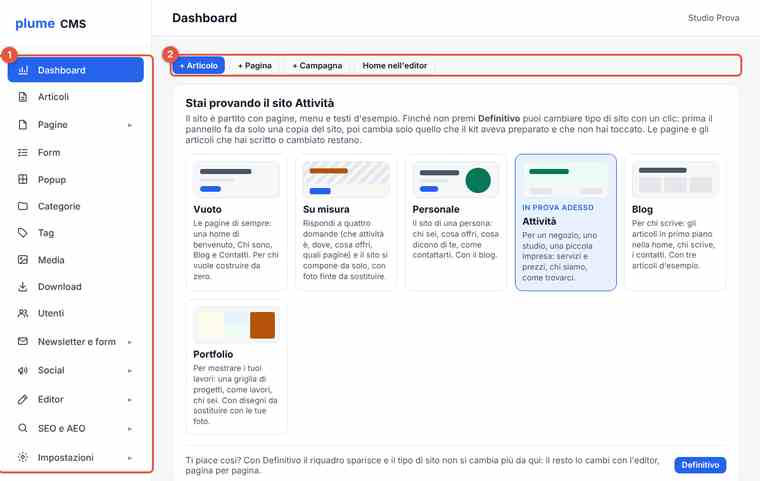

1. **Il menu a sinistra.** Tutte le sezioni del pannello. Le voci con la freccetta (Pagine, Newsletter e form, Editor,
   SEO e AEO, Impostazioni) si aprono e mostrano le sottovoci.
2. **I pulsanti rapidi.** + Articolo, + Pagina, + Campagna e Home nell'editor: le cose che si fanno più spesso, a un clic.

Sotto trovi i riquadri del **tipo di sito** e dei **Primi passi** (capitoli 2 e 3), gli avvisi in giallo, e i numeri
del sito: articoli online, programmati e in bozza, iscritti alla newsletter, form compilati, ultime modifiche, e un
riquadro **Sistema** che dice quando sono girati per l'ultima volta i compiti automatici (il cron, capitolo 26).

### Il menu in basso

In fondo alla colonna di sinistra ci sono quattro voci più piccole: le cose che riguardano te, non il sito.

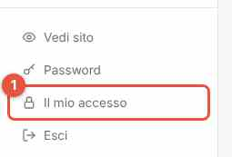

- **Vedi sito** apre il sito in una scheda nuova.
- **Password** cambia nome utente, email e password.
- **Il mio accesso** (1) è il posto dell'aspetto del pannello, dell'accesso a due fattori e dei dispositivi collegati.
- **Esci** chiude la sessione.

### L'aspetto del pannello

Il pannello nasce chiaro, con l'aspetto **Aria**. Se lavori la sera, o se ti piacciono i colori caldi, puoi cambiarlo.
Vale solo per te: ogni utente sceglie il suo, e il sito non cambia.

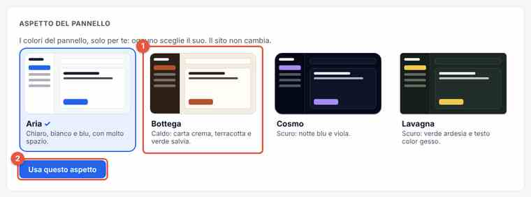

1. In **Il mio accesso**, riquadro **Aspetto del pannello**, fai clic sulla miniatura che ti piace: **Aria** (chiaro,
   bianco e blu), **Bottega** (caldo, carta crema e terracotta), **Cosmo** (scuro, notte blu e viola), **Lavagna**
   (scuro, verde ardesia e gesso).
2. Premi **Usa questo aspetto**. Il pannello cambia subito.

**Checklist**

- [ ] Entro nel pannello con il mio nome utente e la mia password.
- [ ] So dove sono la Dashboard, il menu a sinistra e il menu in basso.
- [ ] Ho scelto l'aspetto del pannello che preferisco.

**Se qualcosa non va**

- *Il pannello appare senza colori, solo testo.* Hai aperto un indirizzo con un pezzo in più dopo il nome della pagina
  (per esempio `/admin/index.php/qualcosa`). Torna a `/admin/`.
- *"Troppi tentativi: riprova fra qualche minuto".* Aspetta il tempo indicato. Se sei sicuro della password, controlla
  che il blocco delle maiuscole sia spento.
- *Dopo un aggiornamento il pannello ha i colori di prima.* Il browser ricorda la versione vecchia: ricarica la pagina
  tenendo premuti **Cmd + Maiusc + R** (sul Mac) o **Ctrl + Maiusc + R** (su Windows). Dalla 1.4.1 non dovrebbe più
  succedere.

---

## 2. Il tipo di sito in prova

**A cosa serve.** All'installazione hai scelto un tipo di sito: Vuoto, Personale, Attività, Blog, Portfolio o Su misura. Finché
non lo dichiari definitivo puoi provarli tutti, con un clic, e vedere quale ti somiglia di più.

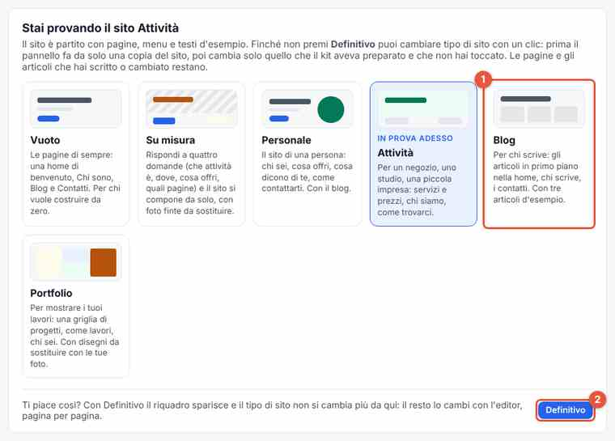

**Esempio.** Studio Prova è partito come **Attività** (la scheda azzurra, "In prova adesso"). Vogliamo vedere come
starebbe da Blog.

1. Fai clic sulla scheda **Blog**. Il pannello chiede conferma: premi **OK**. Prima di cambiare fa da solo una copia
   del sito (la ritrovi in Impostazioni > Copia del sito), poi cambia le pagine, il menu e i testi d'esempio che il kit
   aveva preparato e che **non hai toccato**. Quello che hai scritto o cambiato tu resta dov'è, e il riquadro ti dice
   cosa è rimasto com'era.
2. Quando il sito ti piace, premi **Definitivo** e conferma. Il riquadro sparisce e il tipo di sito non si cambia più
   da qui: da quel momento ogni modifica la fai con l'editor, pagina per pagina.

Apri il sito (Vedi sito) dopo ogni cambio: è il modo più veloce per decidere.

**Checklist**

- [ ] Ho provato almeno un altro tipo di sito oltre a quello di partenza.
- [ ] Ho scelto quello giusto e ho premuto **Definitivo**.

**Se qualcosa non va**

- *Non vedo il riquadro.* Compare solo sulle installazioni nuove (dalla 1.4.0) e solo all'amministratore. Se il sito è
  stato aggiornato da una versione più vecchia, o se hai già premuto Definitivo, il riquadro non c'è.
- *Ho cambiato tipo e una pagina che avevo ritoccato è rimasta quella vecchia.* È voluto: quello che hai cambiato tu
  non si tocca. Se vuoi la pagina del nuovo tipo, cancella la tua e cambia di nuovo tipo.

### Il sito su misura

**A cosa serve.** Invece di partire da un modello uguale per tutti, rispondi a quattro domande e il sito si compone da
solo: home, pagine, menu e testi pensati per la tua attività. Dove andrà una foto c'è un disegno che dice cosa
fotografare ("La vetrina", "Un prodotto", "Le persone"), e lo sostituisci quando hai le foto vere (capitolo 7).

Lo trovi in due posti: nell'installatore, al passo 4, è la carta **Su misura**; dopo, finché il tipo di sito è in prova,
è la carta **Su misura** di questo riquadro.

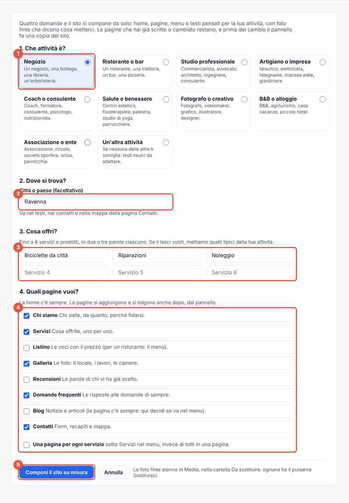

**Esempio.** Ciclofficina Prova, un negozio di biciclette a Ravenna, vuole anche la pagina delle domande frequenti.

1. **Che attività è?** Scegli la carta più vicina: **Negozio**. Ognuna porta testi suoi: un ristorante ha "Il menù" e
   "Prenota un tavolo", un idraulico "Chiedi un preventivo". Se nessuna ti somiglia, **Un'altra attività** scrive testi
   neutri da adattare.
2. **Dove si trova?** Scrivi la città: **Ravenna**. Finisce nei testi, nei contatti e nella mappa della pagina Contatti.
   Puoi lasciarla vuota.
3. **Cosa offri?** Fino a sei servizi o prodotti, due o tre parole ciascuno: **Biciclette da città**, **Riparazioni**,
   **Noleggio**. Diventano le schede della home e le sezioni della pagina Servizi. Se li lasci vuoti, il sito mette
   quelli tipici dell'attività.
4. **Quali pagine vuoi?** Spunta quelle che servono: qui aggiungiamo **Domande frequenti**. La home c'è sempre. Con
   **Una pagina per ogni servizio** ogni servizio ha la sua pagina, sotto Servizi nel menu.
5. Premi **Componi il sito su misura** e conferma. Come per gli altri cambi, prima il pannello fa una copia del sito.
   Nell'installatore il pulsante è **Installa adesso**.

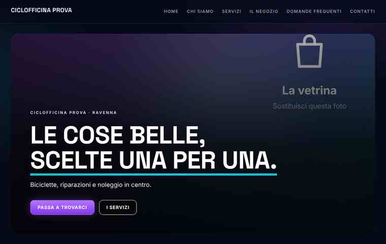

Le risposte restano: se riapri la carta Su misura le ritrovi già scritte. Cambiane una e premi **Ricomponi il sito**:
le pagine che hai già ritoccato, o in cui hai messo una foto vera, restano tue, il riquadro te lo dice.

**Checklist**

- [ ] Ho scelto l'attività e scritto la città.
- [ ] I servizi hanno nomi brevi, come li direi a un cliente al telefono.
- [ ] Nel menu ci sono solo le pagine che userò davvero.
- [ ] Ho aperto il sito e ho letto ogni pagina: i testi sono d'esempio e vanno riscritti con le mie parole.

**Se qualcosa non va**

- *Le foto hanno una scritta "Sostituisci questa foto".* È voluto: sono finte. Si cambiano in Media (capitolo 7).
- *Ho scritto un'emoji nel nome di un servizio e non c'è più.* Il nome di un servizio diventa anche il titolo e
  l'indirizzo di una pagina: le emoji si tolgono.
- *Non vedo la carta Su misura nella dashboard.* Il tipo di sito è già definitivo: da lì in poi il sito si cambia con
  l'editor, pagina per pagina.

---

## 3. I primi passi

**A cosa serve.** Sei cose (sette in un sito su misura) che servono perché il sito sia davvero pronto. Le trovi sulla dashboard, ognuna con il link
alla pagina giusta, e si spuntano da sole quando le hai fatte.

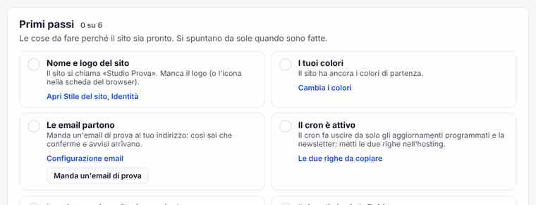

| Passo | Cosa fare | Capitolo |
|---|---|---|
| Nome e logo del sito | Stile del sito, Identità: nome, logo, icona del browser | 13 |
| I tuoi colori | Stile del sito, Colori globali | 13 |
| Le email partono | Manda un'email di prova al tuo indirizzo | 24 |
| Il cron è attivo | Le due righe nei Cron Job dell'hosting | 25 |
| La prima pagina o il primo articolo | Riscrivi una pagina d'esempio o scrivi un articolo | 4, 9 |
| Le tue foto al posto di quelle finte (solo nei siti su misura) | Media, Da sostituire, Sostituisci | 7 |
| Il tipo di sito è definitivo | Premi Definitivo nel riquadro sopra | 2 |

Quando sono tutte verdi compare **Tutto fatto: nascondi**: premilo e la dashboard torna pulita.

**Checklist**

- [ ] Le voci dei Primi passi sono verdi (sei, sette in un sito su misura).
- [ ] Ho nascosto il riquadro.

---

## 4. Il primo articolo

**A cosa serve.** Gli articoli sono le notizie, i racconti, gli avvisi: hanno una data, finiscono nel blog e nel feed,
si dividono in categorie e tag. Le pagine (capitolo 9) invece stanno ferme: Chi siamo, Servizi, Contatti.

**Esempio.** Studio Prova chiude per ferie e vuole avvisare i clienti con un articolo: "Chiusi per ferie dal 10 al 20
agosto".

### Scrivere il testo

Sulla dashboard premi **+ Articolo** (1).

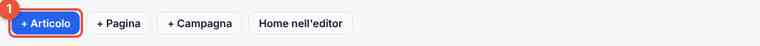

Si apre l'editor visuale con un articolo nuovo, in bozza, che si chiama "Nuovo articolo". Per prima cosa gli dai un
titolo e un indirizzo: premi **Impostazioni**, in alto.

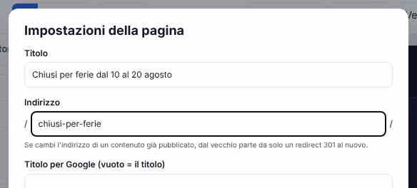

1. **Titolo**: "Chiusi per ferie dal 10 al 20 agosto".
2. **Indirizzo**: la parte dopo il nome del sito, solo lettere minuscole, numeri e trattini. Qui `chiusi-per-ferie`:
   l'articolo sarà su `www.tuosito.it/chiusi-per-ferie/`. Corto è meglio.

Premi **Salva impostazioni**. Nella tela, al centro, il titolo cambia.

Ora il testo. Fai **doppio clic** sul riquadro "Scrivi qui il testo." nella tela: a sinistra si apre il pannello
**Modifica**, con la casella del testo.

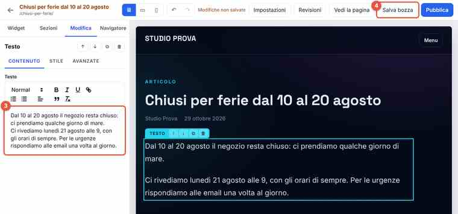

3. Scrivi nella casella a sinistra. Mentre scrivi, la tela a destra ti mostra come verrà. La barra sopra la casella fa
   grassetto, corsivo, link, elenchi, titoletti (la tendina "Normal").
4. Premi **Salva bozza**. In alto compare "Bozza salvata alle..." Il sito non è ancora cambiato.

### Rifinire nella scheda

Il testo c'è. Categoria, tag, immagine e data invece stanno nella **scheda** dell'articolo: premi la freccia **←** in
alto a sinistra (5).

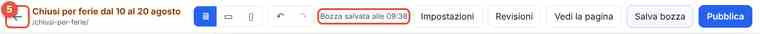

Nella colonna di destra della scheda:

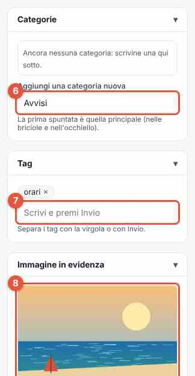

6. **Categorie**: spunta quella giusta, oppure scrivine una nuova in **Aggiungi una categoria nuova** (qui "Avvisi").
   Si crea quando salvi.
7. **Tag**: scrivi una parola e premi **Invio** (qui "orari"). I tag sono più liberi delle categorie: servono a
   ritrovare gli articoli che parlano della stessa cosa.
8. **Immagine in evidenza**: premi **Scegli l'immagine**, poi **Carica** per prenderla dal computer, oppure fai clic su
   una già caricata. Sotto scrivi il **Testo alternativo**: cosa si vede nella foto, per chi non vede e per Google.
   L'immagine in evidenza esce nelle schede del blog e quando qualcuno condivide l'articolo, non in cima all'articolo:
   se la vuoi anche lì, mettila nel testo con un widget Immagine.

Più in basso, a sinistra:

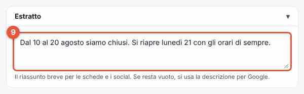

9. **Estratto**: due righe che riassumono l'articolo. Escono nelle schede del blog e sui social.

### Pubblicare

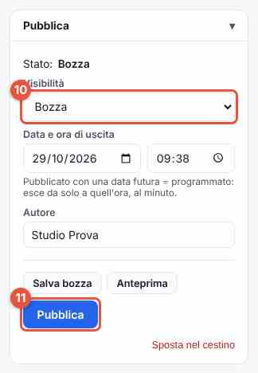

10. **Visibilità**: scegli **Pubblicato**.
11. Premi **Pubblica**. L'articolo è online, con il testo che hai scritto nell'editor.

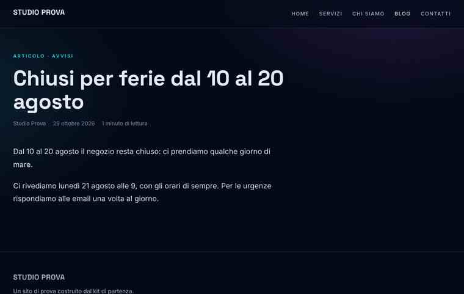

Vuoi che sotto ogni articolo esca sempre lo stesso invito (passa in negozio, iscriviti alla newsletter)? Non va
scritto in ogni articolo: lo prepari una volta sola con **Aggiungi sempre alla fine**, capitolo 16.

**Checklist**

- [ ] Il titolo è quello giusto e l'indirizzo è corto e leggibile.
- [ ] Il testo è salvato (Salva bozza nell'editor).
- [ ] C'è almeno una categoria.
- [ ] L'immagine in evidenza ha il testo alternativo.
- [ ] L'estratto riassume l'articolo in due righe.
- [ ] Ho premuto Pubblica e ho aperto l'articolo sul sito per guardarlo.

**Se qualcosa non va**

- *"L'indirizzo è già usato".* C'è già un contenuto con quell'indirizzo: scegline un altro.
- *Sul sito l'articolo non si vede.* Controlla che la Visibilità sia "Pubblicato" e che la data non sia nel futuro
  (altrimenti è programmato, capitolo 5).
- *Ho cambiato l'indirizzo di un articolo già pubblicato.* Nessun problema: dal vecchio indirizzo parte da solo un
  redirect al nuovo, e i link già condivisi continuano a funzionare.
- *Ho fatto modifiche all'articolo già online, nell'editor, e sul sito non si vedono.* Nell'editor hai premuto Salva
  bozza: per mandarle online premi **Pubblica** nell'editor.

---

## 5. Programmare un articolo

**A cosa serve.** Scrivi oggi, esce domani alle 8, anche se dormi. Un articolo con una data futura è **programmato**:
esce da solo all'ora che hai scelto.

**Esempio.** "Da settembre apriamo anche il sabato": scritto oggi, deve uscire fra cinque giorni alle 8.

Scrivi l'articolo come nel capitolo 4. Poi, nella scheda, riquadro **Pubblica**:

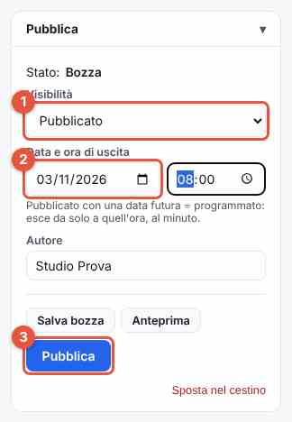

1. **Visibilità**: **Pubblicato**.
2. **Data e ora di uscita**: il giorno e l'ora in cui deve uscire.
3. Premi **Pubblica**. Il pannello risponde "Articolo aggiornato" e nell'elenco degli articoli lo trovi come
   **Programmato**.

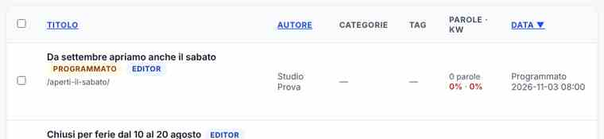

Sulla dashboard, nel riquadro **Contenuti**, la voce **Prossime uscite** ti ricorda cosa sta per uscire e quando.

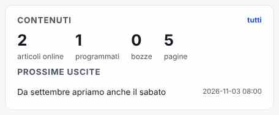

**Checklist**

- [ ] Visibilità "Pubblicato" e una data futura.
- [ ] Nell'elenco l'articolo è "Programmato".
- [ ] Il cron è attivo (capitolo 26): avvisa i motori di ricerca delle pagine nuove.

**Se qualcosa non va**

- *L'ho programmato ma è uscito subito.* La data era nel passato, o l'ora era già passata. Controlla data **e** ora.
- *Voglio rimandarlo.* Apri l'articolo, cambia la data, premi Aggiorna.
- *Voglio fermarlo.* Visibilità "Bozza", Salva bozza: resta tuo finché non lo pubblichi.

---

## 6. Categorie e tag

**A cosa serve.** Le **categorie** sono i cassetti del blog: pochi, stabili (Avvisi, Novità, Consigli). I **tag** sono
le etichette: tante, libere (orari, saldi, agosto). Ogni categoria e ogni tag ha la sua pagina sul sito, con i suoi
articoli.

Le crei mentre scrivi un articolo (capitolo 4), oppure dalla voce **Categorie** (o **Tag**) del menu.

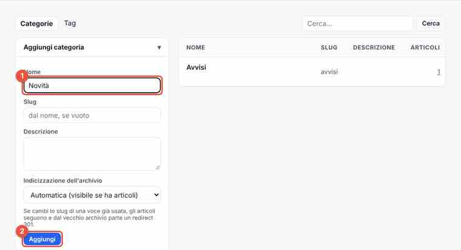

1. **Nome**: come si legge sul sito ("Novità"). Lo **Slug** (l'indirizzo) si fa da solo dal nome, se lo lasci vuoto.
   La **Descrizione** esce in cima alla pagina della categoria e aiuta Google.
2. Premi **Aggiungi**.

A destra c'è l'elenco, con quanti articoli ha ogni voce, e i link per modificarla o eliminarla.

**Checklist**

- [ ] Le categorie sono poche e chiare (meglio 3-6 che 20).
- [ ] Ogni categoria ha una descrizione di una o due frasi.

**Se qualcosa non va**

- *Ho cambiato lo slug di una categoria.* Gli articoli seguono e dal vecchio indirizzo parte un redirect.
- *Ho eliminato una categoria per sbaglio.* Gli articoli restano, senza quella categoria: ricreala e rispuntala.

---

## 7. Le immagini: Media

**A cosa serve.** **Media** è la libreria di tutte le immagini del sito. Le carichi qui, oppure direttamente
dall'editor e dalla scheda (premendo Scegli o Carica): finiscono comunque qui.

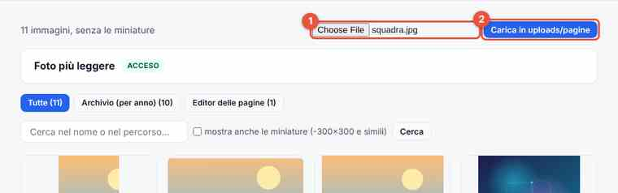

1. Premi **Scegli file** e prendi la foto dal computer (JPEG, PNG, GIF, WebP, AVIF o SVG).
2. Premi **Carica**.

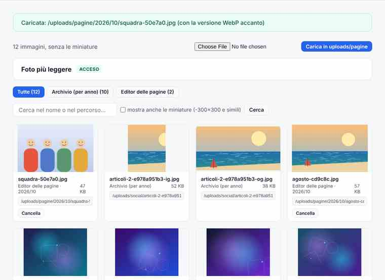

Quando carichi una foto JPEG o PNG, plumeCMS la sistema da solo:

- la raddrizza, se viene dal telefono girata;
- la rimpicciolisce se è enorme (oltre 2560 pixel sul lato lungo: la misura si cambia nel riquadro **Foto leggere**
  della stessa pagina);
- toglie i dati nascosti, come la posizione GPS e il modello del telefono;
- le fa accanto una versione **WebP**, più leggera, che il sito dà ai browser che la sanno leggere.

Tu non devi fare niente: il sito è più veloce e la tua casa non finisce su internet dentro una foto.

### Le foto finte del sito su misura

Un sito su misura (capitolo 2) parte con dei disegni al posto delle foto: ognuno dice cosa ritrarre. In Media li trovi
nella cartella **Da sostituire**, e un avviso in cima ti dice quanti ne restano.

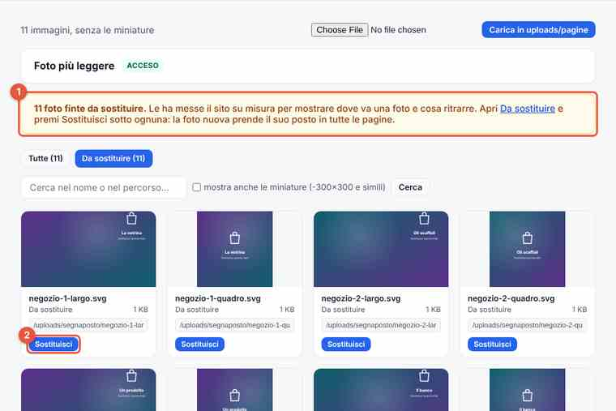

1. Premi **Da sostituire** nell'avviso (o fra le cartelle).
2. Sotto il disegno che vuoi cambiare premi **Sostituisci** e scegli la foto dal computer. Appena la scegli, parte: la
   foto si carica, prende il posto del disegno in tutte le pagine, gli articoli, l'header e il footer, e il disegno si
   cancella. Il messaggio verde ti dice in quanti punti del sito l'ha messa.

Una foto per la home in larghezza va bene orizzontale (il disegno è largo), una per "Chi siamo" va bene verticale.
Sostituisci lo usa solo l'amministratore.

**Checklist**

- [ ] La cartella Da sostituire è vuota (e la voce dei Primi passi è verde).
- [ ] Le foto hanno un nome che dice cosa sono (vetrina-natale.jpg è meglio di IMG_4021.jpg).
- [ ] Ogni foto usata nelle pagine ha il testo alternativo (lo scrivi dove la usi).

**Se qualcosa non va**

- *"Il file supera il limite di caricamento del server".* L'hosting accetta file fino a una certa misura (spesso 2 MB).
  Rimpicciolisci la foto prima di caricarla, oppure chiedi all'hosting di alzare `upload_max_filesize`.
- *Ho cancellato una foto e in una pagina c'è un buco.* Il pannello te lo aveva chiesto: ricaricala e rimettila nella
  pagina.

---

## 8. L'editor visuale: com'è fatto

**A cosa serve.** L'editor è il cuore di plumeCMS: costruisci le pagine trascinando **sezioni**, **colonne** e
**widget**, e vedi subito come vengono. Si apre da **+ Pagina**, da **Home nell'editor**, oppure dal pulsante **Apri
nell'editor visuale** nella scheda di ogni contenuto.

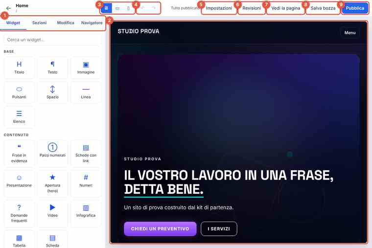

1. **Le quattro linguette del pannello di sinistra**: **Widget** (i mattoncini da mettere nella pagina), **Sezioni**
   (le sezioni pronte, capitolo 10), **Modifica** (le impostazioni dell'elemento scelto), **Navigatore** (l'albero
   della pagina: utile quando gli elementi sono tanti).
2. **La tela**: la pagina come la vedranno le persone. Fai clic su un elemento per sceglierlo, doppio clic per
   modificarlo.
3. **Computer, tablet, telefono**: la tela si stringe alla misura scelta. Molte impostazioni si possono dare diverse
   per ogni misura.
4. **Annulla e ripeti** (anche con Ctrl+Z e Ctrl+Y).
5. **Impostazioni** della pagina: titolo, indirizzo, titolo e descrizione per Google, stato, header e footer.
6. **Revisioni**: tutte le versioni salvate, capitolo 12.
7. **Vedi la pagina** sul sito, in una scheda nuova.
8. **Salva bozza**: salva senza cambiare il sito.
9. **Pubblica**: manda online. Chiede conferma.

Accanto a **Annulla** c'è lo stato della pagina: "Tutto pubblicato", "Modifiche non salvate", "Bozza salvata, non
ancora pubblicata".

### Sezioni, colonne, widget

Ogni pagina è una pila di **sezioni** (le fasce orizzontali). Ogni sezione ha da una a quattro **colonne**. Dentro le
colonne ci sono i **widget**: titoli, testi, immagini, pulsanti, gallerie, prezzi, domande frequenti, mappe, form e
molti altri, 80 in tutto.

- Per **aggiungere un widget**: fai clic su un elemento della tela, poi sul widget nella linguetta **Widget**: entra
  sotto l'elemento scelto. Oppure trascinalo dove vuoi.
- Per **aggiungere una sezione**: premi il **+** viola in fondo a una sezione; la nuova nasce sotto. Oppure, nel
  Navigatore, **+ Aggiungi una sezione**.
- Per **spostare** una sezione trascinala dalla sua maniglia **⋮⋮ Sezione**; un widget lo trascini direttamente.

### Il pannello Modifica

Doppio clic su un elemento, e a sinistra si apre **Modifica**.

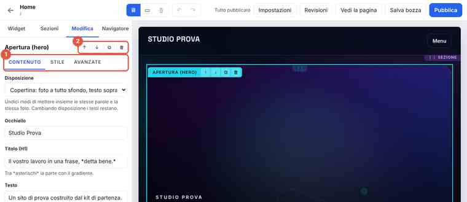

1. **Contenuto, Stile, Avanzate**: le tre schede di ogni elemento. **Contenuto** è cosa dice (testi, immagini, link).
   **Stile** è come appare (colori, caratteri, misure, bordi, ombre). **Avanzate** sono margini, animazioni, visibilità
   per misura dello schermo, classi CSS.
2. **Sposta su, sposta giù, duplica, elimina** l'elemento scelto. Gli stessi pulsanti compaiono anche sulla tela,
   sopra l'elemento.

**Checklist**

- [ ] So distinguere sezione, colonna e widget.
- [ ] So aprire il pannello Modifica (doppio clic) e trovare le schede Contenuto, Stile, Avanzate.
- [ ] So che **Salva bozza** non cambia il sito e **Pubblica** sì.

---

## 9. Esempio: la pagina "Lavora con noi"

**A cosa serve.** Mettere insieme tutto quello che hai visto nel capitolo 8, su una pagina vera, dall'inizio alla fine.
Studio Prova cerca una persona per il negozio e vuole una pagina **Lavora con noi**: un titolo, due righe, una foto, cosa
cerca, un pulsante per scrivere.

### Una pagina nuova

Sulla dashboard premi **+ Pagina**. Si apre l'editor con una pagina in bozza: un titolo grande (H1) e un testo.

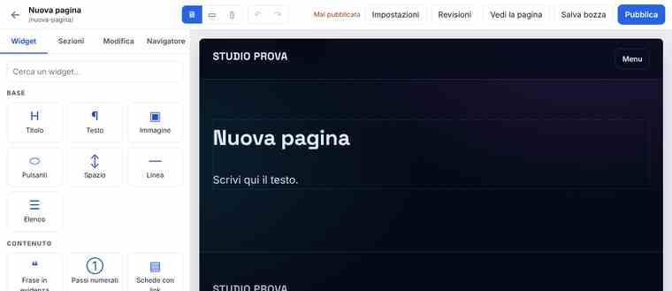

Premi **Impostazioni**, scrivi il **Titolo** "Lavora con noi" e l'**Indirizzo** `lavora-con-noi`, premi **Salva
impostazioni**.

### Il titolo e il testo

Doppio clic sul titolo nella tela.

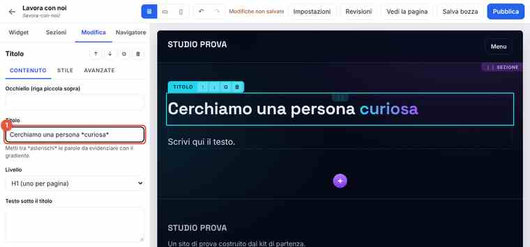

1. Nella casella **Titolo** scrivi "Cerchiamo una persona \*curiosa\*". Le parole fra **asterischi** escono
   evidenziate con il colore del sito: è il modo più veloce per far cadere l'occhio dove vuoi.

Poi doppio clic sul testo sotto, e scrivi le due righe di presentazione, come nel capitolo 4.

### Una sezione a due colonne

Premi il **+** viola in fondo alla sezione: sotto nasce una sezione nuova, già scelta.

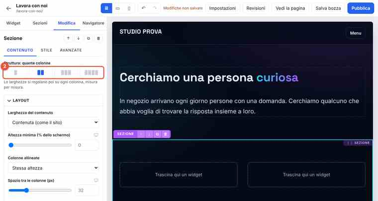

2. In **Struttura: quante colonne** premi il disegno con **due colonne**.

### La foto, a sinistra

Fai clic dentro la colonna di sinistra (dove c'è scritto "Trascina qui un widget"), poi:

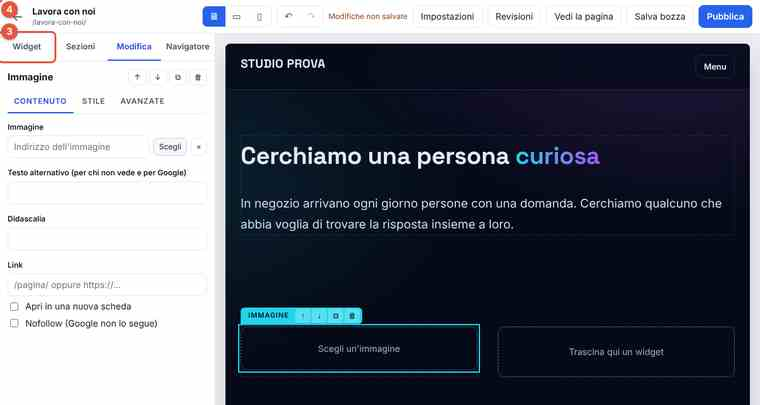

3. Apri la linguetta **Widget**.
4. Fai clic su **Immagine**: entra nella colonna scelta.

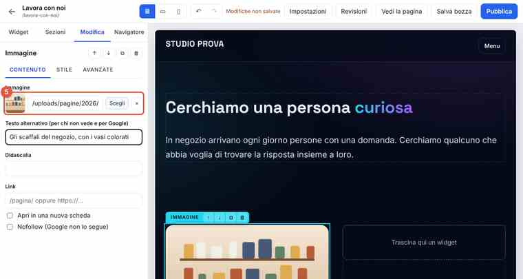

5. Nella scheda **Modifica** premi **Scegli**, poi **Carica un'immagine** e prendi la foto dal computer (oppure scegline
   una già caricata). Sotto scrivi il **Testo alternativo**: "Gli scaffali del negozio, con i vasi colorati".

### Cosa cerchiamo, a destra

Fai clic nella colonna di destra. Dalla linguetta **Widget** aggiungi un **Titolo** (scrivi "Cosa cerchiamo"), poi un
**Elenco**.

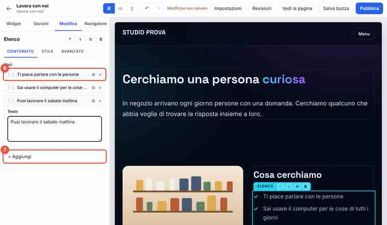

6. Fai clic su una voce per aprirla e scrivi il testo.
7. **+ Aggiungi** mette una voce in più. Con la maniglia **⋮⋮** cambi l'ordine, con **×** togli una voce.

Infine aggiungi un widget **Pulsanti**.

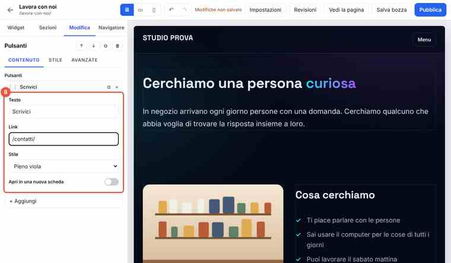

8. Apri la voce del pulsante: **Testo** "Scrivici", **Link** `/contatti/` (l'indirizzo della pagina Contatti). Con
   **Stile** scegli fra Pieno viola, Pieno ciano e Contorno: i colori seguono quelli del sito.

### Lo stile

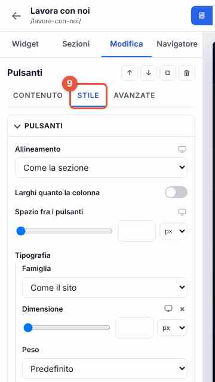

9. Ogni widget ha la sua scheda **Stile**: colori, caratteri, allineamento, bordi, ombre. Se non tocchi niente, il
   widget segue i colori e i caratteri del sito (capitolo 13): è quasi sempre la scelta migliore.

### Al telefono

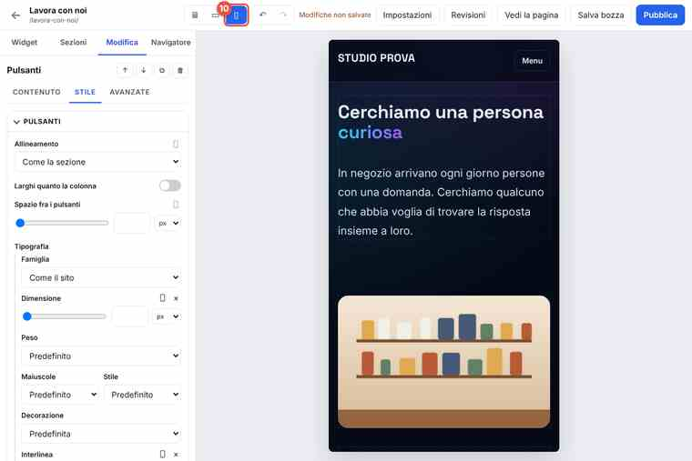

10. Premi l'icona del **telefono** in alto: le due colonne si mettono una sotto l'altra da sole. Guarda che tutto si
    legga bene; poi torna al computer.

### Pubblicare

Premi **Pubblica** e conferma.

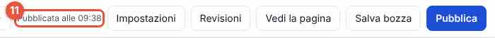

11. In alto compare "Pubblicata alle...". La pagina è online.

Manca una cosa: nessuno la trova, perché non è nel menu. Lo sistemi nel capitolo 17.

**Checklist**

- [ ] La pagina ha un solo titolo H1 (il primo, grande).
- [ ] Ogni immagine ha il testo alternativo.
- [ ] Ho guardato la pagina anche al telefono.
- [ ] I pulsanti portano dove devono (provali sul sito).
- [ ] Ho premuto Pubblica.
- [ ] La pagina è nel menu (capitolo 17).

**Se qualcosa non va**

- *Il widget è entrato nel posto sbagliato.* Trascinalo dove vuoi, oppure usa le frecce **↑ ↓** del pannello Modifica.
- *Ho cancellato qualcosa per sbaglio.* **Annulla** (la freccia in alto, o Ctrl+Z). Se hai già salvato, c'è Revisioni
  (capitolo 12).
- *La pagina dice "La pagina non ha un titolo H1".* Aggiungi un widget Titolo con livello H1, oppure un'Apertura.

---

## 10. Le sezioni pronte

**A cosa serve.** Trenta sezioni già impaginate (prezzi, testimonianze, servizi, numeri, domande frequenti, contatti,
inviti) da mettere nella pagina con un clic. Poi le cambi come vuoi: sono sezioni normali.

**Esempio.** Sotto "Lavora con noi" vogliamo qualche domanda frequente sulle candidature.

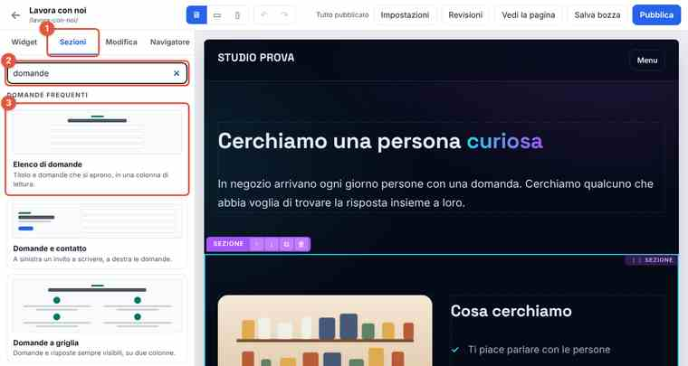

1. Fai clic sull'ultima sezione della pagina, poi apri la linguetta **Sezioni**.
2. Scrivi nella ricerca "domande": restano le sezioni di quel gruppo.
3. Fai clic su quella che ti piace (qui **Elenco di domande**): entra sotto la sezione scelta. Oppure trascinala nel
   punto che vuoi.

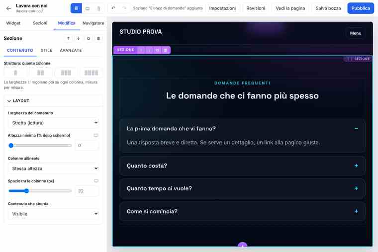

Adesso riscrivi le domande e le risposte con il pannello Modifica (doppio clic sul widget), e premi **Pubblica**.

**Checklist**

- [ ] Ho riscritto tutti i testi d'esempio della sezione (nessun "Lorem" o "Domanda uno").
- [ ] La sezione segue i colori del sito.

---

## 11. L'apertura della pagina

**A cosa serve.** L'**Apertura** (hero) è la prima cosa che si vede di una pagina: titolo grande, due righe, pulsanti,
una foto. Ha undici **disposizioni**: le stesse parole e la stessa foto messe insieme in undici modi.

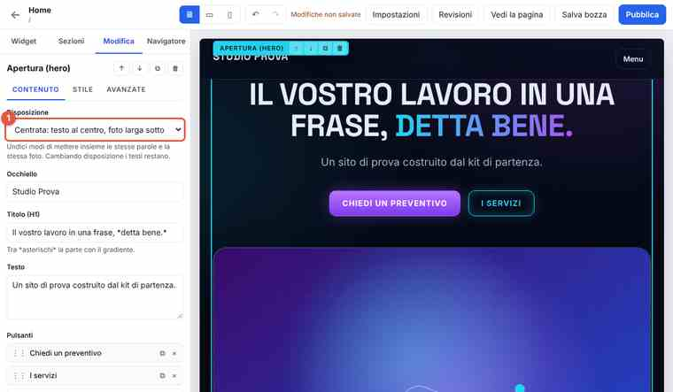

1. Doppio clic sull'Apertura, scheda **Contenuto**, tendina **Disposizione**: Classica, Centrata, Copertina (foto a
   tutto sfondo), Divisa a metà, Rivista, Scheda, Minimale, Mosaico, Inclinata, Banner (bassa, per le pagine interne),
   Diagonale. Cambi e guardi: i testi restano.

Sotto ci sono occhiello, titolo (con le parole fra asterischi evidenziate), testo e pulsanti.

Nella scheda **Stile**, gruppo **Foto**, decidi come appare la foto:

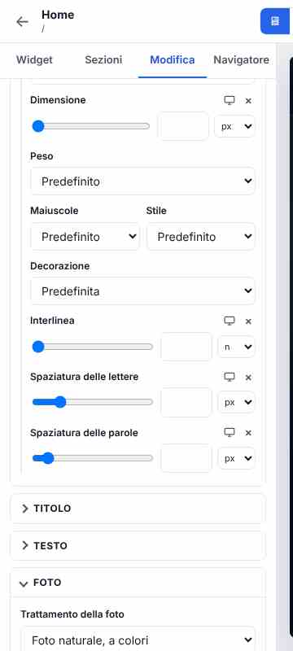

- **Trattamento**: naturale, bianco e nero, oppure con un **velo** colorato (scegli colori e intensità);
- **Effetto animato**: zoom lento, bagliore, cornice luminosa, alone, scintille. Chi ha chiesto al computer meno
  movimento vede la foto ferma.

**Checklist**

- [ ] Il titolo dell'Apertura dice in una frase cosa fai.
- [ ] Il testo sopra la foto si legge bene (se no: velo più intenso, o una disposizione con la foto a lato).
- [ ] Ho guardato l'Apertura anche al telefono.

---

## 12. Tornare indietro: revisioni e versioni

**A cosa serve.** Ogni salvataggio e ogni pubblicazione lasciano una **versione**. Se una modifica non ti convince,
torni a com'era prima, anche dopo giorni.

Nell'editor premi **Revisioni**: a destra si apre l'elenco.

1. Ogni riga è una versione, con data, ora, chi l'ha salvata e se era pubblicata.
   - **Cosa è cambiato** la confronta con quella prima, in parole leggibili.
   - **Rispetto alla tela** la confronta con quello che hai adesso nell'editor.
   - **Carica nella tela** la riporta nell'editor: il sito cambia solo quando premi Pubblica.
   - **Aggiungi nota** le dà un nome ("prima dei saldi").

La pagina **Editor > Versioni** del pannello raccoglie le versioni di tutto: pagine, articoli, header, footer, menu,
stile del sito, con anteprima e ripristino.

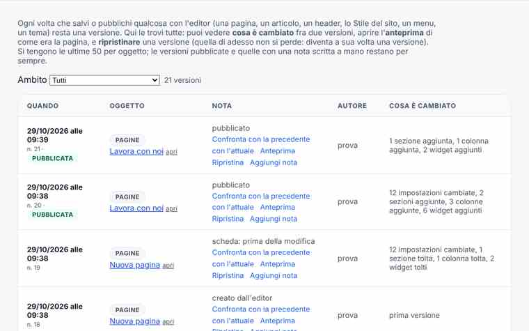

**Checklist**

- [ ] Prima di un cambiamento grosso aggiungo una nota alla versione di adesso.
- [ ] So riportare una versione nella tela e pubblicarla.

---

## 13. Stile del sito

**A cosa serve.** I colori, i caratteri e le misure di **tutto** il sito, in una pagina sola. Cambi il colore principale
qui, e cambia ovunque: pulsanti, titoli evidenziati, link. Si apre da **Editor > Stile del sito**.

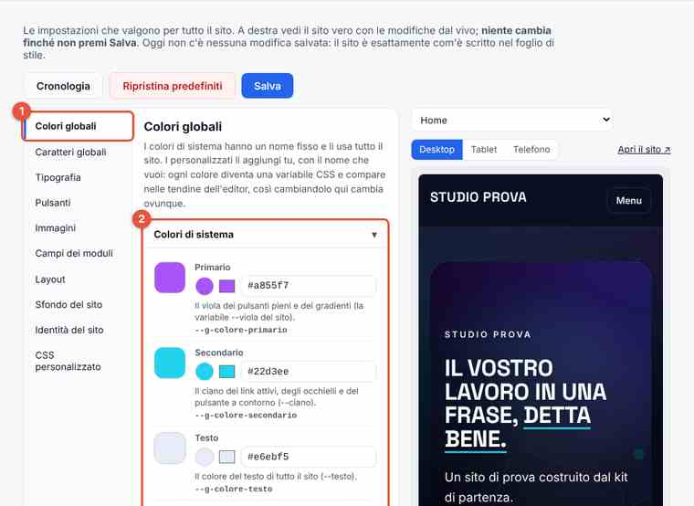

A sinistra le sezioni: **Colori globali**, **Caratteri globali**, **Tipografia** (corpo, paragrafi, link, titoli da H1 a
H6), **Pulsanti**, **Immagini**, **Campi dei moduli**, **Layout** (larghezza della pagina), **Sfondo del sito**,
**Identità del sito**, **CSS personalizzato**. A destra vedi il sito vero, che cambia mentre scegli. **Niente cambia sul
sito finché non premi Salva.**

1. **Colori globali**: i cinque colori di sistema (Primario, Secondario, Testo, Accento, Sfondo del sito). Puoi
   aggiungerne di tuoi con un nome: compaiono nelle tendine dell'editor.
2. Ogni riquadro si apre e si chiude con un clic sul titolo.

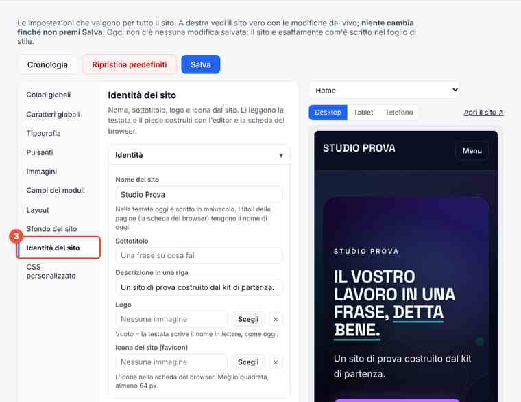

3. **Identità del sito**: il **nome**, il **sottotitolo**, la **descrizione in una riga**, il **logo** (se lo lasci
   vuoto la testata scrive il nome in lettere) e l'**icona del sito** (la piccola immagine nella scheda del browser:
   meglio quadrata, almeno 64 pixel).

In alto, **Cronologia** mostra i salvataggi di prima; **Ripristina predefiniti** torna allo stile di partenza.

**Checklist**

- [ ] Il colore Primario è quello del mio marchio.
- [ ] Ho messo il logo e l'icona del sito.
- [ ] Ho controllato l'anteprima su Desktop, Tablet e Telefono.
- [ ] Ho premuto **Salva**.

**Se qualcosa non va**

- *Ho cambiato tutto e non mi piace più.* Cronologia, oppure Editor > Versioni: lo stile di prima c'è.

---

## 14. I temi

**A cosa serve.** Un **tema** cambia l'aspetto del sito in un colpo solo: colori, caratteri, pulsanti, sfondo, header e
footer. Pagine, articoli, menu e immagini restano come sono. Si apre da **Editor > Temi**.

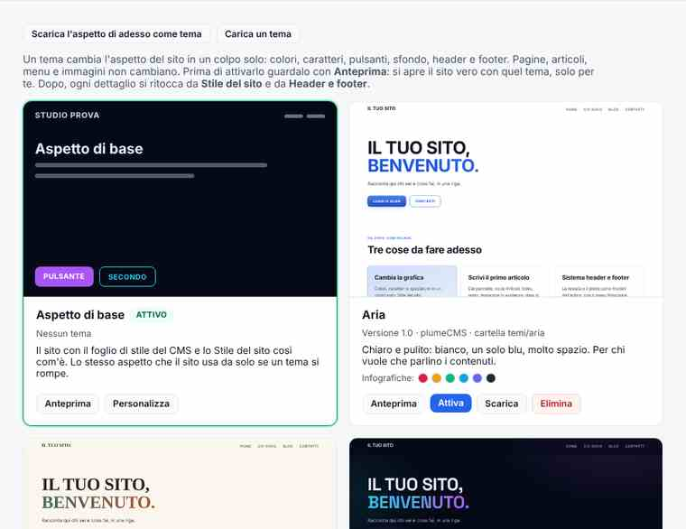

Ogni tema ha una scheda con l'anteprima e quattro pulsanti:

- **Anteprima** apre il sito vero con quel tema, solo per te. Guardalo sempre prima di attivarlo.
- **Attiva** lo mette sul sito, dopo una conferma. Lo stile di prima resta nelle Versioni.
- **Scarica** ne fa uno zip, da portare su un altro sito.
- **Elimina** lo toglie.

In alto: **Scarica l'aspetto di adesso come tema** salva il tuo stile come tema; **Carica un tema** installa uno zip.
Tre temi sono già dentro: **Aria** (chiaro e pulito), **Bottega** (caldo, artigiano), **Cosmo** (scuro, con il viola e
il ciano). Per costruirne uno tuo c'è il **Manuale dei temi**.

**Checklist**

- [ ] Ho guardato i tre temi in Anteprima.
- [ ] Dopo aver attivato un tema ho ritoccato Stile del sito con i miei colori.

**Se qualcosa non va**

- *"Il tema contiene codice PHP".* È una protezione: un tema con PHP esegue codice sul tuo server. Se ti fidi di chi
  l'ha fatto: Impostazioni > Sicurezza, scheda Impostazioni, riquadro in fondo, scrivi la tua password e premi **Apri la
  finestra per un'ora**; poi ricarica lo zip.
- *Il sito dopo il tema è strano.* Se un tema si rompe, il sito torna da solo all'aspetto di base e la pagina Temi lo
  dice in rosso.

---

## 15. Header e footer

**A cosa serve.** L'**header** è la testata in cima a ogni pagina (logo, menu). Il **footer** è il piede in fondo
(contatti, link, copyright). Si costruiscono con lo stesso editor delle pagine, da **Editor > Header e footer**.

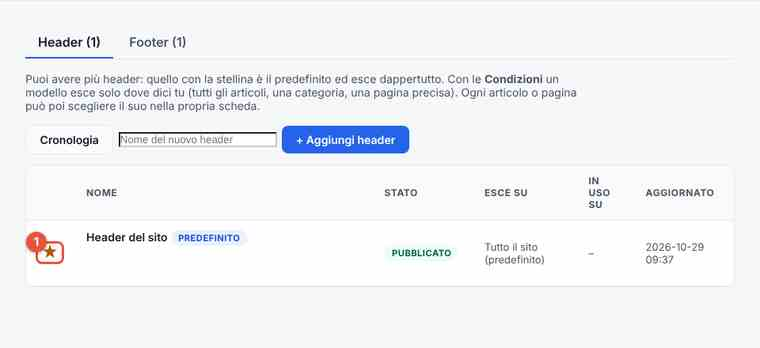

- Puoi averne più di uno. Quello con la **stellina piena** (1) è il **predefinito**: esce su tutto il sito. Premi la
  stellina vuota di un altro per farlo diventare il predefinito.
- **Modifica** lo apre nell'editor delle pagine: cambi, premi Pubblica. **Anteprima sul sito** lo mostra sul sito vero.
- **Condizioni** decide dove esce un header diverso: tutti gli articoli, una categoria, una pagina sola. Vince la
  condizione più precisa.
- Nella scheda di ogni contenuto (riquadro **Header e footer**) puoi scegliere un header o un footer diverso solo per
  quella pagina, oppure **Nessuno**.

**Checklist**

- [ ] L'header mostra il logo e il menu.
- [ ] Il footer ha i contatti, la privacy e l'anno giusto.

---

## 16. Un riquadro in fondo a ogni articolo

**A cosa serve.** Chi arriva alla fine di un articolo è la persona più interessata che hai. Con **Aggiungi sempre alla
fine** prepari una volta sola un riquadro ombreggiato che esce sotto **ogni** articolo, anche quelli che hai già
pubblicato: un invito a passare in negozio, l'iscrizione alla newsletter, un contatto, un libro da consigliare. Lo
componi con l'editor visuale, come una pagina (capitolo 8). Non esce nelle pagine né nella home, solo negli articoli.

Lo prepara e lo cambia solo l'**amministratore**: il redattore non ha la linguetta.

**Esempio.** Lo Studio Prova vuole che chi legge un articolo trovi in fondo un invito a passare in negozio, con un
pulsante per prenotare una visita.

### Creare il riquadro

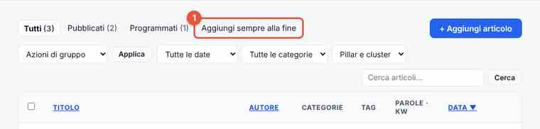

1. Nel menu a sinistra apri **Articoli**. In alto, dopo Tutti, Pubblicati, Programmati, Bozze e Cestino, premi la
   linguetta **Aggiungi sempre alla fine**.

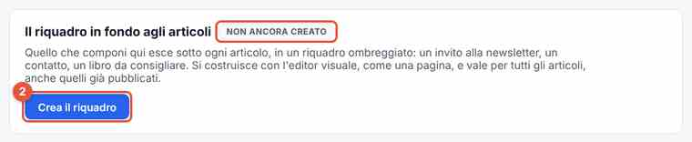

La pagina dice **Non ancora creato**.

2. Premi **Crea il riquadro**. Si apre l'editor visuale con il riquadro già pronto: un titolo, "Prima di andare", e un
   testo da riscrivere. Sopra vedi le righe grigie che fanno la parte dell'articolo; il riquadro sta sotto, con i colori
   del tuo sito.

### Scriverci dentro

3. Fai doppio clic sul titolo nella tela. A sinistra, nella casella **Titolo**, scrivi *Ti è stato utile? Vieni a
   trovarci*.
4. Fai doppio clic sul testo e scrivi il tuo: *Siamo in negozio dal martedì al sabato, dalle 9 alle 19. Se vuoi un
   consiglio con calma, prenota una visita: ti dedichiamo mezz'ora solo per te.*

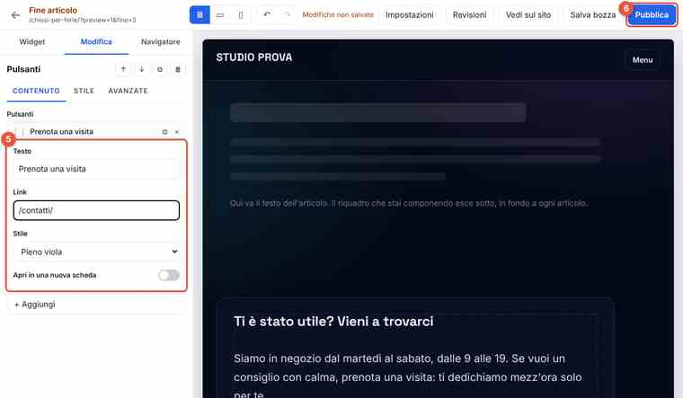

5. Con il testo ancora selezionato, apri la linguetta **Widget** e scegli **Pulsanti**: il pulsante entra subito sotto
   il testo. Nel pannello **Modifica** scrivi il **Testo** (*Prenota una visita*) e il **Link** (*/contatti/*).
6. Premi **Pubblica**. Finché non lo fai il riquadro resta una bozza e sul sito non esce.

Dentro il riquadro puoi mettere qualunque widget dell'editor: una foto, l'iscrizione alla newsletter (capitolo 20), più
colonne. Tieni però il riquadro corto: tre o quattro righe e un pulsante funzionano meglio di una pagina intera.

### Acceso e spento

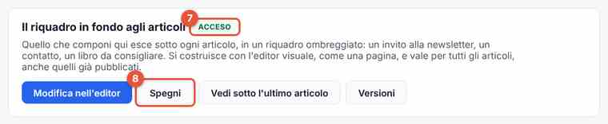

7. Premi la freccia in alto a sinistra dell'editor: torni alla pagina del riquadro, che ora dice **Acceso**. Più sotto
   c'è l'**anteprima**: l'ultimo articolo pubblicato con il riquadro in fondo.
8. **Spegni** toglie il riquadro da tutti gli articoli senza perdere niente; **Accendi** lo rimette. Da qui hai anche
   **Modifica nell'editor**, **Vedi sotto l'ultimo articolo** (il sito vero, in una scheda nuova) e **Versioni** (le
   versioni di prima, da confrontare e ripristinare, capitolo 12).

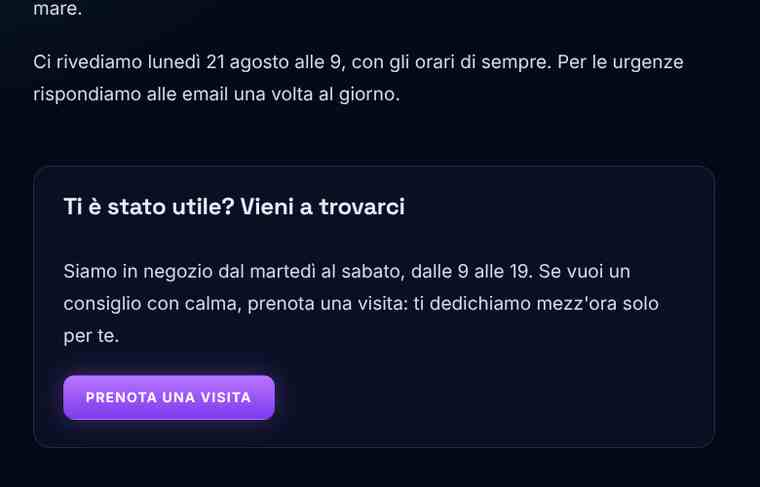

Sul sito il riquadro esce dopo il testo di ogni articolo, nella stessa colonna, con l'ombra, il bordo e gli angoli
tondi. I colori vengono dallo Stile del sito e dal tema (capitoli 13 e 14): se li cambi, il riquadro li segue.

**Quando lo cambi.** Apri **Modifica nell'editor**, cambia e premi **Pubblica**. Le modifiche salvate con **Salva
bozza** si vedono solo nelle anteprime (quella della pagina del riquadro e Vedi sotto l'ultimo articolo), non sul sito.

**Checklist**

- [ ] Il riquadro ha un titolo, due o tre righe e al massimo un pulsante.
- [ ] Il pulsante porta a una pagina che esiste (prova a premerlo dal sito).
- [ ] Ho premuto **Pubblica** nell'editor e la pagina del riquadro dice **Acceso**.
- [ ] Ho aperto un articolo dal telefono e il riquadro si legge bene.

**Se qualcosa non va**

- *Il riquadro non esce sul sito.* Guarda la pagina del riquadro: se dice **Spento**, non l'hai mai pubblicato
  (Modifica nell'editor, poi Pubblica) o l'hai spento (premi Accendi). Esce solo sotto gli articoli, non nelle pagine.
- *Accendi dice che il riquadro non è ancora stato pubblicato.* La prima volta si accende con **Pubblica** nell'editor.
- *Non vedo la linguetta.* È solo dell'amministratore: entra con un utente amministratore.

---

## 17. Il menu

**A cosa serve.** Il **menu** è l'elenco di voci della testata (Home, Servizi, Chi siamo...). Si cambia da **Editor >
Menu di navigazione**.

**Esempio.** Mettere "Lavora con noi" (capitolo 9) nel menu principale.

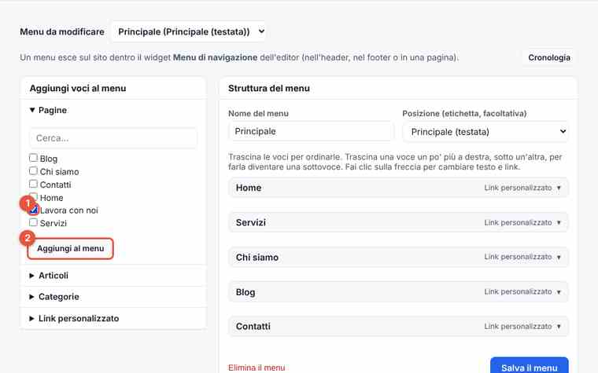

1. In **Aggiungi voci al menu**, gruppo **Pagine**, spunta **Lavora con noi**.
2. Premi **Aggiungi al menu**: la voce entra in fondo alla struttura.

Trascina le voci per cambiarne l'ordine; trascinane una un po' a destra, sotto un'altra, e diventa una **sottovoce**.
La freccetta **▾** di ogni voce apre testo, indirizzo e "Apri in una nuova scheda".

3. Premi **Salva il menu**.

Con **Link personalizzato** aggiungi una voce verso qualunque indirizzo, anche fuori dal sito (la pagina Facebook, una
prenotazione). In alto, **Menu da modificare** passa agli altri menu (per esempio quello del footer); **Crea un nuovo
menu** ne fa uno nuovo.

**Checklist**

- [ ] Ogni pagina importante è nel menu.
- [ ] Le voci sono poche (sei o sette al massimo) e nell'ordine in cui le cerca chi visita.
- [ ] Ho premuto **Salva il menu** e ho guardato il sito anche al telefono.

---

## 18. I form

**A cosa serve.** Un **form** raccoglie dati da chi visita: richieste di preventivo, candidature, prenotazioni. Le
compilazioni arrivano nel pannello e, se vuoi, anche via email.

**Esempio.** Un form "Candidature" da mettere nella pagina "Lavora con noi".

Apri **Form** dal menu e premi **+ Nuovo form**.

1. **Nome (nel pannello)**: "Candidature". Serve a te per riconoscerlo.
2. **Titolo mostrato sopra il form**, **Testo di introduzione** e **Testo del pulsante** sono quello che legge chi
   visita.
3. **Campi**: si parte con Nome, Email e Messaggio. Per ogni campo scegli l'etichetta, il tipo (testo breve, email,
   telefono, testo lungo, scelta singola, scelta multipla, casella da spuntare, data, numero) e se è **obbligatorio**. **+ Aggiungi un campo** ne mette un altro;
   la maniglia **⋮⋮** cambia l'ordine.
4. Premi **Salva**.

A destra, **Dopo l'invio** decide cosa succede: iscrivere la persona a una lista della newsletter (con email di
conferma), avvisarti via email, e cosa scrivere nella pagina di ringraziamento.

### Mettere il form nella pagina

Apri "Lavora con noi" nell'editor, fai clic sul pulsante "Scrivici" e aggiungi il widget **Modulo** (gruppo "Dal sito").

5. Nella tendina **Quale modulo** scegli **Candidature**. Premi **Pubblica**.

Sotto il form ci sono sempre la spunta per la privacy e il controllo **Sono una persona**, che ferma i programmi automatici.

### Leggere le compilazioni

Le trovi in **Newsletter e form > Invii dei form**, con una linguetta per ogni form e **Scarica CSV** per aprirle con
Excel o Numbers.

**Checklist**

- [ ] Il form chiede solo quello che serve davvero.
- [ ] Il campo Email è di tipo **Email** (serve per risponderti e per la newsletter).
- [ ] Ho compilato il form dal sito, una volta, e la compilazione è arrivata.
- [ ] Le email partono (capitolo 25), se voglio l'avviso a ogni compilazione.

---

## 19. I popup

**A cosa serve.** Una finestra che compare sopra la pagina: un'offerta, un avviso, un invito a iscriversi. Si apre da
**Popup**, **+ Nuovo popup**.

1. **Cosa mostra**: occhiello, **titolo**, testo, un'immagine, un pulsante con il suo link; oppure un form dentro il
   popup (tendina **Modulo dentro il popup**).
2. **Su quali pagine**: tutte, solo la home, solo gli articoli, solo le pagine, oppure gli indirizzi che scrivi tu.
3. **Quando compare**: dopo qualche secondo, quando chi legge arriva a una certa percentuale della pagina, o quando il
   mouse esce dalla pagina (solo computer). Sotto scegli **ogni quanti giorni** la stessa persona lo rivede.
4. **Acceso**: spunta, e premi **Salva**.

**Checklist**

- [ ] Il popup non compare prima di 5-10 secondi (chi arriva deve prima vedere la pagina).
- [ ] La stessa persona non lo rivede ogni volta (almeno 7 giorni).
- [ ] L'ho spento quando l'offerta è finita.

---

## 20. La newsletter

**A cosa serve.** Scrivere alle persone che si sono iscritte, dal tuo sito, senza servizi esterni da pagare. Le email
partono dal tuo server, a giri, grazie al cron (capitolo 26).

### Gli iscritti

**Newsletter e form > Iscritti e liste**: l'elenco degli iscritti, le liste (Newsletter, Clienti...), chi deve ancora
confermare e chi è uscito. Le persone si iscrivono da sole con un form (capitolo 18) e confermano con un'email
(doppio consenso).

Se avevi una newsletter su Brevo, esporta i contatti in CSV e importali dal riquadro **Importa i contatti da Brevo**.

### Una campagna

**Newsletter e form > Campagne**, poi **+ Nuova campagna**.

1. **Oggetto**: la riga che si legge nella casella di posta. Corto e chiaro.
2. **Testo**: scrivi come in un'email normale. `{nome}` diventa il nome della persona. Sotto, un **pulsante** con il
   suo link e le **liste** a cui mandarla.

A destra c'è l'anteprima dell'ultima versione salvata. Poi:

- **Salva e manda la prova**: la ricevi tu, per controllarla nella tua casella;
- **Programma l'invio**: parte da sola all'ora scelta;
- **Invia adesso alle liste scelte**: parte al prossimo giro del cron (ogni 5 minuti, al massimo 150 email l'ora, per non
  finire fra lo spam).

### I flussi automatici

**Flussi automatici** sono email che partono da sole: il benvenuto a chi si iscrive, un promemoria dopo qualche giorno,
un'email diversa a chi ha aperto e a chi no. Si disegnano su una tela con quattro blocchi: **Email**, **Attesa**,
**Bivio**, **Fine**.

**Checklist**

- [ ] Le email partono (capitolo 25) e il cron è attivo (capitolo 26).
- [ ] Ho mandato la prova a me stesso prima di ogni campagna.
- [ ] Ogni email ha il link per uscire dalla newsletter (lo mette plumeCMS da solo).

---

## 21. I social e l'email del mattino

**A cosa serve.** Ogni mattina ti arriva un'email con tutto pronto per i social: cosa esce oggi sul sito, il testo per
ogni canale con il link e gli hashtag, le due immagini della misura giusta. Copi, incolli, pubblichi: cinque minuti con il
caffè, invece di mezz'ora a riscrivere la stessa cosa quattro volte. Si apre da **Social**, nel menu a sinistra.

**Esempio.** L'articolo "Chiusi per ferie" del capitolo 4 deve arrivare su LinkedIn, Facebook, Instagram e WhatsApp, e
il giorno dopo serve un promemoria.

### Una volta: le impostazioni

1. **Le email del mattino**: "Oggi sul sito" (i contenuti che escono oggi) e "Social di oggi" (i testi del calendario).
   Arrivano all'indirizzo degli avvisi di Impostazioni > Configurazione email (capitolo 25).
2. **I canali** su cui pubblichi: LinkedIn, Facebook, Instagram, WhatsApp e Telegram, Substack. Quelli spenti spariscono
   dalle email e dalle pagine.
3. **Hashtag fissi**, uno per canale: escono in fondo a ogni testo (per esempio quello del tuo marchio).
4. **Hashtag per categoria**: una riga per categoria, il nome, due punti, gli hashtag ("Avvisi: #avvisi #orari"). Un
   articolo di quella categoria li prende in più.

Sotto puoi mettere un **link in più nei testi di WhatsApp**, con la sua frase: per esempio la pagina per prenotare.
Premi **Salva**.

### Per ogni contenuto: il riquadro Social

Nella scheda dell'articolo, sotto l'estratto, c'è il riquadro **Social**.

1. **Testo per i social**: due o tre righe che fanno venire voglia di leggere. Va su tutti i canali; il link e gli
   hashtag li aggiunge il CMS. Le emoji vanno bene. Se lo lasci vuoto, si usa l'estratto.
2. **Un testo diverso per un canale**: si apre e ti dà tre caselle, LinkedIn, Facebook e Instagram, WhatsApp e Telegram.
   Su WhatsApp, per esempio, scrivi come scriveresti a un amico.
3. **Le due immagini**, fatte da sole dall'immagine in evidenza: 1200x630 per LinkedIn e Facebook, 1080x1350 per
   Instagram. Se cambi la foto, cambiano anche loro.

Premi **Aggiorna** (o Pubblica).

### Ogni mattina: l'email "Oggi sul sito"

Il giorno in cui esce un articolo, al giro del mattino del cron (capitolo 26), ti arriva **"Oggi sul sito tuosito.it:
1 articolo"**. Per ogni contenuto che esce quel giorno: il titolo, le due immagini con i pulsanti per scaricarle, un
riquadro per ogni canale con il testo pronto, e i pulsanti **Condividi su LinkedIn**, **Condividi su Facebook**,
**Invia su WhatsApp**, **Invia su Telegram**.

In **Social > Email del mattino** la vedi prima che parta:

1. Scegli il **giorno** e premi **Mostra**: vedi l'email di quel giorno, anche di un giorno futuro (gli articoli
   programmati).
2. **Mandala adesso** te la manda subito, per provarla. Al mattino parte comunque, una volta sola.

### I testi pronti, in qualunque momento

**Social > Testi dei contenuti** mostra i testi degli articoli più recenti, canale per canale, con le immagini.

1. **Fai clic su un testo**: si seleziona e si copia. Lo incolli nel social.
2. I link **Condividi** aprono il social con l'indirizzo già dentro.

### Il calendario: un testo per ogni giorno

Per un articolo importante un post solo non basta. Nel **Calendario** prepari i testi dei giorni dopo: ogni mattina
arriva l'email **"Social di oggi"** con il testo di quel giorno, il link e le immagini. Per esempio una settimana di post
su un articolo lungo, un capitolo al giorno.

Premi **+ Un testo nel calendario**:

1. **Giorno** in cui ti arriva.
2. **Contenuto** a cui porta il link.
3. **Titolo del giorno**: ti dice di cosa parla quel post (esce nell'oggetto dell'email).
4. I testi per **LinkedIn**, **Facebook e Instagram**, **WhatsApp e Telegram**. Quelli vuoti prendono il testo del
   riquadro Social del contenuto.

Sotto: l'**ancora**, per portare il link a un punto preciso della pagina (l'id di un titolo), e due immagini diverse da
quelle del contenuto, se le vuoi. Premi **Salva**.

Ogni riga dice se il testo è **In attesa** o **Inviato**. Un testo inviato non riparte; **Rimetti in attesa** lo fa
ripartire domattina, **Mandalo adesso a me** te lo manda subito senza toccare il calendario.

**Checklist**

- [ ] L'indirizzo degli avvisi è scritto e le email partono (capitolo 25).
- [ ] Il cron gira (capitolo 26): senza, le email del mattino non partono da sole.
- [ ] Ho scelto i canali e scritto gli hashtag fissi.
- [ ] Ogni articolo ha il suo testo per i social e un'immagine in evidenza.
- [ ] Ho guardato l'anteprima dell'email del giorno prima di dormirci sopra.

**Se qualcosa non va**

- *Stamattina non è arrivata l'email.* Quel giorno non usciva niente (allora non parte), oppure il cron non gira
  (Impostazioni > Log cron), oppure manca l'indirizzo degli avvisi. In Log cron il giro del mattino dice cosa ha fatto.
- *Le immagini per i social non ci sono.* Serve un'immagine in evidenza caricata nel sito (Media). Da un indirizzo
  esterno il CMS non può ritagliarle e usa la foto com'è.
- *Il testo di Instagram ha il link.* Instagram non rende cliccabili i link nei post: se preferisci, cancellalo prima di
  pubblicare e scrivi "link in bio".

---

## 22. I file da scaricare

**A cosa serve.** Manuali, listini, moduli, programmi: i file che offri da scaricare, con un indirizzo fisso e il conto
di quante volte sono stati scaricati (le persone sì, i robot no). Si apre da **Download**.

1. **Scegli file**: PDF, ZIP, ePub, documenti Word, Excel, PowerPoint e LibreOffice.
2. **Titolo**, una riga di **Descrizione** e la **Versione**, poi **Carica**.

Ogni file ha il suo indirizzo, `/scarica/nome-del-file/`, da mettere in un pulsante o in un'email. Nelle pagine li
mostri con il widget **Download** (gruppo "Dal sito").

Se nel nome del file c'è la versione (`guida-1.2.pdf`, poi `guida-1.3.pdf`), i file diventano una **serie**:
l'indirizzo `/scarica/guida-ultima/` porta sempre al più recente. Carichi la versione nuova e i link la seguono da soli.

**Checklist**

- [ ] Ogni file ha un titolo che dice cosa contiene.
- [ ] Ho provato a scaricarlo dal sito.

---

## 23. Farsi trovare: SEO e AEO

**A cosa serve.** Fare in modo che Google e le intelligenze artificiali capiscano di cosa parla ogni pagina e la
mostrino a chi la cerca. Molto lo fa plumeCMS da solo: la mappa del sito, i dati strutturati, i redirect quando cambi un
indirizzo. Il resto lo fai tu, contenuto per contenuto.

### In ogni contenuto

Nella scheda di ogni articolo e di ogni pagina (e nelle Impostazioni dell'editor):

- **Titolo per Google**: il titolo che esce nei risultati. Vuoto vuol dire uguale al titolo.
- **Descrizione per Google**: le due righe sotto il titolo nei risultati (fino a 160 caratteri).
- **Keyword principale**: la parola o la frase con cui vuoi essere trovato ("negozio di vasi a Bologna").
- **Controllo SEO**: un punteggio da 0 a 100 e l'elenco di cosa sistemare, in parole chiare. Si aggiorna con
  **Ricontrolla**.
- **In breve**: da 40 a 60 parole che rispondono subito alla domanda principale. Le intelligenze artificiali le
  usano volentieri.
- **Domande frequenti**: una domanda per blocco, con la risposta sotto. Diventano dati per Google.

### Il pannello SEO e AEO

**Panoramica** mette in fila tutti i contenuti pubblicati con il loro punteggio: parti dai rossi. Le altre schede
collegano Google Search Console e IndexNow, controllano copertura e prestazioni, tengono le impostazioni globali e i
dati strutturati.

**Redirect e 404** elenca i rimandi dai vecchi indirizzi e le pagine che qualcuno ha cercato senza trovarle: da qui le
rimandi dove devono andare.

**Checklist**

- [ ] Ogni pagina importante ha titolo e descrizione per Google.
- [ ] Le pagine principali hanno un punteggio sopra 70.
- [ ] Ho guardato Redirect e 404 almeno una volta al mese.

---

## 24. Utenti e ruoli

**A cosa serve.** Far lavorare altre persone sul sito, ognuna con il suo nome e la sua password. Si apre da **Utenti**.

1. **Nome utente**, email, nome mostrato.
2. **Ruolo**:
   - **Amministratore**: può tutto.
   - **Redattore**: scrive e pubblica articoli e pagine, carica immagini, gestisce categorie e tag. Non vede utenti,
     impostazioni, aggiornamenti e sicurezza.

Poi la **password** (almeno 12 caratteri, due volte) e **Aggiungi**. Dai la password alla persona di persona, non per
email; al primo accesso potrà cambiarla da **Password**.

**Checklist**

- [ ] Ogni persona ha il suo utente (mai password condivise).
- [ ] Gli amministratori sono il meno possibile.
- [ ] Quando qualcuno smette di lavorare al sito, tolgo il suo utente.

---

## 25. Le email del sito

**A cosa serve.** Il sito manda email: conferme di iscrizione, avvisi dei form, la newsletter, le email del mattino con i social
(capitolo 21).
Perché arrivino (e non finiscano fra lo spam) conviene farle partire da una casella vera del tuo dominio. Si apre da
**Impostazioni > Configurazione email**.

I dati sono quelli della casella email che spedisce: li trovi nel pannello del tuo hosting (in cPanel: **Account email**,
poi **Connetti dispositivi**).

1. **Server SMTP** (per esempio `mail.tuosito.it`), **Porta** e **Sicurezza** (465 con SSL, oppure 587 con STARTTLS), **Utente**
   (l'indirizzo email completo), **Password della casella**, **Indirizzo e nome del mittente**.
2. Più in basso, l'indirizzo dove arrivano le email del mattino e gli avvisi dei form, e la casella per mandare
   un'**email di prova**.

Premi **Salva**, poi manda l'email di prova (anche dai Primi passi, sulla dashboard). Se arriva, hai finito.

**Checklist**

- [ ] L'email di prova è arrivata (controlla anche lo spam).
- [ ] Il mittente è un indirizzo del mio dominio (info@tuosito.it), non una casella gratuita.

**Se qualcosa non va**

- *L'email di prova non parte.* Il messaggio sotto dice perché, in parole chiare: di solito password sbagliata o porta
  sbagliata. Prova 465 con SSL, poi 587 con STARTTLS.
- *Parte ma non arriva.* Guarda nello spam. Se è lì, chiedi all'hosting di attivare SPF e DKIM per il tuo dominio.

---

## 26. Il cron: i compiti automatici

**A cosa serve.** Il **cron** è una sveglia che l'hosting suona al sito a orari fissi. Senza, il sito fa le cose solo
quando qualcuno lo visita. Con il cron:

- le campagne programmate partono alla loro ora e la newsletter va a piccoli giri, ogni 5 minuti;
- ogni mattina ti arrivano le email "Oggi sul sito" e "Social di oggi" (capitolo 21);
- ogni mattina il sito applica gli aggiornamenti programmati, avvisa i motori di ricerca (IndexNow) delle pagine nuove o
  cambiate e fa i compiti dei moduli installati;
- i flussi automatici della newsletter vanno avanti (il benvenuto ai nuovi iscritti, i promemoria).

Si imposta una volta, nel pannello dell'hosting. La pagina **Impostazioni > Log cron** ti dà le righe già pronte.

In **cPanel**:

1. apri **Processi cron** (Cron Jobs), nella sezione Avanzate;
2. in **Aggiungi nuovo processo cron** scegli l'intervallo scritto sotto la riga: **una volta al giorno** alle 6 per la
   prima, **ogni 5 minuti** per la seconda;
3. nel campo **Comando** incolla la riga (un clic sul riquadro la copia) e premi **Aggiungi**.

Fai lo stesso per la seconda riga. Il giorno dopo, la stessa pagina ti dice com'è andato l'ultimo giro.

**Esegui adesso** fa partire subito il giro del mattino, per provare senza aspettare domani.

**Checklist**

- [ ] Ho messo le due righe in cPanel.
- [ ] In Log cron l'ultimo giro è di oggi.
- [ ] Nei Primi passi la voce "Il cron è attivo" è verde.

---

## 27. La sicurezza

**A cosa serve.** plumeCMS è protetto già all'installazione: blocca chi prova a indovinare le password, chiude le porte
che non servono, controlla quello che entra. **Impostazioni > Sicurezza** ti fa vedere come sta il sito, a colori.

**Verde**: a posto. **Giallo**: funziona, ma si può stringere. **Rosso**: da sistemare. **Grigio**: informazione.
Accanto a ogni voce c'è cosa fare. Le altre schede: **Impostazioni** (regole di accesso, la finestra di un'ora per i file
PHP), **Registro** (accessi, blocchi, modifiche), **Sessioni e utenti**, **Rapporti CSP**.

Il primo rosso di quasi tutti i siti nuovi è **Connessione https**: attiva il certificato gratuito nell'hosting (in
cPanel: **SSL/TLS Status**, o **Let's Encrypt**) e poi la riga "forza https" nel file `.htaccess`.

### L'accesso a due fattori

Con il secondo fattore, per entrare non basta la password: serve anche un codice di sei cifre che cambia ogni 30 secondi
sul tuo telefono. Chi ruba la password resta fuori.

1. Installa sul telefono un'app di autenticazione gratuita (Google Authenticator, Microsoft Authenticator, 2FAS...).
2. In **Il mio accesso** premi **Attiva il secondo fattore**: compare un codice QR.
3. Inquadralo con l'app e scrivi nel pannello il codice di sei cifre che l'app ti mostra.
4. Il pannello ti dà **otto codici di recupero**: salvali subito (stampali, o mettili nel gestore di password). Servono
   se perdi il telefono, e non si rivedono più.

**Checklist**

- [ ] In Sicurezza non ci sono voci rosse.
- [ ] Il sito si apre in https.
- [ ] Il secondo fattore è attivo per ogni amministratore.
- [ ] I codici di recupero sono in un posto sicuro.

**Se qualcosa non va**

- *Ho dimenticato la password.* Nella pagina di accesso usa il link per reimpostarla: arriva un'email (serve che le
  email partano, capitolo 25).
- *Ho perso il telefono del secondo fattore.* Entra con uno dei codici di recupero, poi rigenera il secondo fattore.
- *Mi sono chiuso fuori del tutto* (secondo fattore perso e niente codici, o lista degli indirizzi che non ti fa entrare).
  Con il gestore dei file dell'hosting apri `includes/config.local.php` e aggiungi in fondo la riga di emergenza
  `define('CMS_SICUREZZA_SPEGNI', true);`: spegne secondo fattore e lista degli indirizzi. Entra, sistema in
  **Sicurezza** quello che ti bloccava, poi **togli la riga**: finché c'è, la pagina Sicurezza lo segna in rosso.

---

## 28. Aggiornare plumeCMS

**A cosa serve.** Le versioni nuove portano funzioni e correzioni. Un aggiornamento è uno zip che carichi dal pannello:
prima di toccare qualunque cosa il pannello fa una copia di sicurezza, e se qualcosa va storto rimette tutto com'era da
solo. Si apre da **Impostazioni > Aggiornamenti**.

Due strade.

**Quando il pannello te lo dice.** Una volta al giorno il pannello chiede al sito ufficiale se c'è una versione nuova.
Se c'è, lo vedi sulla dashboard e in questa pagina:

1. premi **Scarica e prepara**: lo zip arriva da solo, controllato;
2. premi **Applica ora** sul pacchetto pronto.

**A mano.** Scarica lo zip di aggiornamento (`plumecms-<versione>-aggiornamento.zip`) dal sito di plumeCMS:

1. in **Carica un pacchetto** premi **Scegli file** e prendi lo zip;
2. premi **Carica**;
3. nella lista **Pacchetti** premi **Applica ora**.

Alla fine in alto c'è scritto il numero della versione nuova. Si può saltare dalle versioni vecchie direttamente
all'ultima: non serve passare da quelle in mezzo.

**Checklist**

- [ ] Prima di aggiornare ho una copia del sito recente (capitolo 29; il pannello ne fa comunque una).
- [ ] Dopo l'aggiornamento il numero di versione è quello nuovo.
- [ ] Ho aperto il sito e qualche pagina del pannello: tutto come prima.

**Se qualcosa non va**

- *"Il file supera il limite di caricamento del server".* Lo zip è più grande di quello che l'hosting accetta: chiedi
  di alzare il limite, oppure usa **Scarica e prepara**, che non passa dal caricamento.
- *Qualcosa non va dopo l'aggiornamento.* In fondo alla pagina c'è **Snapshot**: la copia fatta prima. **Ripristina**
  torna a com'era.

---

## 29. La copia del sito

**A cosa serve.** Una copia completa del sito (database, immagini, temi, moduli) in un solo file, da tenere al sicuro.
Serve se qualcosa si rompe, o per spostare il sito su un altro hosting. Si apre da **Impostazioni > Copia del sito**.

- **Prepara la copia** la fa sul server; poi la scarichi dall'elenco **Copie sul server**. Se ne tengono le ultime sei.
- **Ripristina da una copia** rimette il sito com'era nella copia. Prima, per sicurezza, fa da sola una copia del sito di
  adesso. Il server accetta file fino a una certa misura (qui 2 MB): una copia più grande si mette con il gestore dei
  file dell'hosting nella cartella `aggiornamenti/copie/` e si ripristina dall'elenco.

La copia contiene dati personali (utenti, iscritti, messaggi dei form): tienila in un posto sicuro e non mandarla per
email.

**Checklist**

- [ ] Faccio una copia una volta al mese, e prima di ogni cambiamento grosso.
- [ ] Ne tengo una sul mio computer, fuori dal server.

---

## 30. Controlla il server

**A cosa serve.** Sapere se l'hosting ha tutto quello che serve a plumeCMS: versione di PHP, estensioni, HTTPS, cron,
email, cartelle scrivibili, protezioni dei file. Non cambia niente: guarda e ti dice. Si apre da **Impostazioni >
Controlla il server**.

In cima, quante voci sono **a posto**, **da sapere** e **da sistemare**. Sotto, ogni voce con la spiegazione in parole
semplici. **Controlla di nuovo** rifà i controlli; **Manda un'email di prova** prova la posta.

**Checklist**

- [ ] Nessuna voce "da sistemare".
- [ ] Le voci "da sapere" le ho lette e capite.

---

## 31. Portare qui un sito WordPress

**A cosa serve.** Se hai un sito WordPress, plumeCMS lo legge e porta qui articoli, pagine, immagini, categorie, tag,
menu e titoli SEO, con i redirect dai vecchi indirizzi. Il sito WordPress non viene toccato. Si apre da **Impostazioni >
Importa da WordPress**.

### Prima, in WordPress

1. Entra nel pannello di WordPress e apri **Utenti > Profilo**.
2. In fondo, in **Password per le applicazioni**, scrivi un nome (per esempio "plumeCMS") e premi **Aggiungi una nuova
   password per le applicazioni**.
3. Copia la password che compare: sei gruppi di quattro lettere e cifre. Non è la password con cui entri in WordPress.

### Poi, in plumeCMS

4. Scrivi l'**indirizzo del sito WordPress**, il tuo **nome utente** di WordPress e la **password per le
   applicazioni**. Premi **Collegati e analizza il sito**.
5. Arriva il **report**: quanti articoli, pagine, immagini, categorie, tag e menu ci sono, cosa diventano qui, e cosa
   non si può portare, con il motivo.

6. Togli la spunta a quello che non vuoi (o usa Tutto, Solo gli articoli, Solo le pagine) e premi **Importa le voci
   scelte**. Una barra ti dice a che punto è; se chiudi la pagina, l'import riprende quando la riapri.
7. Alla fine tutto è **in prova**: i visitatori non vedono niente. Premi **Apri l'anteprima del sito** e guardalo,
   pagina per pagina. Il riepilogo dice cosa è entrato, cosa no e cosa conviene guardare.
8. Se ti piace, premi **Conferma l'import**: da quel momento è definitivo. Se non ti convince, **Annulla l'import**
   toglie tutto quello che è entrato e il sito torna com'era.

Dopo la conferma puoi cancellare la password per le applicazioni da WordPress, dallo stesso punto in cui l'hai creata.

**Checklist**

- [ ] WordPress è in https e ha la versione 5.6 o più nuova.
- [ ] Ho letto nel report cosa non entra (grafica di Elementor, shortcode dei plugin, commenti).
- [ ] Ho guardato l'anteprima prima di confermare.
- [ ] Dopo la conferma ho controllato menu e redirect.

**Se qualcosa non va**

- *"La password non è quella per le applicazioni".* Hai usato la password con cui entri in WordPress: crea quella per le
  applicazioni (passi 1-3).
- *"Il sito non risponde" o "la REST è chiusa".* Un plugin di sicurezza di WordPress blocca l'accesso: spegnilo il tempo
  dell'import.

---

## Checklist finale: prima di dire a tutti che il sito è online

- [ ] Il tipo di sito è **Definitivo** e i **Primi passi** sono tutti verdi.
- [ ] Ho riscritto tutti i testi d'esempio: home, Chi siamo, Servizi, Contatti, footer.
- [ ] Logo, icona del sito e colori sono i miei (Stile del sito).
- [ ] Ogni pagina importante è nel menu, e il menu funziona anche al telefono.
- [ ] I form arrivano: ne ho compilato uno dal sito.
- [ ] L'email di prova è arrivata e il cron gira.
- [ ] Il sito si apre in **https** e in Sicurezza non c'è niente di rosso.
- [ ] Il secondo fattore è attivo e i codici di recupero sono al sicuro.
- [ ] Le pagine principali hanno titolo e descrizione per Google.
- [ ] La pagina della privacy c'è ed è collegata nel footer e nei form.
- [ ] Ho fatto una copia del sito e l'ho scaricata sul mio computer.
- [ ] Ho aperto il sito dal telefono, come farebbe un cliente, e ho provato a fare quello che deve fare lui.

## Problemi frequenti

| Problema | Cosa fare |
|---|---|
| Ho cambiato una pagina ma sul sito non si vede | Nell'editor hai premuto Salva bozza: premi **Pubblica**. Se l'hai fatto, ricarica la pagina del sito |
| Il pannello ha i colori di prima dopo un aggiornamento | Ricarica con **Cmd + Maiusc + R** (Mac) o **Ctrl + Maiusc + R** (Windows) |
| Stamattina non è arrivata l'email "Oggi sul sito" | Quel giorno non usciva niente, o il cron non gira, o manca l'indirizzo degli avvisi (capitolo 21) |
| Ho fatto il riquadro in fondo agli articoli ma sul sito non c'è | Non l'hai pubblicato (nell'editor premi **Pubblica**) o è spento: Articoli > Aggiungi sempre alla fine, **Accendi** (capitolo 16) |
| Un articolo programmato non è uscito | Controlla data e ora nella scheda; controlla che il cron giri (Log cron) |
| Le email non arrivano | Configurazione email, email di prova; guarda lo spam (capitolo 25) |
| "Il file supera il limite di caricamento del server" | File troppo grande per l'hosting: rimpiccioliscilo o chiedi all'hosting di alzare il limite |
| Una pagina è sparita dal menu | Editor > Menu di navigazione: rimettila e premi Salva il menu |
| Ho rovinato una pagina | Editor > Revisioni: carica la versione di prima e pubblica |
| Ho rovinato lo stile del sito | Stile del sito > Cronologia, oppure Editor > Versioni |
| Un tema ha rotto il sito | Il sito torna da solo all'aspetto di base: in Editor > Temi vedi il motivo in rosso |
| Non riesco più a entrare | Link "password dimenticata"; codici di recupero; la riga di emergenza nel `config.local.php` per i casi estremi |
