# Manuale d'uso di plumeCMS

Versione del manuale: plumeCMS 2.0.0 beta, 30 ottobre 2026.

## Prima di cominciare

Hai installato plumeCMS e hai davanti un sito che esiste già: pagine, menu, testi d'esempio. Adesso deve diventare tuo.
Questo manuale ti accompagna lì, un passo alla volta.

Ogni capitolo è fatto allo stesso modo:

- **a cosa serve**, in due righe;
- **un esempio vero**, fatto sul sito di prova "Studio Prova" (un negozio): le schermate che vedi sono quelle che
  vedrai tu;
- **i passi**, numerati come i pallini rossi sulle schermate;
- **una checklist**, per sapere quando hai finito;
- **se qualcosa non va**, le cose che capitano più spesso.

Non serve leggerlo tutto di fila. Se è la prima volta, fai i capitoli 1, 2 e 3: in mezz'ora sai muoverti nel pannello.
Poi scegli quello che ti serve.

Una parola sui nomi. **Il pannello** è la parte riservata, dove lavori tu. **Il sito** è quello che vedono le persone.
**Pubblicare** vuol dire rendere visibile sul sito quello che hai preparato nel pannello.

Il manuale ha due parti. La **prima** (capitoli 1-31) è il CMS di sempre: c'è su ogni sito. La **seconda**
(capitoli 32-40) racconta gli **addon**, le funzioni in più che accendi solo se ti servono: prenotazioni, eventi,
recensioni, negozio, statistiche, area riservata, corsi, copia del sito altrove. Nel PDF la seconda parte è un file a
sé, `manuale-uso-addon.pdf`.

Questo manuale racconta come si usa plumeCMS. Per costruire un tema c'è il manuale dei temi.

---

## 1. Il pannello in cinque minuti

**A cosa serve.** Il pannello è il posto da cui cambi tutto: testi, pagine, immagini, aspetto, utenti. Qui impari a
entrare, a orientarti e a sceglierti i colori del pannello che ti stancano di meno.

### Entrare

Il pannello sta all'indirizzo del sito seguito da `/admin/`. Se il sito è `https://www.tuosito.it`, il pannello è
`https://www.tuosito.it/admin/`. Se hai installato plumeCMS in una cartella (per esempio `https://www.tuosito.it/nuovo`),
il pannello è `https://www.tuosito.it/nuovo/admin/`.

1. Scrivi il **nome utente** scelto durante l'installazione.
2. Scrivi la **password**.
3. Premi **Accedi**.

Se sbagli la password troppe volte di fila, il pannello ti fa aspettare qualche minuto: è una protezione contro chi
prova a indovinarla. Se l'hai dimenticata, sotto il modulo c'è il link per reimpostarla via email.

### La dashboard

Dopo l'accesso arrivi alla **Dashboard**: la pagina che ti dice come sta il sito e cosa c'è da fare.

1. **Il menu a sinistra.** Tutte le sezioni del pannello. Le voci con la freccetta (Pagine, Newsletter e form, Editor,
   SEO e AEO, Impostazioni) si aprono e mostrano le sottovoci.
2. **I pulsanti rapidi.** + Articolo, + Pagina, + Campagna e Home nell'editor: le cose che si fanno più spesso, a un clic.

In cima c'è sempre la riga **Visita il sito ufficiale plumeCMS**: il link porta a plumecms.danilofailli.it, dove trovi
le versioni nuove, i manuali e le novità.

Sotto trovi i riquadri del **tipo di sito** e dei **Primi passi** (capitoli 2 e 3), gli avvisi in giallo, e i numeri
del sito: articoli online, programmati e in bozza, iscritti alla newsletter, form compilati, ultime modifiche, e un
riquadro **Sistema** che dice quando sono girati per l'ultima volta i compiti automatici (il cron, capitolo 26).

### Il menu in basso

In fondo alla colonna di sinistra ci sono quattro voci più piccole: le cose che riguardano te, non il sito.

- **Vedi sito** apre il sito in una scheda nuova.
- **Password** cambia nome utente, email e password.
- **Il mio accesso** (1) è il posto dell'aspetto del pannello, dell'accesso a due fattori e dei dispositivi collegati.
- **Esci** chiude la sessione.

### L'aspetto del pannello

Il pannello nasce chiaro, con l'aspetto **Aria**. Se lavori la sera, o se ti piacciono i colori caldi, puoi cambiarlo.
Vale solo per te: ogni utente sceglie il suo, e il sito non cambia.

1. In **Il mio accesso**, riquadro **Aspetto del pannello**, fai clic sulla miniatura che ti piace: **Aria** (chiaro,
   bianco e blu), **Bottega** (caldo, carta crema e terracotta), **Cosmo** (scuro, notte blu e viola), **Lavagna**
   (scuro, verde ardesia e gesso).
2. Premi **Usa questo aspetto**. Il pannello cambia subito.

**Checklist**

- [ ] Entro nel pannello con il mio nome utente e la mia password.
- [ ] So dove sono la Dashboard, il menu a sinistra e il menu in basso.
- [ ] Ho scelto l'aspetto del pannello che preferisco.

**Se qualcosa non va**

- *Il pannello appare senza colori, solo testo.* Hai aperto un indirizzo con un pezzo in più dopo il nome della pagina
  (per esempio `/admin/index.php/qualcosa`). Torna a `/admin/`.
- *"Troppi tentativi: riprova fra qualche minuto".* Aspetta il tempo indicato. Se sei sicuro della password, controlla
  che il blocco delle maiuscole sia spento.
- *Dopo un aggiornamento il pannello ha i colori di prima.* Il browser ricorda la versione vecchia: ricarica la pagina
  tenendo premuti **Cmd + Maiusc + R** (sul Mac) o **Ctrl + Maiusc + R** (su Windows). Dalla 1.4.1 non dovrebbe più
  succedere.

---

## 2. Il tipo di sito in prova

**A cosa serve.** All'installazione hai scelto un tipo di sito: Vuoto, Personale, Attività, Blog, Portfolio o Su misura. Finché
non lo dichiari definitivo puoi provarli tutti, con un clic, e vedere quale ti somiglia di più.

**Esempio.** Studio Prova è partito come **Attività** (la scheda azzurra, "In prova adesso"). Vogliamo vedere come
starebbe da Blog.

1. Fai clic sulla scheda **Blog**. Il pannello chiede conferma: premi **OK**. Prima di cambiare fa da solo una copia
   del sito (la ritrovi in Impostazioni > Copia del sito), poi cambia le pagine, il menu e i testi d'esempio che il kit
   aveva preparato e che **non hai toccato**. Quello che hai scritto o cambiato tu resta dov'è, e il riquadro ti dice
   cosa è rimasto com'era.
2. Quando il sito ti piace, premi **Definitivo** e conferma. Il riquadro sparisce e il tipo di sito non si cambia più
   da qui: da quel momento ogni modifica la fai con l'editor, pagina per pagina.

Apri il sito (Vedi sito) dopo ogni cambio: è il modo più veloce per decidere.

**Checklist**

- [ ] Ho provato almeno un altro tipo di sito oltre a quello di partenza.
- [ ] Ho scelto quello giusto e ho premuto **Definitivo**.

**Se qualcosa non va**

- *Non vedo il riquadro.* Compare solo sulle installazioni nuove (dalla 1.4.0) e solo all'amministratore. Se il sito è
  stato aggiornato da una versione più vecchia, o se hai già premuto Definitivo, il riquadro non c'è.
- *Ho cambiato tipo e una pagina che avevo ritoccato è rimasta quella vecchia.* È voluto: quello che hai cambiato tu
  non si tocca. Se vuoi la pagina del nuovo tipo, cancella la tua e cambia di nuovo tipo.

### Il sito su misura

**A cosa serve.** Invece di partire da un modello uguale per tutti, rispondi a quattro domande e il sito si compone da
solo: home, pagine, menu e testi pensati per la tua attività. Dove andrà una foto c'è un disegno che dice cosa
fotografare ("La vetrina", "Un prodotto", "Le persone"), e lo sostituisci quando hai le foto vere (capitolo 7).

Lo trovi in due posti: nell'installatore, al passo 4, è la carta **Su misura**; dopo, finché il tipo di sito è in prova,
è la carta **Su misura** di questo riquadro.

**Esempio.** Ciclofficina Prova, un negozio di biciclette a Ravenna, vuole anche la pagina delle domande frequenti.

1. **Che attività è?** Scegli la carta più vicina: **Negozio**. Ognuna porta testi suoi: un ristorante ha "Il menù" e
   "Prenota un tavolo", un idraulico "Chiedi un preventivo". Se nessuna ti somiglia, **Un'altra attività** scrive testi
   neutri da adattare.
2. **Dove si trova?** Scrivi la città: **Ravenna**. Finisce nei testi, nei contatti e nella mappa della pagina Contatti.
   Puoi lasciarla vuota.
3. **Cosa offri?** Fino a sei servizi o prodotti, due o tre parole ciascuno: **Biciclette da città**, **Riparazioni**,
   **Noleggio**. Diventano le schede della home e le sezioni della pagina Servizi. Se li lasci vuoti, il sito mette
   quelli tipici dell'attività.
4. **Quali pagine vuoi?** Spunta quelle che servono: qui aggiungiamo **Domande frequenti**. La home c'è sempre. Con
   **Una pagina per ogni servizio** ogni servizio ha la sua pagina, sotto Servizi nel menu.
5. Premi **Componi il sito su misura** e conferma. Come per gli altri cambi, prima il pannello fa una copia del sito.
   Nell'installatore il pulsante è **Installa adesso**.

Le risposte restano: se riapri la carta Su misura le ritrovi già scritte. Cambiane una e premi **Ricomponi il sito**:
le pagine che hai già ritoccato, o in cui hai messo una foto vera, restano tue, il riquadro te lo dice.

**Checklist**

- [ ] Ho scelto l'attività e scritto la città.
- [ ] I servizi hanno nomi brevi, come li direi a un cliente al telefono.
- [ ] Nel menu ci sono solo le pagine che userò davvero.
- [ ] Ho aperto il sito e ho letto ogni pagina: i testi sono d'esempio e vanno riscritti con le mie parole.

**Se qualcosa non va**

- *Le foto hanno una scritta "Sostituisci questa foto".* È voluto: sono finte. Si cambiano in Media (capitolo 7).
- *Ho scritto un'emoji nel nome di un servizio e non c'è più.* Il nome di un servizio diventa anche il titolo e
  l'indirizzo di una pagina: le emoji si tolgono.
- *Non vedo la carta Su misura nella dashboard.* Il tipo di sito è già definitivo: da lì in poi il sito si cambia con
  l'editor, pagina per pagina.

---

## 3. I primi passi

**A cosa serve.** Sei cose (sette in un sito su misura) che servono perché il sito sia davvero pronto. Le trovi sulla dashboard, ognuna con il link
alla pagina giusta, e si spuntano da sole quando le hai fatte.

| Passo | Cosa fare | Capitolo |
|---|---|---|
| Nome e logo del sito | Stile del sito, Identità: nome, logo, icona del browser | 13 |
| I tuoi colori | Stile del sito, Colori globali | 13 |
| Le email partono | Manda un'email di prova al tuo indirizzo | 24 |
| Il cron è attivo | Le due righe nei Cron Job dell'hosting | 25 |
| La prima pagina o il primo articolo | Riscrivi una pagina d'esempio o scrivi un articolo | 4, 9 |
| Le tue foto al posto di quelle finte (solo nei siti su misura) | Media, Da sostituire, Sostituisci | 7 |
| Il tipo di sito è definitivo | Premi Definitivo nel riquadro sopra | 2 |

Quando sono tutte verdi compare **Tutto fatto: nascondi**: premilo e la dashboard torna pulita.

**Checklist**

- [ ] Le voci dei Primi passi sono verdi (sei, sette in un sito su misura).
- [ ] Ho nascosto il riquadro.

---

## 4. Il primo articolo

**A cosa serve.** Gli articoli sono le notizie, i racconti, gli avvisi: hanno una data, finiscono nel blog e nel feed,
si dividono in categorie e tag. Le pagine (capitolo 9) invece stanno ferme: Chi siamo, Servizi, Contatti.

**Esempio.** Studio Prova chiude per ferie e vuole avvisare i clienti con un articolo: "Chiusi per ferie dal 10 al 20
agosto".

### Scrivere il testo

Sulla dashboard premi **+ Articolo** (1).

Si apre l'editor visuale con un articolo nuovo, in bozza, che si chiama "Nuovo articolo". Per prima cosa gli dai un
titolo e un indirizzo: premi **Impostazioni**, in alto.

1. **Titolo**: "Chiusi per ferie dal 10 al 20 agosto".
2. **Indirizzo**: la parte dopo il nome del sito, solo lettere minuscole, numeri e trattini. Qui `chiusi-per-ferie`:
   l'articolo sarà su `www.tuosito.it/chiusi-per-ferie/`. Corto è meglio.

Premi **Salva impostazioni**. Nella tela, al centro, il titolo cambia.

Ora il testo. Fai **doppio clic** sul riquadro "Scrivi qui il testo." nella tela: a sinistra si apre il pannello
**Modifica**, con la casella del testo.

3. Scrivi nella casella a sinistra. Mentre scrivi, la tela a destra ti mostra come verrà. La barra sopra la casella fa
   grassetto, corsivo, link, elenchi, titoletti (la tendina "Normal").
4. Premi **Salva bozza**. In alto compare "Bozza salvata alle..." Il sito non è ancora cambiato.

### Rifinire nella scheda

Il testo c'è. Categoria, tag, immagine e data invece stanno nella **scheda** dell'articolo: premi la freccia **←** in
alto a sinistra (5).

Nella colonna di destra della scheda:

6. **Categorie**: spunta quella giusta, oppure scrivine una nuova in **Aggiungi una categoria nuova** (qui "Avvisi").
   Si crea quando salvi.
7. **Tag**: scrivi una parola e premi **Invio** (qui "orari"). I tag sono più liberi delle categorie: servono a
   ritrovare gli articoli che parlano della stessa cosa.
8. **Immagine in evidenza**: premi **Scegli l'immagine**, poi **Carica** per prenderla dal computer, oppure fai clic su
   una già caricata. Sotto scrivi il **Testo alternativo**: cosa si vede nella foto, per chi non vede e per Google.
   L'immagine in evidenza esce nelle schede del blog e quando qualcuno condivide l'articolo, non in cima all'articolo:
   se la vuoi anche lì, mettila nel testo con un widget Immagine.

Più in basso, a sinistra:

9. **Estratto**: due righe che riassumono l'articolo. Escono nelle schede del blog e sui social.

### Pubblicare

10. **Visibilità**: scegli **Pubblicato**.
11. Premi **Pubblica**. L'articolo è online, con il testo che hai scritto nell'editor.

Vuoi che sotto ogni articolo esca sempre lo stesso invito (passa in negozio, iscriviti alla newsletter)? Non va
scritto in ogni articolo: lo prepari una volta sola con **Aggiungi sempre alla fine**, capitolo 16.

**Checklist**

- [ ] Il titolo è quello giusto e l'indirizzo è corto e leggibile.
- [ ] Il testo è salvato (Salva bozza nell'editor).
- [ ] C'è almeno una categoria.
- [ ] L'immagine in evidenza ha il testo alternativo.
- [ ] L'estratto riassume l'articolo in due righe.
- [ ] Ho premuto Pubblica e ho aperto l'articolo sul sito per guardarlo.

**Se qualcosa non va**

- *"L'indirizzo è già usato".* C'è già un contenuto con quell'indirizzo: scegline un altro.
- *Sul sito l'articolo non si vede.* Controlla che la Visibilità sia "Pubblicato" e che la data non sia nel futuro
  (altrimenti è programmato, capitolo 5).
- *Ho cambiato l'indirizzo di un articolo già pubblicato.* Nessun problema: dal vecchio indirizzo parte da solo un
  redirect al nuovo, e i link già condivisi continuano a funzionare.
- *Ho fatto modifiche all'articolo già online, nell'editor, e sul sito non si vedono.* Nell'editor hai premuto Salva
  bozza: per mandarle online premi **Pubblica** nell'editor.

---

## 5. Programmare un articolo

**A cosa serve.** Scrivi oggi, esce domani alle 8, anche se dormi. Un articolo con una data futura è **programmato**:
esce da solo all'ora che hai scelto.

**Esempio.** "Da settembre apriamo anche il sabato": scritto oggi, deve uscire fra cinque giorni alle 8.

Scrivi l'articolo come nel capitolo 4. Poi, nella scheda, riquadro **Pubblica**:

1. **Visibilità**: **Pubblicato**.
2. **Data e ora di uscita**: il giorno e l'ora in cui deve uscire.
3. Premi **Pubblica**. Il pannello risponde "Articolo aggiornato" e nell'elenco degli articoli lo trovi come
   **Programmato**.

Sulla dashboard, nel riquadro **Contenuti**, la voce **Prossime uscite** ti ricorda cosa sta per uscire e quando.

**Checklist**

- [ ] Visibilità "Pubblicato" e una data futura.
- [ ] Nell'elenco l'articolo è "Programmato".
- [ ] Il cron è attivo (capitolo 26): avvisa i motori di ricerca delle pagine nuove.

**Se qualcosa non va**

- *L'ho programmato ma è uscito subito.* La data era nel passato, o l'ora era già passata. Controlla data **e** ora.
- *Voglio rimandarlo.* Apri l'articolo, cambia la data, premi Aggiorna.
- *Voglio fermarlo.* Visibilità "Bozza", Salva bozza: resta tuo finché non lo pubblichi.

---

## 6. Categorie e tag

**A cosa serve.** Le **categorie** sono i cassetti del blog: pochi, stabili (Avvisi, Novità, Consigli). I **tag** sono
le etichette: tante, libere (orari, saldi, agosto). Ogni categoria e ogni tag ha la sua pagina sul sito, con i suoi
articoli.

Le crei mentre scrivi un articolo (capitolo 4), oppure dalla voce **Categorie** (o **Tag**) del menu.

1. **Nome**: come si legge sul sito ("Novità"). Lo **Slug** (l'indirizzo) si fa da solo dal nome, se lo lasci vuoto.
   La **Descrizione** esce in cima alla pagina della categoria e aiuta Google.
2. Premi **Aggiungi**.

A destra c'è l'elenco, con quanti articoli ha ogni voce, e i link per modificarla o eliminarla.

**Checklist**

- [ ] Le categorie sono poche e chiare (meglio 3-6 che 20).
- [ ] Ogni categoria ha una descrizione di una o due frasi.

**Se qualcosa non va**

- *Ho cambiato lo slug di una categoria.* Gli articoli seguono e dal vecchio indirizzo parte un redirect.
- *Ho eliminato una categoria per sbaglio.* Gli articoli restano, senza quella categoria: ricreala e rispuntala.

---

## 7. Le immagini: Media

**A cosa serve.** **Media** è la libreria di tutte le immagini del sito. Le carichi qui, oppure direttamente
dall'editor e dalla scheda (premendo Scegli o Carica): finiscono comunque qui.

1. Premi **Scegli file** e prendi la foto dal computer (JPEG, PNG, GIF, WebP, AVIF o SVG).
2. Premi **Carica**.

Quando carichi una foto JPEG o PNG, plumeCMS la sistema da solo:

- la raddrizza, se viene dal telefono girata;
- la rimpicciolisce se è enorme (oltre 2560 pixel sul lato lungo: la misura si cambia nel riquadro **Foto leggere**
  della stessa pagina);
- toglie i dati nascosti, come la posizione GPS e il modello del telefono;
- le fa accanto una versione **WebP**, più leggera, che il sito dà ai browser che la sanno leggere.

Tu non devi fare niente: il sito è più veloce e la tua casa non finisce su internet dentro una foto.

### Le foto finte del sito su misura

Un sito su misura (capitolo 2) parte con dei disegni al posto delle foto: ognuno dice cosa ritrarre. In Media li trovi
nella cartella **Da sostituire**, e un avviso in cima ti dice quanti ne restano.

1. Premi **Da sostituire** nell'avviso (o fra le cartelle).
2. Sotto il disegno che vuoi cambiare premi **Sostituisci** e scegli la foto dal computer. Appena la scegli, parte: la
   foto si carica, prende il posto del disegno in tutte le pagine, gli articoli, l'header e il footer, e il disegno si
   cancella. Il messaggio verde ti dice in quanti punti del sito l'ha messa.

Una foto per la home in larghezza va bene orizzontale (il disegno è largo), una per "Chi siamo" va bene verticale.
Sostituisci lo usa solo l'amministratore.

**Checklist**

- [ ] La cartella Da sostituire è vuota (e la voce dei Primi passi è verde).
- [ ] Le foto hanno un nome che dice cosa sono (vetrina-natale.jpg è meglio di IMG_4021.jpg).
- [ ] Ogni foto usata nelle pagine ha il testo alternativo (lo scrivi dove la usi).

**Se qualcosa non va**

- *"Il file supera il limite di caricamento del server".* L'hosting accetta file fino a una certa misura (spesso 2 MB).
  Rimpicciolisci la foto prima di caricarla, oppure chiedi all'hosting di alzare `upload_max_filesize`.
- *Ho cancellato una foto e in una pagina c'è un buco.* Il pannello te lo aveva chiesto: ricaricala e rimettila nella
  pagina.

---

## 8. L'editor visuale: com'è fatto

**A cosa serve.** L'editor è il cuore di plumeCMS: costruisci le pagine trascinando **sezioni**, **colonne** e
**widget**, e vedi subito come vengono. Si apre da **+ Pagina**, da **Home nell'editor**, oppure dal pulsante **Apri
nell'editor visuale** nella scheda di ogni contenuto.

1. **Le quattro linguette del pannello di sinistra**: **Widget** (i mattoncini da mettere nella pagina), **Sezioni**
   (le sezioni pronte, capitolo 10), **Modifica** (le impostazioni dell'elemento scelto), **Navigatore** (l'albero
   della pagina: utile quando gli elementi sono tanti).
2. **La tela**: la pagina come la vedranno le persone. Fai clic su un elemento per sceglierlo, doppio clic per
   modificarlo.
3. **Computer, tablet, telefono**: la tela si stringe alla misura scelta. Molte impostazioni si possono dare diverse
   per ogni misura.
4. **Annulla e ripeti** (anche con Ctrl+Z e Ctrl+Y).
5. **Impostazioni** della pagina: titolo, indirizzo, titolo e descrizione per Google, stato, header e footer.
6. **Revisioni**: tutte le versioni salvate, capitolo 12.
7. **Vedi la pagina** sul sito, in una scheda nuova.
8. **Salva bozza**: salva senza cambiare il sito.
9. **Pubblica**: manda online. Chiede conferma.

Accanto a **Annulla** c'è lo stato della pagina: "Tutto pubblicato", "Modifiche non salvate", "Bozza salvata, non
ancora pubblicata".

### Sezioni, colonne, widget

Ogni pagina è una pila di **sezioni** (le fasce orizzontali). Ogni sezione ha da una a quattro **colonne**. Dentro le
colonne ci sono i **widget**: titoli, testi, immagini, pulsanti, gallerie, prezzi, domande frequenti, mappe, form e
molti altri, 87 in tutto.

- Per **aggiungere un widget**: fai clic su un elemento della tela, poi sul widget nella linguetta **Widget**: entra
  sotto l'elemento scelto. Oppure trascinalo dove vuoi.
- Per **aggiungere una sezione**: premi il **+** viola in fondo a una sezione; la nuova nasce sotto. Oppure, nel
  Navigatore, **+ Aggiungi una sezione**.
- Per **spostare** una sezione trascinala dalla sua maniglia **⋮⋮ Sezione**; un widget lo trascini direttamente.

### Il pannello Modifica

Doppio clic su un elemento, e a sinistra si apre **Modifica**.

1. **Contenuto, Stile, Avanzate**: le tre schede di ogni elemento. **Contenuto** è cosa dice (testi, immagini, link).
   **Stile** è come appare (colori, caratteri, misure, bordi, ombre). **Avanzate** sono margini, animazioni, visibilità
   per misura dello schermo, classi CSS.
2. **Sposta su, sposta giù, duplica, elimina** l'elemento scelto. Gli stessi pulsanti compaiono anche sulla tela,
   sopra l'elemento.

**Checklist**

- [ ] So distinguere sezione, colonna e widget.
- [ ] So aprire il pannello Modifica (doppio clic) e trovare le schede Contenuto, Stile, Avanzate.
- [ ] So che **Salva bozza** non cambia il sito e **Pubblica** sì.

### I widget per le attività

Sette widget pensati per chi ha un negozio, uno studio, un locale. Li trovi nella linguetta **Widget**, come gli altri.

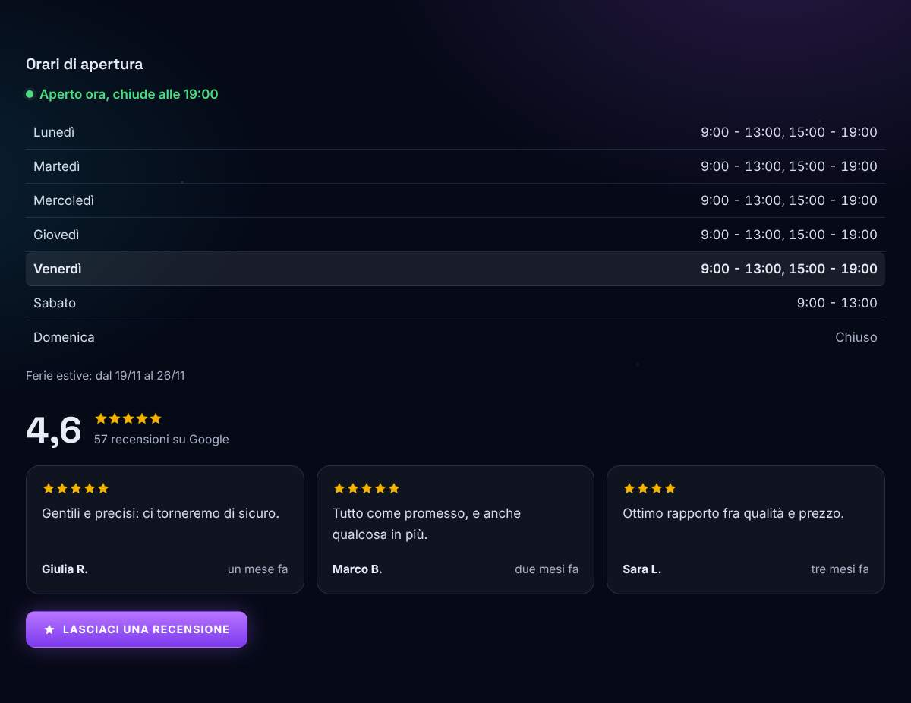

| Widget | A cosa serve | Cosa scrivere |
|---|---|---|
| **Orari di apertura** | I giorni con gli orari, e in alto "Aperto ora, chiude alle 19:00" oppure "Chiuso ora, apre domani alle 9:00", che si aggiorna da solo | Un giorno per riga: `9:00-13:00, 15:00-19:00`, `Chiuso`, `24 ore`. In **Ferie e chiusure** le date (`2026-08-10`): in quei giorni il widget dice Chiuso e il motivo |
| **Barra contatti (telefono)** | Una fascia fissa in fondo allo schermo, solo sul telefono: Chiama, WhatsApp, Indicazioni, Scrivici | Il numero, il numero WhatsApp con il prefisso (39...), l'indirizzo, l'email: un pulsante per ognuno che scrivi |
| **Recensioni** | Il voto medio con le stelle, alcune recensioni e il pulsante "Lasciaci una recensione" | Il voto (4,8), quante sono, dove (Google); le recensioni copiale con il permesso di chi le ha scritte; nel link del pulsante l'indirizzo che Google ti dà per farti recensire |
| **Prima e dopo** | Due foto una sopra l'altra, con una linea da trascinare: il lavoro prima e dopo | Due foto con la stessa inquadratura |
| **Squadra** | Le persone, con foto, ruolo, due righe e i contatti | Senza foto escono le iniziali |
| **Slider** | Più aperture che scorrono, ognuna con foto, titolo e pulsante | Una slide per messaggio, non più di quattro |
| **Eventi** | Le serate, i corsi, le aperture straordinarie, in ordine di data | La data come `2026-11-21`: quando l'evento è passato sparisce da solo |

Orari ed Eventi mettono anche i dati che Google sa leggere (si spengono dalla sezione Aspetto o Elenco). Le recensioni
no, apposta: Google non mostra le stelle che un'attività scrive di sé.

**Checklist**

- [ ] Negli orari ho scritto anche i giorni di chiusura e le ferie.
- [ ] Ho aperto il sito dal telefono e la barra dei contatti chiama il numero giusto.

---

## 9. Esempio: la pagina "Lavora con noi"

**A cosa serve.** Mettere insieme tutto quello che hai visto nel capitolo 8, su una pagina vera, dall'inizio alla fine.
Studio Prova cerca una persona per il negozio e vuole una pagina **Lavora con noi**: un titolo, due righe, una foto, cosa
cerca, un pulsante per scrivere.

### Una pagina nuova

Sulla dashboard premi **+ Pagina**. Si apre l'editor con una pagina in bozza: un titolo grande (H1) e un testo.

Premi **Impostazioni**, scrivi il **Titolo** "Lavora con noi" e l'**Indirizzo** `lavora-con-noi`, premi **Salva
impostazioni**.

### Il titolo e il testo

Doppio clic sul titolo nella tela.

1. Nella casella **Titolo** scrivi "Cerchiamo una persona \*curiosa\*". Le parole fra **asterischi** escono
   evidenziate con il colore del sito: è il modo più veloce per far cadere l'occhio dove vuoi.

Poi doppio clic sul testo sotto, e scrivi le due righe di presentazione, come nel capitolo 4.

### Una sezione a due colonne

Premi il **+** viola in fondo alla sezione: sotto nasce una sezione nuova, già scelta.

2. In **Struttura: quante colonne** premi il disegno con **due colonne**.

### La foto, a sinistra

Fai clic dentro la colonna di sinistra (dove c'è scritto "Trascina qui un widget"), poi:

3. Apri la linguetta **Widget**.
4. Fai clic su **Immagine**: entra nella colonna scelta.

5. Nella scheda **Modifica** premi **Scegli**, poi **Carica un'immagine** e prendi la foto dal computer (oppure scegline
   una già caricata). Sotto scrivi il **Testo alternativo**: "Gli scaffali del negozio, con i vasi colorati".

### Cosa cerchiamo, a destra

Fai clic nella colonna di destra. Dalla linguetta **Widget** aggiungi un **Titolo** (scrivi "Cosa cerchiamo"), poi un
**Elenco**.

6. Fai clic su una voce per aprirla e scrivi il testo.
7. **+ Aggiungi** mette una voce in più. Con la maniglia **⋮⋮** cambi l'ordine, con **×** togli una voce.

Infine aggiungi un widget **Pulsanti**.

8. Apri la voce del pulsante: **Testo** "Scrivici", **Link** `/contatti/` (l'indirizzo della pagina Contatti). Con
   **Stile** scegli fra Pieno viola, Pieno ciano e Contorno: i colori seguono quelli del sito.

### Lo stile

9. Ogni widget ha la sua scheda **Stile**: colori, caratteri, allineamento, bordi, ombre. Se non tocchi niente, il
   widget segue i colori e i caratteri del sito (capitolo 13): è quasi sempre la scelta migliore.

### Al telefono

10. Premi l'icona del **telefono** in alto: le due colonne si mettono una sotto l'altra da sole. Guarda che tutto si
    legga bene; poi torna al computer.

### Pubblicare

Premi **Pubblica** e conferma.

11. In alto compare "Pubblicata alle...". La pagina è online.

Manca una cosa: nessuno la trova, perché non è nel menu. Lo sistemi nel capitolo 17.

**Checklist**

- [ ] La pagina ha un solo titolo H1 (il primo, grande).
- [ ] Ogni immagine ha il testo alternativo.
- [ ] Ho guardato la pagina anche al telefono.
- [ ] I pulsanti portano dove devono (provali sul sito).
- [ ] Ho premuto Pubblica.
- [ ] La pagina è nel menu (capitolo 17).

**Se qualcosa non va**

- *Il widget è entrato nel posto sbagliato.* Trascinalo dove vuoi, oppure usa le frecce **↑ ↓** del pannello Modifica.
- *Ho cancellato qualcosa per sbaglio.* **Annulla** (la freccia in alto, o Ctrl+Z). Se hai già salvato, c'è Revisioni
  (capitolo 12).
- *La pagina dice "La pagina non ha un titolo H1".* Aggiungi un widget Titolo con livello H1, oppure un'Apertura.

---

## 10. Le sezioni pronte

**A cosa serve.** Trenta sezioni già impaginate (prezzi, testimonianze, servizi, numeri, domande frequenti, contatti,
inviti) da mettere nella pagina con un clic. Poi le cambi come vuoi: sono sezioni normali.

**Esempio.** Sotto "Lavora con noi" vogliamo qualche domanda frequente sulle candidature.

1. Fai clic sull'ultima sezione della pagina, poi apri la linguetta **Sezioni**.
2. Scrivi nella ricerca "domande": restano le sezioni di quel gruppo.
3. Fai clic su quella che ti piace (qui **Elenco di domande**): entra sotto la sezione scelta. Oppure trascinala nel
   punto che vuoi.

Adesso riscrivi le domande e le risposte con il pannello Modifica (doppio clic sul widget), e premi **Pubblica**.

**Checklist**

- [ ] Ho riscritto tutti i testi d'esempio della sezione (nessun "Lorem" o "Domanda uno").
- [ ] La sezione segue i colori del sito.

---

## 11. L'apertura della pagina

**A cosa serve.** L'**Apertura** (hero) è la prima cosa che si vede di una pagina: titolo grande, due righe, pulsanti,
una foto. Ha undici **disposizioni**: le stesse parole e la stessa foto messe insieme in undici modi.

1. Doppio clic sull'Apertura, scheda **Contenuto**, tendina **Disposizione**: Classica, Centrata, Copertina (foto a
   tutto sfondo), Divisa a metà, Rivista, Scheda, Minimale, Mosaico, Inclinata, Banner (bassa, per le pagine interne),
   Diagonale. Cambi e guardi: i testi restano.

Sotto ci sono occhiello, titolo (con le parole fra asterischi evidenziate), testo e pulsanti.

Nella scheda **Stile**, gruppo **Foto**, decidi come appare la foto:

- **Trattamento**: naturale, bianco e nero, oppure con un **velo** colorato (scegli colori e intensità);
- **Effetto animato**: zoom lento, bagliore, cornice luminosa, alone, scintille. Chi ha chiesto al computer meno
  movimento vede la foto ferma.

**Checklist**

- [ ] Il titolo dell'Apertura dice in una frase cosa fai.
- [ ] Il testo sopra la foto si legge bene (se no: velo più intenso, o una disposizione con la foto a lato).
- [ ] Ho guardato l'Apertura anche al telefono.

---

## 12. Tornare indietro: revisioni e versioni

**A cosa serve.** Ogni salvataggio e ogni pubblicazione lasciano una **versione**. Se una modifica non ti convince,
torni a com'era prima, anche dopo giorni.

Nell'editor premi **Revisioni**: a destra si apre l'elenco.

1. Ogni riga è una versione, con data, ora, chi l'ha salvata e se era pubblicata.
   - **Cosa è cambiato** la confronta con quella prima, in parole leggibili.
   - **Rispetto alla tela** la confronta con quello che hai adesso nell'editor.
   - **Carica nella tela** la riporta nell'editor: il sito cambia solo quando premi Pubblica.
   - **Aggiungi nota** le dà un nome ("prima dei saldi").

La pagina **Editor > Versioni** del pannello raccoglie le versioni di tutto: pagine, articoli, header, footer, menu,
stile del sito, con anteprima e ripristino.

**Checklist**

- [ ] Prima di un cambiamento grosso aggiungo una nota alla versione di adesso.
- [ ] So riportare una versione nella tela e pubblicarla.

---

## 13. Stile del sito

**A cosa serve.** I colori, i caratteri e le misure di **tutto** il sito, in una pagina sola. Cambi il colore principale
qui, e cambia ovunque: pulsanti, titoli evidenziati, link. Si apre da **Editor > Stile del sito**.

A sinistra le sezioni: **Colori globali**, **Caratteri globali**, **Tipografia** (corpo, paragrafi, link, titoli da H1 a
H6), **Pulsanti**, **Immagini**, **Campi dei moduli**, **Layout** (larghezza della pagina), **Sfondo del sito**,
**Identità del sito**, **CSS personalizzato**. A destra vedi il sito vero, che cambia mentre scegli. **Niente cambia sul
sito finché non premi Salva.**

1. **Colori globali**: i cinque colori di sistema (Primario, Secondario, Testo, Accento, Sfondo del sito). Puoi
   aggiungerne di tuoi con un nome: compaiono nelle tendine dell'editor.
2. Ogni riquadro si apre e si chiude con un clic sul titolo.

3. **Identità del sito**: il **nome**, il **sottotitolo**, la **descrizione in una riga**, il **logo** (se lo lasci
   vuoto la testata scrive il nome in lettere) e l'**icona del sito** (la piccola immagine nella scheda del browser:
   meglio quadrata, almeno 64 pixel).

In alto, **Cronologia** mostra i salvataggi di prima; **Ripristina predefiniti** torna allo stile di partenza.

**Checklist**

- [ ] Il colore Primario è quello del mio marchio.
- [ ] Ho messo il logo e l'icona del sito.
- [ ] Ho controllato l'anteprima su Desktop, Tablet e Telefono.
- [ ] Ho premuto **Salva**.

**Se qualcosa non va**

- *Ho cambiato tutto e non mi piace più.* Cronologia, oppure Editor > Versioni: lo stile di prima c'è.

---

## 14. I temi

**A cosa serve.** Un **tema** cambia l'aspetto del sito in un colpo solo: colori, caratteri, pulsanti, sfondo, header e
footer. Pagine, articoli, menu e immagini restano come sono. Si apre da **Editor > Temi**.

Ogni tema ha una scheda con l'anteprima e quattro pulsanti:

- **Anteprima** apre il sito vero con quel tema, solo per te. Guardalo sempre prima di attivarlo.
- **Attiva** lo mette sul sito, dopo una conferma. Lo stile di prima resta nelle Versioni.
- **Scarica** ne fa uno zip, da portare su un altro sito.
- **Elimina** lo toglie.

In alto: **Scarica l'aspetto di adesso come tema** salva il tuo stile come tema; **Carica un tema** installa uno zip.
Tre temi sono già dentro: **Aria** (chiaro e pulito), **Bottega** (caldo, artigiano), **Cosmo** (scuro, con il viola e
il ciano). Per costruirne uno tuo c'è il **Manuale dei temi**.

**Checklist**

- [ ] Ho guardato i tre temi in Anteprima.
- [ ] Dopo aver attivato un tema ho ritoccato Stile del sito con i miei colori.

**Se qualcosa non va**

- *"Il tema contiene codice PHP".* È una protezione: un tema con PHP esegue codice sul tuo server. Se ti fidi di chi
  l'ha fatto: Impostazioni > Sicurezza, scheda Impostazioni, riquadro in fondo, scrivi la tua password e premi **Apri la
  finestra per un'ora**; poi ricarica lo zip.
- *Il sito dopo il tema è strano.* Se un tema si rompe, il sito torna da solo all'aspetto di base e la pagina Temi lo
  dice in rosso.

---

## 15. Header e footer

**A cosa serve.** L'**header** è la testata in cima a ogni pagina (logo, menu). Il **footer** è il piede in fondo
(contatti, link, copyright). Si costruiscono con lo stesso editor delle pagine, da **Editor > Header e footer**.

- Puoi averne più di uno. Quello con la **stellina piena** (1) è il **predefinito**: esce su tutto il sito. Premi la
  stellina vuota di un altro per farlo diventare il predefinito.
- **Modifica** lo apre nell'editor delle pagine: cambi, premi Pubblica. **Anteprima sul sito** lo mostra sul sito vero.
- **Condizioni** decide dove esce un header diverso: tutti gli articoli, una categoria, una pagina sola. Vince la
  condizione più precisa.
- Nella scheda di ogni contenuto (riquadro **Header e footer**) puoi scegliere un header o un footer diverso solo per
  quella pagina, oppure **Nessuno**.

**Checklist**

- [ ] L'header mostra il logo e il menu.
- [ ] Il footer ha i contatti, la privacy e l'anno giusto.

### La frase in fondo al sito

Sotto il footer, in piccolo, ogni pagina ha una riga: **Un nuovo sito plumeCMS**, con il link al sito ufficiale. La
cambi o la spegni da **Impostazioni > Sito pubblico**, riquadro **La frase in fondo al sito**.

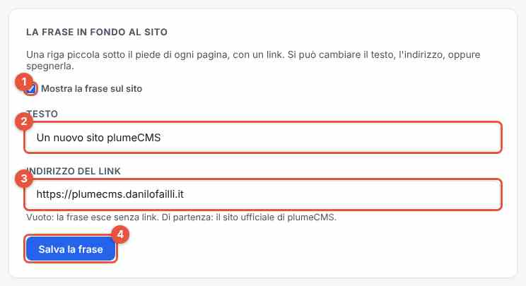

1. **Mostra la frase sul sito**: togli la spunta per spegnerla.
2. **Testo**: quello che si legge (per esempio "Sito fatto con plumeCMS da Studio Prova").
3. **Indirizzo del link**: dove porta. Lascialo vuoto e la frase esce senza link.
4. Premi **Salva la frase** e apri il sito: in fondo a ogni pagina c'è quella nuova.

Il testo è solo testo: niente grassetti né codice, e le emoji si tolgono.

---

## 16. Un riquadro in fondo a ogni articolo

**A cosa serve.** Chi arriva alla fine di un articolo è la persona più interessata che hai. Con **Aggiungi sempre alla
fine** prepari una volta sola un riquadro ombreggiato che esce sotto **ogni** articolo, anche quelli che hai già
pubblicato: un invito a passare in negozio, l'iscrizione alla newsletter, un contatto, un libro da consigliare. Lo
componi con l'editor visuale, come una pagina (capitolo 8). Non esce nelle pagine né nella home, solo negli articoli.

Lo prepara e lo cambia solo l'**amministratore**: il redattore non ha la linguetta.

**Esempio.** Lo Studio Prova vuole che chi legge un articolo trovi in fondo un invito a passare in negozio, con un
pulsante per prenotare una visita.

### Creare il riquadro

1. Nel menu a sinistra apri **Articoli**. In alto, dopo Tutti, Pubblicati, Programmati, Bozze e Cestino, premi la
   linguetta **Aggiungi sempre alla fine**.

La pagina dice **Non ancora creato**.

2. Premi **Crea il riquadro**. Si apre l'editor visuale con il riquadro già pronto: un titolo, "Prima di andare", e un
   testo da riscrivere. Sopra vedi le righe grigie che fanno la parte dell'articolo; il riquadro sta sotto, con i colori
   del tuo sito.

### Scriverci dentro

3. Fai doppio clic sul titolo nella tela. A sinistra, nella casella **Titolo**, scrivi *Ti è stato utile? Vieni a
   trovarci*.
4. Fai doppio clic sul testo e scrivi il tuo: *Siamo in negozio dal martedì al sabato, dalle 9 alle 19. Se vuoi un
   consiglio con calma, prenota una visita: ti dedichiamo mezz'ora solo per te.*

5. Con il testo ancora selezionato, apri la linguetta **Widget** e scegli **Pulsanti**: il pulsante entra subito sotto
   il testo. Nel pannello **Modifica** scrivi il **Testo** (*Prenota una visita*) e il **Link** (*/contatti/*).
6. Premi **Pubblica**. Finché non lo fai il riquadro resta una bozza e sul sito non esce.

Dentro il riquadro puoi mettere qualunque widget dell'editor: una foto, l'iscrizione alla newsletter (capitolo 20), più
colonne. Tieni però il riquadro corto: tre o quattro righe e un pulsante funzionano meglio di una pagina intera.

### Acceso e spento

7. Premi la freccia in alto a sinistra dell'editor: torni alla pagina del riquadro, che ora dice **Acceso**. Più sotto
   c'è l'**anteprima**: l'ultimo articolo pubblicato con il riquadro in fondo.
8. **Spegni** toglie il riquadro da tutti gli articoli senza perdere niente; **Accendi** lo rimette. Da qui hai anche
   **Modifica nell'editor**, **Vedi sotto l'ultimo articolo** (il sito vero, in una scheda nuova) e **Versioni** (le
   versioni di prima, da confrontare e ripristinare, capitolo 12).

Sul sito il riquadro esce dopo il testo di ogni articolo, nella stessa colonna, con l'ombra, il bordo e gli angoli
tondi. I colori vengono dallo Stile del sito e dal tema (capitoli 13 e 14): se li cambi, il riquadro li segue.

**Quando lo cambi.** Apri **Modifica nell'editor**, cambia e premi **Pubblica**. Le modifiche salvate con **Salva
bozza** si vedono solo nelle anteprime (quella della pagina del riquadro e Vedi sotto l'ultimo articolo), non sul sito.

**Checklist**

- [ ] Il riquadro ha un titolo, due o tre righe e al massimo un pulsante.
- [ ] Il pulsante porta a una pagina che esiste (prova a premerlo dal sito).
- [ ] Ho premuto **Pubblica** nell'editor e la pagina del riquadro dice **Acceso**.
- [ ] Ho aperto un articolo dal telefono e il riquadro si legge bene.

**Se qualcosa non va**

- *Il riquadro non esce sul sito.* Guarda la pagina del riquadro: se dice **Spento**, non l'hai mai pubblicato
  (Modifica nell'editor, poi Pubblica) o l'hai spento (premi Accendi). Esce solo sotto gli articoli, non nelle pagine.
- *Accendi dice che il riquadro non è ancora stato pubblicato.* La prima volta si accende con **Pubblica** nell'editor.
- *Non vedo la linguetta.* È solo dell'amministratore: entra con un utente amministratore.

---

## 17. Il menu

**A cosa serve.** Il **menu** è l'elenco di voci della testata (Home, Servizi, Chi siamo...). Si cambia da **Editor >
Menu di navigazione**.

**Esempio.** Mettere "Lavora con noi" (capitolo 9) nel menu principale.

1. In **Aggiungi voci al menu**, gruppo **Pagine**, spunta **Lavora con noi**.
2. Premi **Aggiungi al menu**: la voce entra in fondo alla struttura.

Trascina le voci per cambiarne l'ordine; trascinane una un po' a destra, sotto un'altra, e diventa una **sottovoce**.
La freccetta **▾** di ogni voce apre testo, indirizzo e "Apri in una nuova scheda".

3. Premi **Salva il menu**.

Con **Link personalizzato** aggiungi una voce verso qualunque indirizzo, anche fuori dal sito (la pagina Facebook, una
prenotazione). In alto, **Menu da modificare** passa agli altri menu (per esempio quello del footer); **Crea un nuovo
menu** ne fa uno nuovo.

**Checklist**

- [ ] Ogni pagina importante è nel menu.
- [ ] Le voci sono poche (sei o sette al massimo) e nell'ordine in cui le cerca chi visita.
- [ ] Ho premuto **Salva il menu** e ho guardato il sito anche al telefono.

---

## 18. I form

**A cosa serve.** Un **form** raccoglie dati da chi visita: richieste di preventivo, candidature, prenotazioni. Le
compilazioni arrivano nel pannello e, se vuoi, anche via email.

**Esempio.** Un form "Candidature" da mettere nella pagina "Lavora con noi".

Apri **Newsletter e form > Form** dal menu e premi **+ Nuovo form**.

1. **Nome (nel pannello)**: "Candidature". Serve a te per riconoscerlo.
2. **Titolo mostrato sopra il form**, **Testo di introduzione** e **Testo del pulsante** sono quello che legge chi
   visita.
3. **Campi**: si parte con Nome, Email e Messaggio. Per ogni campo scegli l'etichetta, il tipo (testo breve, email,
   telefono, testo lungo, scelta singola, scelta multipla, casella da spuntare, data, numero) e se è **obbligatorio**. **+ Aggiungi un campo** ne mette un altro;
   la maniglia **⋮⋮** cambia l'ordine.
4. Premi **Salva**.

A destra, **Dopo l'invio** decide cosa succede: iscrivere la persona a una lista della newsletter (con email di
conferma), avvisarti via email, e cosa scrivere nella pagina di ringraziamento.

### A chi arriva l'avviso

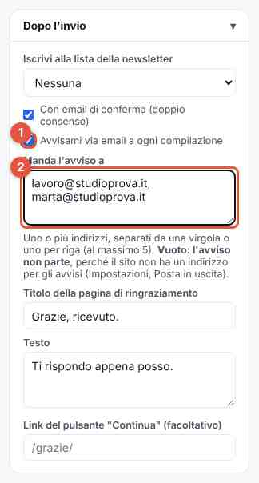

1. **Avvisami via email a ogni compilazione**: con la spunta, a ogni form compilato parte un'email con tutto quello che
   la persona ha scritto.
2. **Manda l'avviso a**: gli indirizzi che la ricevono, separati da una virgola o uno per riga, al massimo cinque. Le
   candidature possono andare a chi si occupa del personale, i preventivi all'ufficio commerciale. Se lo lasci vuoto,
   l'avviso va all'indirizzo degli avvisi del sito (**Impostazioni > Posta in uscita**, capitolo 25): sotto la casella
   c'è scritto quale.

Ogni indirizzo riceve la sua email. Se ne scrivi uno sbagliato, il form non si salva e il pannello ti dice quale. Nel
widget Modulo dell'editor l'indirizzo non si sceglie: si sceglie qui, una volta, e vale in ogni pagina in cui metti
quel form.

### Mettere il form nella pagina

Apri "Lavora con noi" nell'editor, fai clic sul pulsante "Scrivici" e aggiungi il widget **Modulo** (gruppo "Dal sito").

5. Nella tendina **Quale modulo** scegli **Candidature**. Premi **Pubblica**.

Sotto il form ci sono sempre la spunta per la privacy e il controllo **Sono una persona**, che ferma i programmi automatici.

### Dare un file a chi compila il form

Un form può regalare un file: una guida, un listino, un catalogo. La persona lo riceve solo dopo aver confermato la sua
email, così sai che l'indirizzo è vero.

**Esempio.** Studio Prova regala la "Guida alla cura delle piante" a chi si iscrive alla newsletter.

Prima carica il file in **Download** con la spunta **Riservato** (capitolo 22). Poi apri il form (qui un form nuovo,
"Guida in regalo") e guarda il riquadro **Dopo l'invio**:

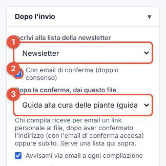

1. **Iscrivi alla lista della newsletter**: scegli una lista. Senza lista il file non si può dare, e il pannello lo dice.
2. **Con email di conferma (doppio consenso)**: lasciala spuntata.
3. **Dopo la conferma, dai questo file**: scegli il file. Nella tendina compaiono solo i file riservati.

Premi **Salva** e metti il form in una pagina con il widget **Modulo**, come sopra.

Chi compila riceve l'email di conferma. Quando preme il pulsante, il sito apre la pagina **Ecco il tuo file** con il
pulsante **Scarica**, e gli manda anche un'email con il link personale al file (vale 30 giorni).

Chi è già nella lista riceve il file subito per email, senza conferma. Se togli la spunta della conferma, il pulsante
**Scarica** esce già nella pagina di ringraziamento. L'email di conferma dice per cosa si conferma (il titolo del form),
e la persona entra solo nella lista di quel form, non in tutte le liste della newsletter.

### Leggere le compilazioni

Le trovi in **Newsletter e form > Invii dei form**, con una linguetta per ogni form e **Scarica CSV** per aprirle con
Excel o Numbers.

**Checklist**

- [ ] Il form chiede solo quello che serve davvero.
- [ ] Il campo Email è di tipo **Email** (serve per risponderti e per la newsletter).
- [ ] Ho compilato il form dal sito, una volta, e la compilazione è arrivata.
- [ ] Le email partono (capitolo 25), se voglio l'avviso a ogni compilazione.
- [ ] In **Manda l'avviso a** c'è chi deve leggere le compilazioni, oppure so che vanno all'indirizzo del sito.
- [ ] Se il form dà un file: il file è **Riservato** in Download, il form ha una lista, e ho provato io a compilarlo e a
  confermare (il file è arrivato per email).

---

## 19. I popup

**A cosa serve.** Una finestra che compare sopra la pagina: un'offerta, un avviso, un invito a iscriversi. Si apre da
**Popup**, **+ Nuovo popup**.

1. **Cosa mostra**: occhiello, **titolo**, testo, un'immagine, un pulsante con il suo link; oppure un form dentro il
   popup (tendina **Modulo dentro il popup**).
2. **Su quali pagine**: tutte, solo la home, solo gli articoli, solo le pagine, oppure gli indirizzi che scrivi tu.
3. **Quando compare**: dopo qualche secondo, quando chi legge arriva a una certa percentuale della pagina, o quando il
   mouse esce dalla pagina (solo computer). Sotto scegli **ogni quanti giorni** la stessa persona lo rivede.
4. **Acceso**: spunta, e premi **Salva**.

**Checklist**

- [ ] Il popup non compare prima di 5-10 secondi (chi arriva deve prima vedere la pagina).
- [ ] La stessa persona non lo rivede ogni volta (almeno 7 giorni).
- [ ] L'ho spento quando l'offerta è finita.

---

## 20. La newsletter

**A cosa serve.** Scrivere alle persone che si sono iscritte, dal tuo sito, senza servizi esterni da pagare. Le email
partono dal tuo server, a giri, grazie al cron (capitolo 26).

### Gli iscritti

**Newsletter e form > Iscritti e liste**: l'elenco degli iscritti, le liste (Newsletter, Clienti...), chi deve ancora
confermare e chi è uscito. Le persone si iscrivono da sole con un form (capitolo 18) e confermano con un'email
(doppio consenso).

In alto quattro numeri: **iscritti attivi**, **in attesa di conferma**, **usciti** e **rimbalzati**. Un iscritto è
**rimbalzato** quando il server di posta ha rifiutato il suo indirizzo per sempre (non esiste più): da quel momento non
riceve più niente, né campagne né flussi.

Se avevi una newsletter su Brevo (o un altro servizio), esporta i contatti in CSV e importali dal riquadro **Importa i
contatti**. Il file vuole la colonna EMAIL; NOME, COGNOME e CONSENSO (la data del consenso) se ci sono. Chi è uscito, è
rimbalzato o ha chiesto di cancellare i suoi dati resta fuori.

- **Fai partire i flussi per gli importati**: senza questa spunta, accanto a **Importa**, i flussi automatici (il
  benvenuto, per esempio) non partono per chi entra con l'importazione. Spuntala solo se vuoi che anche loro ricevano il
  benvenuto.
- **Il filtro degli stati**, sopra l'elenco: oltre ad Attivi, In attesa e Usciti ci sono **Rimbalzati** e **Con 3 errori
  di fila**: gli indirizzi che hanno dato tre errori temporanei uno dopo l'altro. Restano attivi, ma vale la pena
  controllarli (una lettera sbagliata, una casella piena). Quando ce ne sono, lo dice anche un avviso in cima alla pagina,
  con **Vedi chi**.

**Cancella dati**, nella riga di un iscritto, cancella tutto quello che lo riguarda: iscrizione, aperture e clic, flussi,
form compilati. Un'importazione non lo rimette dentro; se si iscrive di nuovo da solo e conferma, torna.

### Una campagna

**Newsletter e form > Campagne**, poi **+ Nuova campagna**.

1. **Oggetto**: la riga che si legge nella casella di posta. Corto e chiaro.
2. **Testo**: scrivi come in un'email normale. `{nome}` diventa il nome della persona. Sotto, un **pulsante** con il
   suo link e le **liste** a cui mandarla.

A destra c'è l'anteprima dell'ultima versione salvata. Poi:

- **Salva e manda la prova**: la ricevi tu, per controllarla nella tua casella;
- **Programma l'invio**: parte da sola all'ora scelta;
- **Invia adesso alle liste scelte**: parte al prossimo giro del cron (ogni 5 minuti, al massimo 150 email l'ora, per non
  finire fra lo spam).

### Quante email partono

I server condivisi lasciano partire un numero limitato di email ogni ora (a volte anche al giorno). Se il sito lo supera,
l'hosting blocca la posta. Il limite lo scrivi in **Newsletter e form > Iscritti e liste**, linguetta **Impostazioni** (accanto a Campagne,
Iscritti e Liste):

- **Email al massimo ogni ora**: chiedi all'hosting il limite del tuo piano e scrivi un numero un po' più basso;
- **Email al massimo al giorno**: 0 vuol dire nessun limite.

Contano **tutte** le email del sito, non solo le campagne: conferme, avvisi dei form, flussi, prenotazioni. Sotto ogni
casella c'è scritto quante ne sono partite nell'ultima ora e nelle ultime 24 ore. Quando il limite è raggiunto le email
aspettano il giro dopo del cron: non si perdono.

### I flussi automatici

**Flussi automatici** sono email che partono da sole: il benvenuto a chi si iscrive, un promemoria dopo qualche giorno,
un'email diversa a chi ha aperto e a chi no. Si disegnano su una tela con quattro blocchi: **Email**, **Attesa**,
**Bivio**, **Fine**.

**Checklist**

- [ ] Le email partono (capitolo 25) e il cron è attivo (capitolo 26).
- [ ] Ho mandato la prova a me stesso prima di ogni campagna.
- [ ] Ogni email ha il link per uscire dalla newsletter (lo mette plumeCMS da solo).
- [ ] I limiti di email ogni ora e al giorno sono sotto quelli dell'hosting.
- [ ] Una volta al mese guardo i **Rimbalzati** e quelli **Con 3 errori di fila**.

---

## 21. I social e l'email del mattino

**A cosa serve.** Ogni mattina ti arriva un'email con tutto pronto per i social: cosa esce oggi sul sito, il testo per
ogni canale con il link e gli hashtag, le due immagini della misura giusta. Copi, incolli, pubblichi: cinque minuti con il
caffè, invece di mezz'ora a riscrivere la stessa cosa quattro volte. Si apre da **Social**, nel menu a sinistra.

**Esempio.** L'articolo "Chiusi per ferie" del capitolo 4 deve arrivare su LinkedIn, Facebook, Instagram e WhatsApp, e
il giorno dopo serve un promemoria.

### Una volta: le impostazioni

1. **Le email del mattino**: "Oggi sul sito" (i contenuti che escono oggi) e "Social di oggi" (i testi del calendario).
   Arrivano all'indirizzo degli avvisi di Impostazioni > Configurazione email (capitolo 25).
2. **I canali** su cui pubblichi: LinkedIn, Facebook, Instagram, WhatsApp e Telegram, Substack. Quelli spenti spariscono
   dalle email e dalle pagine.
3. **Hashtag fissi**, uno per canale: escono in fondo a ogni testo (per esempio quello del tuo marchio).
4. **Hashtag per categoria**: una riga per categoria, il nome, due punti, gli hashtag ("Avvisi: #avvisi #orari"). Un
   articolo di quella categoria li prende in più.

Sotto puoi mettere un **link in più nei testi di WhatsApp**, con la sua frase: per esempio la pagina per prenotare.
Premi **Salva**.

### Per ogni contenuto: il riquadro Social

Nella scheda dell'articolo, sotto l'estratto, c'è il riquadro **Social**.

1. **Testo per i social**: due o tre righe che fanno venire voglia di leggere. Va su tutti i canali; il link e gli
   hashtag li aggiunge il CMS. Le emoji vanno bene. Se lo lasci vuoto, si usa l'estratto.
2. **Un testo diverso per un canale**: si apre e ti dà tre caselle, LinkedIn, Facebook e Instagram, WhatsApp e Telegram.
   Su WhatsApp, per esempio, scrivi come scriveresti a un amico.
3. **Le due immagini**, fatte da sole dall'immagine in evidenza: 1200x630 per LinkedIn e Facebook, 1080x1350 per
   Instagram. Se cambi la foto, cambiano anche loro.

Premi **Aggiorna** (o Pubblica).

### Ogni mattina: l'email "Oggi sul sito"

Il giorno in cui esce un articolo, al giro del mattino del cron (capitolo 26), ti arriva **"Oggi sul sito tuosito.it:
1 articolo"**. Per ogni contenuto che esce quel giorno: il titolo, le due immagini con i pulsanti per scaricarle, un
riquadro per ogni canale con il testo pronto, e i pulsanti **Condividi su LinkedIn**, **Condividi su Facebook**,
**Invia su WhatsApp**, **Invia su Telegram**.

In **Social > Email del mattino** la vedi prima che parta:

1. Scegli il **giorno** e premi **Mostra**: vedi l'email di quel giorno, anche di un giorno futuro (gli articoli
   programmati).
2. **Mandala adesso** te la manda subito, per provarla. Al mattino parte comunque, una volta sola.

### I testi pronti, in qualunque momento

**Social > Testi dei contenuti** mostra i testi degli articoli più recenti, canale per canale, con le immagini.

1. **Fai clic su un testo**: si seleziona e si copia. Lo incolli nel social.
2. I link **Condividi** aprono il social con l'indirizzo già dentro.

### Il calendario: un testo per ogni giorno

Per un articolo importante un post solo non basta. Nel **Calendario** prepari i testi dei giorni dopo: ogni mattina
arriva l'email **"Social di oggi"** con il testo di quel giorno, il link e le immagini. Per esempio una settimana di post
su un articolo lungo, un capitolo al giorno.

Premi **+ Un testo nel calendario**:

1. **Giorno** in cui ti arriva.
2. **Contenuto** a cui porta il link.
3. **Titolo del giorno**: ti dice di cosa parla quel post (esce nell'oggetto dell'email).
4. I testi per **LinkedIn**, **Facebook e Instagram**, **WhatsApp e Telegram**. Quelli vuoti prendono il testo del
   riquadro Social del contenuto.

Sotto: l'**ancora**, per portare il link a un punto preciso della pagina (l'id di un titolo), e due immagini diverse da
quelle del contenuto, se le vuoi. Premi **Salva**.

Ogni riga dice se il testo è **In attesa** o **Inviato**. Un testo inviato non riparte; **Rimetti in attesa** lo fa
ripartire domattina, **Mandalo adesso a me** te lo manda subito senza toccare il calendario.

**Checklist**

- [ ] L'indirizzo degli avvisi è scritto e le email partono (capitolo 25).
- [ ] Il cron gira (capitolo 26): senza, le email del mattino non partono da sole.
- [ ] Ho scelto i canali e scritto gli hashtag fissi.
- [ ] Ogni articolo ha il suo testo per i social e un'immagine in evidenza.
- [ ] Ho guardato l'anteprima dell'email del giorno prima di dormirci sopra.

**Se qualcosa non va**

- *Stamattina non è arrivata l'email.* Quel giorno non usciva niente (allora non parte), oppure il cron non gira
  (Impostazioni > Log cron), oppure manca l'indirizzo degli avvisi. In Log cron il giro del mattino dice cosa ha fatto.
- *Le immagini per i social non ci sono.* Serve un'immagine in evidenza caricata nel sito (Media). Da un indirizzo
  esterno il CMS non può ritagliarle e usa la foto com'è.
- *Il testo di Instagram ha il link.* Instagram non rende cliccabili i link nei post: se preferisci, cancellalo prima di
  pubblicare e scrivi "link in bio".

---

## 22. I file da scaricare

**A cosa serve.** Manuali, listini, moduli, programmi: i file che offri da scaricare, con un indirizzo fisso e il conto
di quante volte sono stati scaricati (le persone sì, i robot no). Si apre da **Download**.

1. **Scegli file**: PDF, ZIP, ePub, documenti Word, Excel, PowerPoint e LibreOffice.
2. **Titolo**, una riga di **Descrizione** e la **Versione**, poi **Carica**.

Ogni file ha il suo indirizzo, `/scarica/nome-del-file/`, da mettere in un pulsante o in un'email. Nelle pagine li
mostri con il widget **Download** (gruppo "Dal sito").

Se nel nome del file c'è la versione (`guida-1.2.pdf`, poi `guida-1.3.pdf`), i file diventano una **serie**:
l'indirizzo `/scarica/guida-ultima/` porta sempre al più recente. Carichi la versione nuova e i link la seguono da soli.

### I file riservati

Un file **riservato** non ha un indirizzo pubblico: nessuno lo scarica scrivendo `/scarica/...`. Lo ricevono, con un
**link personale**, solo le persone a cui lo dai: chi conferma l'email di un form (capitolo 18), i membri dell'area
riservata e chi segue un corso (capitoli 38 e 39).

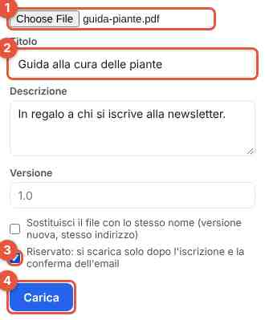

1. **Scegli file**.
2. Il **Titolo**: è quello che legge chi lo riceve.
3. Spunta **Riservato**.
4. Premi **Carica**.

Un file già caricato diventa riservato con il pulsante **Rendi riservato** nella sua riga (e torna pubblico con **Rendi
pubblico**): il suo indirizzo pubblico smette subito di funzionare.

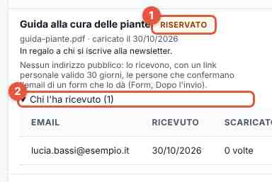

1. Il segno **Riservato** accanto al titolo.
2. **Chi l'ha ricevuto**: aprilo per vedere a chi è arrivato il link, quando, e quante volte l'ha usato.

Il link personale vale 30 giorni. Lo cambi nella casella **Il link personale vale ... giorni**, sotto il modulo di
caricamento; i link già mandati restano come erano. Un link scaduto apre una pagina che spiega cosa fare.

**Checklist**

- [ ] Ogni file ha un titolo che dice cosa contiene.
- [ ] Ho provato a scaricarlo dal sito.
- [ ] I file da dare solo a chi si iscrive sono **Riservati**, e il loro indirizzo `/scarica/...` non funziona.

---

## 23. Farsi trovare: SEO e AEO

**A cosa serve.** Fare in modo che Google e le intelligenze artificiali capiscano di cosa parla ogni pagina e la
mostrino a chi la cerca. Molto lo fa plumeCMS da solo: la mappa del sito, i dati strutturati, i redirect quando cambi un
indirizzo. Il resto lo fai tu, contenuto per contenuto.

### In ogni contenuto

Nella scheda di ogni articolo e di ogni pagina (e nelle Impostazioni dell'editor):

- **Titolo per Google**: il titolo che esce nei risultati. Vuoto vuol dire uguale al titolo.
- **Descrizione per Google**: le due righe sotto il titolo nei risultati (fino a 160 caratteri).
- **Keyword principale**: la parola o la frase con cui vuoi essere trovato ("negozio di vasi a Bologna").
- **Controllo SEO**: un punteggio da 0 a 100 e l'elenco di cosa sistemare, in parole chiare. Si aggiorna con
  **Ricontrolla**.
- **In breve**: da 40 a 60 parole che rispondono subito alla domanda principale. Le intelligenze artificiali le
  usano volentieri.
- **Domande frequenti**: una domanda per blocco, con la risposta sotto. Diventano dati per Google.

### Il pannello SEO e AEO

**Panoramica** mette in fila tutti i contenuti pubblicati con il loro punteggio: parti dai rossi. Le altre schede
collegano Google Search Console e IndexNow, controllano copertura e prestazioni, tengono le impostazioni globali e i
dati strutturati.

### L'immagine per i social

Quando qualcuno condivide una pagina su Facebook, WhatsApp, LinkedIn o X, esce un'anteprima con una foto. Per gli
articoli è l'immagine in evidenza; per tutte le altre pagine è l'**immagine social predefinita**, in **SEO e AEO >
Globale SEO**.

La misura giusta è **1200 x 630 pixel**, in **JPG o PNG** (le SVG i social non le mostrano), con logo e scritte al
centro: i bordi a volte si tagliano. Preparala e caricala in **Media** (capitolo 7). Poi:

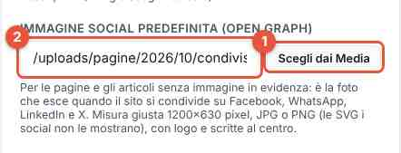

1. Premi **Scegli dai Media**. Si apre la libreria: scrivi una parte del nome nella casella di ricerca e fai clic
   sull'immagine.
2. L'indirizzo entra da solo nella casella. Premi **Salva titoli e meta**, in fondo al riquadro.

Il sito manda ai social l'indirizzo intero dell'immagine, con le misure: l'anteprima esce giusta già la prima volta.

**Redirect e 404** elenca i rimandi dai vecchi indirizzi e le pagine che qualcuno ha cercato senza trovarle: da qui le
rimandi dove devono andare.

**Checklist**

- [ ] Ogni pagina importante ha titolo e descrizione per Google.
- [ ] Le pagine principali hanno un punteggio sopra 70.
- [ ] Ho guardato Redirect e 404 almeno una volta al mese.
- [ ] L'immagine social predefinita c'è, 1200 x 630, in JPG o PNG.

---

## 24. Utenti e ruoli

**A cosa serve.** Far lavorare altre persone sul sito, ognuna con il suo nome e la sua password. Si apre da **Utenti**.

1. **Nome utente**, email, nome mostrato.
2. **Ruolo**:
   - **Amministratore**: può tutto.
   - **Redattore**: scrive e pubblica articoli e pagine, carica immagini, gestisce categorie e tag. Non vede utenti,
     impostazioni, aggiornamenti e sicurezza.

Poi la **password** (almeno 12 caratteri, due volte) e **Aggiungi**. Dai la password alla persona di persona, non per
email; al primo accesso potrà cambiarla da **Password**.

**Checklist**

- [ ] Ogni persona ha il suo utente (mai password condivise).
- [ ] Gli amministratori sono il meno possibile.
- [ ] Quando qualcuno smette di lavorare al sito, tolgo il suo utente.

---

## 25. Le email del sito

**A cosa serve.** Il sito manda email: conferme di iscrizione, avvisi dei form, la newsletter, le email del mattino con i social
(capitolo 21).
Perché arrivino (e non finiscano fra lo spam) conviene farle partire da una casella vera del tuo dominio. Si apre da
**Impostazioni > Configurazione email**.

I dati sono quelli della casella email che spedisce: li trovi nel pannello del tuo hosting (in cPanel: **Account email**,
poi **Connetti dispositivi**).

1. **Server SMTP** (per esempio `mail.tuosito.it`), **Porta** e **Sicurezza** (465 con SSL, oppure 587 con STARTTLS), **Utente**
   (l'indirizzo email completo), **Password della casella**, **Indirizzo e nome del mittente**.
2. Più in basso, l'indirizzo dove arrivano le email del mattino e gli avvisi dei form, e la casella per mandare
   un'**email di prova**.

Premi **Salva**, poi manda l'email di prova (anche dai Primi passi, sulla dashboard). Se arriva, hai finito.

**Checklist**

- [ ] L'email di prova è arrivata (controlla anche lo spam).
- [ ] Il mittente è un indirizzo del mio dominio (info@tuosito.it), non una casella gratuita.

**Se qualcosa non va**

- *L'email di prova non parte.* Il messaggio sotto dice perché, in parole chiare: di solito password sbagliata o porta
  sbagliata. Prova 465 con SSL, poi 587 con STARTTLS.
- *Parte ma non arriva.* Guarda nello spam. Se è lì, chiedi all'hosting di attivare SPF e DKIM per il tuo dominio.

---

## 26. Il cron: i compiti automatici

**A cosa serve.** Il **cron** è una sveglia che l'hosting suona al sito a orari fissi. Senza, il sito fa le cose solo
quando qualcuno lo visita. Con il cron:

- le campagne programmate partono alla loro ora e la newsletter va a piccoli giri, ogni 5 minuti;
- ogni mattina ti arrivano le email "Oggi sul sito" e "Social di oggi" (capitolo 21);
- ogni mattina il sito applica gli aggiornamenti programmati, avvisa i motori di ricerca (IndexNow) delle pagine nuove o
  cambiate e fa i compiti dei moduli installati;
- i flussi automatici della newsletter vanno avanti (il benvenuto ai nuovi iscritti, i promemoria).

Si imposta una volta, nel pannello dell'hosting. La pagina **Impostazioni > Log cron** ti dà le righe già pronte.

In **cPanel**:

1. apri **Processi cron** (Cron Jobs), nella sezione Avanzate;
2. in **Aggiungi nuovo processo cron** scegli l'intervallo scritto sotto la riga: **una volta al giorno** alle 6 per la
   prima, **ogni 5 minuti** per la seconda;
3. nel campo **Comando** incolla la riga (un clic sul riquadro la copia) e premi **Aggiungi**.

Fai lo stesso per la seconda riga. Il giorno dopo, la stessa pagina ti dice com'è andato l'ultimo giro.

**Esegui adesso** fa partire subito il giro del mattino, per provare senza aspettare domani.

**Checklist**

- [ ] Ho messo le due righe in cPanel.
- [ ] In Log cron l'ultimo giro è di oggi.
- [ ] Nei Primi passi la voce "Il cron è attivo" è verde.

---

## 27. La sicurezza

**A cosa serve.** plumeCMS è protetto già all'installazione: blocca chi prova a indovinare le password, chiude le porte
che non servono, controlla quello che entra. **Impostazioni > Sicurezza** ti fa vedere come sta il sito, a colori.

**Verde**: a posto. **Giallo**: funziona, ma si può stringere. **Rosso**: da sistemare. **Grigio**: informazione.
Accanto a ogni voce c'è cosa fare. Le altre schede: **Impostazioni** (regole di accesso, la finestra di un'ora per i file
PHP), **Registro** (accessi, blocchi, modifiche), **Sessioni e utenti**, **Rapporti CSP**.

Il primo rosso di quasi tutti i siti nuovi è **Connessione https**: attiva il certificato gratuito nell'hosting (in
cPanel: **SSL/TLS Status**, o **Let's Encrypt**) e poi la riga "forza https" nel file `.htaccess`.

### L'accesso a due fattori

Con il secondo fattore, per entrare non basta la password: serve anche un codice di sei cifre che cambia ogni 30 secondi
sul tuo telefono. Chi ruba la password resta fuori.

1. Installa sul telefono un'app di autenticazione gratuita (Google Authenticator, Microsoft Authenticator, 2FAS...).
2. In **Il mio accesso** premi **Attiva il secondo fattore**: compare un codice QR.
3. Inquadralo con l'app e scrivi nel pannello il codice di sei cifre che l'app ti mostra.
4. Il pannello ti dà **otto codici di recupero**: salvali subito (stampali, o mettili nel gestore di password). Servono
   se perdi il telefono, e non si rivedono più.

**Checklist**

- [ ] In Sicurezza non ci sono voci rosse.
- [ ] Il sito si apre in https.
- [ ] Il secondo fattore è attivo per ogni amministratore.
- [ ] I codici di recupero sono in un posto sicuro.

**Se qualcosa non va**

- *Ho dimenticato la password.* Nella pagina di accesso usa il link per reimpostarla: arriva un'email (serve che le
  email partano, capitolo 25).
- *Ho perso il telefono del secondo fattore.* Entra con uno dei codici di recupero, poi rigenera il secondo fattore.
- *Mi sono chiuso fuori del tutto* (secondo fattore perso e niente codici, o lista degli indirizzi che non ti fa entrare).
  Con il gestore dei file dell'hosting apri `includes/config.local.php` e aggiungi in fondo la riga di emergenza
  `define('CMS_SICUREZZA_SPEGNI', true);`: spegne secondo fattore e lista degli indirizzi. Entra, sistema in
  **Sicurezza** quello che ti bloccava, poi **togli la riga**: finché c'è, la pagina Sicurezza lo segna in rosso.

---

## 28. Aggiornare plumeCMS

**A cosa serve.** Le versioni nuove portano funzioni e correzioni. Un aggiornamento è uno zip che carichi dal pannello:
prima di toccare qualunque cosa il pannello fa una copia di sicurezza, e se qualcosa va storto rimette tutto com'era da
solo. Si apre da **Impostazioni > Aggiornamenti**.

Due strade.

**Quando il pannello te lo dice.** Una volta al giorno il pannello chiede al sito ufficiale se c'è una versione nuova.
Se c'è, lo vedi sulla dashboard e in questa pagina:

1. premi **Scarica e prepara**: lo zip arriva da solo, controllato;
2. premi **Applica ora** sul pacchetto pronto.

**A mano.** Scarica lo zip di aggiornamento (`plumecms-<versione>-aggiornamento.zip`) dal sito di plumeCMS:

1. in **Carica un pacchetto** premi **Scegli file** e prendi lo zip;
2. premi **Carica**;
3. nella lista **Pacchetti** premi **Applica ora**.

Alla fine in alto c'è scritto il numero della versione nuova. Si può saltare dalle versioni vecchie direttamente
all'ultima: non serve passare da quelle in mezzo.

**Checklist**

- [ ] Prima di aggiornare ho una copia del sito recente (capitolo 29; il pannello ne fa comunque una).
- [ ] Dopo l'aggiornamento il numero di versione è quello nuovo.
- [ ] Ho aperto il sito e qualche pagina del pannello: tutto come prima.

**Se qualcosa non va**

- *"Il file supera il limite di caricamento del server".* Lo zip è più grande di quello che l'hosting accetta: chiedi
  di alzare il limite, oppure usa **Scarica e prepara**, che non passa dal caricamento.
- *Qualcosa non va dopo l'aggiornamento.* In fondo alla pagina c'è **Snapshot**: la copia fatta prima. **Ripristina**
  torna a com'era.

---

## 29. La copia del sito

**A cosa serve.** Una copia completa del sito (database, immagini, temi, moduli) in un solo file, da tenere al sicuro.
Serve se qualcosa si rompe, o per spostare il sito su un altro hosting. Si apre da **Impostazioni > Copia del sito**.

- **Prepara la copia** la fa sul server; poi la scarichi dall'elenco **Copie sul server**. Se ne tengono le ultime sei.
- **Ripristina da una copia** rimette il sito com'era nella copia. Prima, per sicurezza, fa da sola una copia del sito di
  adesso. Il server accetta file fino a una certa misura (qui 2 MB): una copia più grande si mette con il gestore dei
  file dell'hosting nella cartella `aggiornamenti/copie/` e si ripristina dall'elenco.

La copia contiene dati personali (utenti, iscritti, messaggi dei form): tienila in un posto sicuro e non mandarla per
email.

**Checklist**

- [ ] Faccio una copia una volta al mese, e prima di ogni cambiamento grosso.
- [ ] Ne tengo una sul mio computer, fuori dal server.

---

## 30. Controlla il server

**A cosa serve.** Sapere se l'hosting ha tutto quello che serve a plumeCMS: versione di PHP, estensioni, HTTPS, cron,
email, cartelle scrivibili, protezioni dei file. Non cambia niente: guarda e ti dice. Si apre da **Impostazioni >
Controlla il server**.

In cima, quante voci sono **a posto**, **da sapere** e **da sistemare**. Sotto, ogni voce con la spiegazione in parole
semplici. **Controlla di nuovo** rifà i controlli; **Manda un'email di prova** prova la posta.

**Checklist**

- [ ] Nessuna voce "da sistemare".
- [ ] Le voci "da sapere" le ho lette e capite.

---

## 31. Portare qui un sito WordPress

**A cosa serve.** Se hai un sito WordPress, plumeCMS lo legge e porta qui articoli, pagine, immagini, categorie, tag,
menu e titoli SEO, con i redirect dai vecchi indirizzi. Il sito WordPress non viene toccato. Si apre da **Impostazioni >
Importa da WordPress**.

### Prima, in WordPress

1. Entra nel pannello di WordPress e apri **Utenti > Profilo**.
2. In fondo, in **Password per le applicazioni**, scrivi un nome (per esempio "plumeCMS") e premi **Aggiungi una nuova
   password per le applicazioni**.
3. Copia la password che compare: sei gruppi di quattro lettere e cifre. Non è la password con cui entri in WordPress.

### Poi, in plumeCMS

4. Scrivi l'**indirizzo del sito WordPress**, il tuo **nome utente** di WordPress e la **password per le
   applicazioni**. Premi **Collegati e analizza il sito**.
5. Arriva il **report**: quanti articoli, pagine, immagini, categorie, tag e menu ci sono, cosa diventano qui, e cosa
   non si può portare, con il motivo.

6. Togli la spunta a quello che non vuoi (o usa Tutto, Solo gli articoli, Solo le pagine) e premi **Importa le voci
   scelte**. Una barra ti dice a che punto è; se chiudi la pagina, l'import riprende quando la riapri.
7. Alla fine tutto è **in prova**: i visitatori non vedono niente. Premi **Apri l'anteprima del sito** e guardalo,
   pagina per pagina. Il riepilogo dice cosa è entrato, cosa no e cosa conviene guardare.
8. Se ti piace, premi **Conferma l'import**: da quel momento è definitivo. Se non ti convince, **Annulla l'import**
   toglie tutto quello che è entrato e il sito torna com'era.

Dopo la conferma puoi cancellare la password per le applicazioni da WordPress, dallo stesso punto in cui l'hai creata.

**Checklist**

- [ ] WordPress è in https e ha la versione 5.6 o più nuova.
- [ ] Ho letto nel report cosa non entra (grafica di Elementor, shortcode dei plugin, commenti).
- [ ] Ho guardato l'anteprima prima di confermare.
- [ ] Dopo la conferma ho controllato menu e redirect.

**Se qualcosa non va**

- *"La password non è quella per le applicazioni".* Hai usato la password con cui entri in WordPress: crea quella per le
  applicazioni (passi 1-3).
- *"Il sito non risponde" o "la REST è chiusa".* Un plugin di sicurezza di WordPress blocca l'accesso: spegnilo il tempo
  dell'import.

---

## Parte seconda: gli addon

Gli **addon** sono funzioni in più che arrivano con plumeCMS ma restano spente finché non le accendi. Un sito di un
parrucchiere vuole le prenotazioni, un'associazione gli eventi, una bottega il negozio: ognuno accende solo quello che
gli serve, e il pannello resta semplice.

| Capitolo | Addon | Per chi |
|---|---|---|
| 32 | Accendere e spegnere | tutti |
| 33 | Prenotazioni e appuntamenti | parrucchieri, estetiste, studi, consulenti |
| 34 | Eventi con iscrizione | associazioni, corsi, serate, visite guidate |
| 35 | Raccolta recensioni | chi ha clienti contenti e vuole farlo sapere |
| 36 | Vetrina prodotti | botteghe, artigiani, piccoli negozi |
| 37 | Statistiche delle visite | tutti |
| 38 | Area riservata (membri) | chi ha pagine e file solo per i suoi iscritti |
| 39 | Corsi online | formatori, scuole, chi insegna |
| 40 | Copia del sito altrove | tutti |

**È una beta.** La 2.0.0 è la prima versione con gli addon: sono provati (nel browser, contro gli attacchi,
nell'installazione e nell'aggiornamento), ma non ancora su tanti siti veri. Ogni capitolo dice anche **cosa non c'è
ancora**. Se qualcosa non va come scritto qui, segnalalo.

Gli esempi raccontano attività vere (un salone, un'associazione, una bottega). Le schermate sono fatte sul sito di prova
"Studio Prova", con i dati dell'esempio: il nome in alto è quello.

Prima di accendere un addon che manda email (prenotazioni, eventi, recensioni, negozio, area riservata, corsi),
controlla che la posta del sito funzioni: **Impostazioni > Configurazione email**, email di prova (capitolo 25). Senza,
il sito lavora ma le email non partono.

---

## 32. Gli addon: accendere e spegnere

**A cosa serve.** Decidere quali funzioni in più usa il tuo sito. Si fa da una pagina sola, **Impostazioni > Addon**, ed
è solo per l'amministratore.

**Esempio.** Il salone "Forbici d'Oro" di Bologna vuole che i clienti prenotino dal sito: accende **Prenotazioni e
appuntamenti**.

Apri **Impostazioni > Addon**. C'è una carta per ogni addon, con il nome, due righe su cosa fa e il suo stato (**Spento**
o **Acceso**).

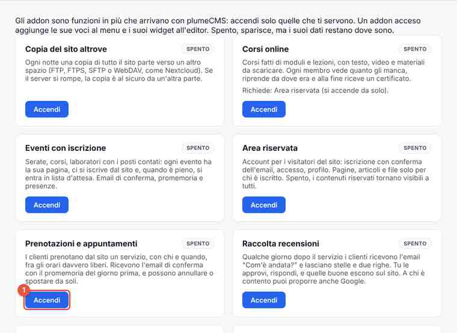

1. Sulla carta **Prenotazioni e appuntamenti** premi **Accendi**.

La pagina si ricarica:

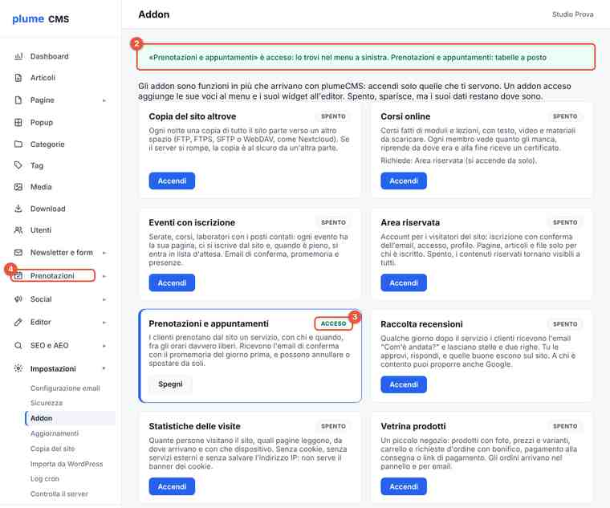

2. Il messaggio verde: "«Prenotazioni e appuntamenti» è acceso: lo trovi nel menu a sinistra", e "tabelle a posto"
   (l'addon ha preparato il suo posto nel database).
3. La carta ha il bordo colorato e dice **Acceso**; il pulsante adesso è **Spegni**.
4. Nel menu a sinistra c'è la voce nuova, **Prenotazioni**, con le sue pagine.

Un addon acceso aggiunge anche i suoi **widget** all'editor (per esempio **Prenota**, nel gruppo "Dal sito") e, quando
serve, i suoi indirizzi al sito (per esempio `/negozio/` o `/corsi/`).

Dove compare la voce di ogni addon nel menu:

| Addon | Voce del menu |
|---|---|
| Prenotazioni e appuntamenti | **Prenotazioni**, dopo Newsletter e form |
| Eventi con iscrizione | **Eventi**, dopo Newsletter e form |
| Raccolta recensioni | **Recensioni**, dopo Newsletter e form |
| Vetrina prodotti | **Vetrina**, dopo Media |
| Statistiche delle visite | **Statistiche**, subito dopo Dashboard |
| Area riservata | **Membri**, dopo Utenti |
| Corsi online | **Corsi**, dopo Membri |
| Copia del sito altrove | **Impostazioni > Copia altrove**, dopo Copia del sito |

**Corsi online** ha bisogno dell'**Area riservata** (i corsi li seguono i membri): sulla sua carta c'è scritto "Richiede:
Area riservata (si accende da solo)", e infatti accendendo i Corsi si accende anche l'Area riservata.

### Spegnere

Premi **Spegni** sulla carta e conferma. L'addon sparisce: le sue voci dal menu, i suoi widget dalle pagine, i suoi
indirizzi dal sito. **I dati restano**: prenotazioni, prodotti, iscritti, recensioni sono ancora nel database e tornano
tutti quando lo riaccendi.

Una sola eccezione da ricordare: spegnendo l'**Area riservata**, le pagine e gli articoli "solo per i membri" tornano
visibili a tutti (capitolo 38).

Gli aggiornamenti di plumeCMS non accendono e non spengono niente: gli addon restano come li hai lasciati. Anche la
**Copia del sito** (capitolo 29) si ricorda quali addon erano accesi.

**Checklist**

- [ ] Ho acceso solo gli addon che uso davvero.
- [ ] Per ogni addon acceso c'è la sua voce nel menu, e l'ho aperta almeno una volta.
- [ ] Gli addon che mandano email: la posta del sito funziona (capitolo 25).
- [ ] So che spegnere un addon non cancella i suoi dati.

---

## 33. Prenotazioni e appuntamenti

**A cosa serve.** I clienti prenotano dal sito: scelgono il servizio, con chi (se siete in più di uno), il giorno e
l'ora fra quelli **davvero liberi**. Ricevono subito l'email di conferma, con il file per il calendario del telefono e un
link personale per annullare o spostare da soli. Il giorno prima arriva il promemoria. Tu ricevi un'email a ogni
prenotazione e vedi tutto nell'agenda del pannello.

Il sito non dà mai lo stesso orario a due persone: anche se due clienti premono **Prenota** nello stesso istante, uno
solo lo ottiene, e all'altro il sito chiede di sceglierne un altro.

**Esempio.** Il salone "Forbici d'Oro", in via dell'Indipendenza a Bologna. Anna lavora dal lunedì al sabato, 9-13 e
15-19; Marco dal lunedì al venerdì, 10-18. Offrono "Taglio donna" (45 minuti, 35 €, con 15 minuti per riordinare dopo)
e "Colore" (90 minuti, 60 €, solo Anna). Vogliono che si prenoti almeno 2 ore prima e che si possa annullare fino al
giorno prima.

Accendi l'addon (capitolo 32): nel menu compare **Prenotazioni** con cinque pagine, **Agenda**, **Prenotazioni**,
**Servizi**, **Persone e orari** e **Impostazioni**. Finché mancano persone e servizi, ogni pagina ha in cima il riquadro
giallo **Per cominciare**, che dice cosa fare.

### Chi lavora e quando: Persone e orari

Apri **Prenotazioni > Persone e orari** e premi **Aggiungi una persona**.

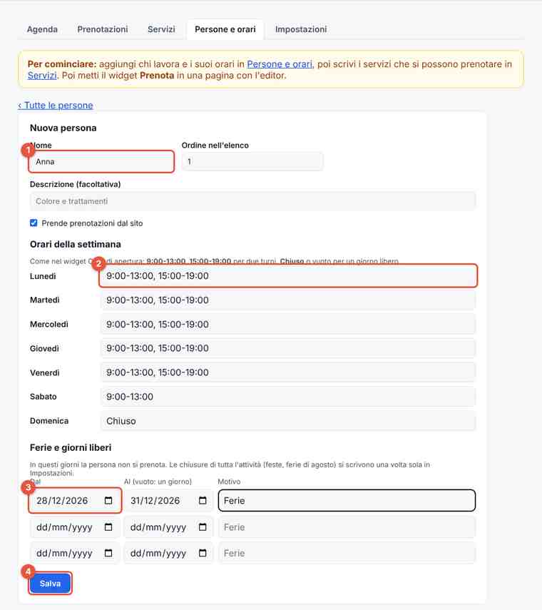

1. **Nome**: "Anna". **Descrizione** è facoltativa ("Colore e trattamenti"); **Prende prenotazioni dal sito** resta
   spuntata.
2. **Orari della settimana**: trovi già 9:00-13:00, 15:00-19:00 dal lunedì al venerdì, 9:00-13:00 il sabato, domenica
   Chiuso. Per Anna vanno bene così. Si scrivono come nel widget Orari di apertura: due turni separati da una virgola,
   **Chiuso** (o vuoto) per un giorno libero.
3. **Ferie e giorni liberi**: le date in cui Anna non c'è, con **Dal**, **Al** e **Motivo**. Per un giorno solo lascia
   vuoto "Al".
4. Premi **Salva**.

Ripeti per Marco: dal lunedì al venerdì `10:00-18:00`, sabato e domenica `Chiuso`.

Se lavori da solo basta una persona: il sito non chiederà "con chi".

### Cosa si prenota: Servizi

Apri **Prenotazioni > Servizi** e premi **Aggiungi un servizio**.

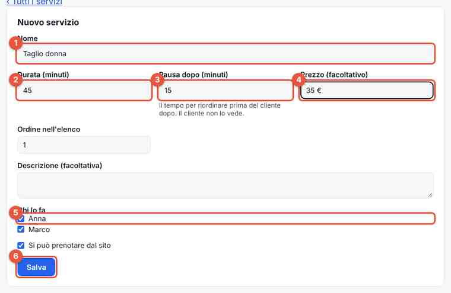

1. **Nome**: "Taglio donna".
2. **Durata (minuti)**: 45.
3. **Pausa dopo (minuti)**: 15. Il cliente non la vede: è il tempo per riordinare prima del cliente dopo.
4. **Prezzo (facoltativo)**: "35 €". Si scrive come vuoi che si legga.
5. **Chi lo fa**: lascia spuntati Anna e Marco.
6. Premi **Salva**.

Aggiungi **Colore**: durata 90, prezzo "60 €", e in **Chi lo fa** togli la spunta a Marco. L'elenco dei servizi dice
per ognuno durata, prezzo e chi lo fa.

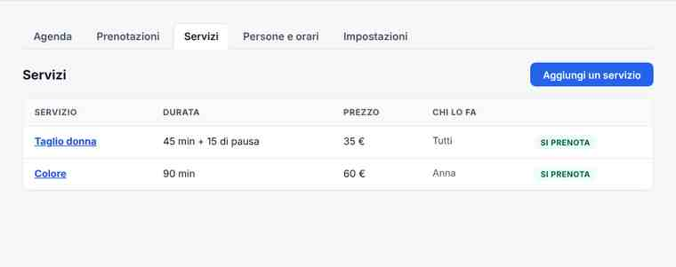

Un servizio che per un po' non vuoi far prenotare: aprilo e togli la spunta **Si può prenotare dal sito**.

### Le regole: Impostazioni

Apri **Prenotazioni > Impostazioni**.

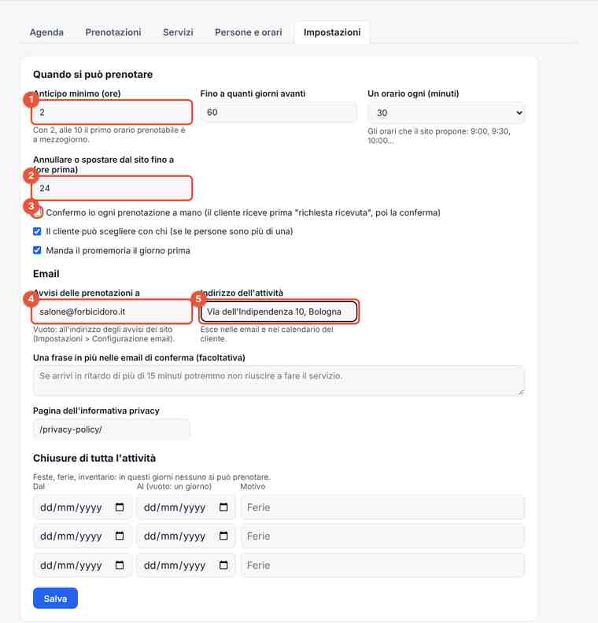

1. **Anticipo minimo (ore)**: 2. Alle 10 il primo orario prenotabile è a mezzogiorno. Accanto: **Fino a quanti giorni
   avanti** (60) e **Un orario ogni (minuti)** (30: il sito propone 9:00, 9:30, 10:00...).
2. **Annullare o spostare dal sito fino a (ore prima)**: 24.
3. **Confermo io ogni prenotazione a mano**: lasciala spenta e le prenotazioni sono subito confermate. Accesa, il cliente
   riceve prima "richiesta ricevuta", e la conferma arriva quando premi **Conferma** nel pannello. Sotto: **Il cliente
   può scegliere con chi** e **Manda il promemoria il giorno prima**.
4. **Avvisi delle prenotazioni a**: l'email del salone, "salone@forbicidoro.it". Vuoto: l'indirizzo degli avvisi del
   sito.
5. **Indirizzo dell'attività**: "Via dell'Indipendenza 10, Bologna". Esce nelle email e nel calendario del cliente.

Più in basso: **Una frase in più nelle email di conferma** ("Se arrivi in ritardo di più di 15 minuti..."), la **Pagina
dell'informativa privacy** e le **Chiusure di tutta l'attività** (Natale, ferie di agosto, inventario): in quei giorni
nessuno si prenota. Premi **Salva**.

### Il calendario sul sito: il widget Prenota

Crea una pagina "Prenota" (capitolo 9) e, nel gruppo **Dal sito** dei widget, aggiungi **Prenota**.

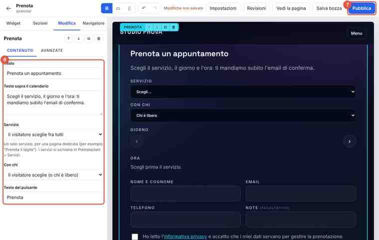

6. Nel pannello **Modifica** cambi il **Titolo**, il **Testo sopra il calendario** e il **Testo del pulsante**. In
   **Servizio** puoi fissarne uno solo (per una pagina "Prenota il colore"); in **Con chi** puoi fissare una persona.
7. Premi **Pubblica**, e metti la pagina nel menu (capitolo 17).

Sul sito il cliente fa così:

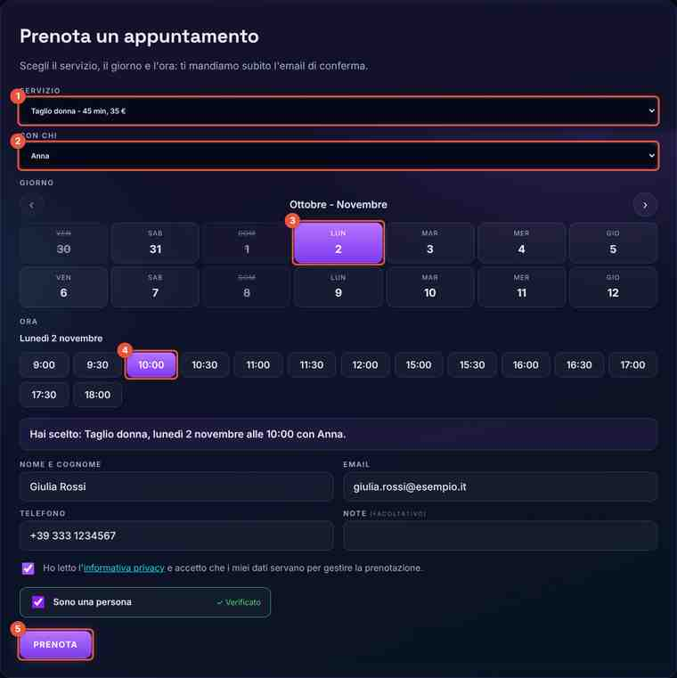

1. Sceglie il **Servizio** (con durata e prezzo).
2. Sceglie **Con chi**: una persona, oppure "Chi è libero".
3. Sceglie il **giorno** fra le due settimane mostrate (le frecce portano alle due dopo). I giorni chiusi o pieni sono
   barrati.
4. Sceglie l'**ora**: sotto compare il riepilogo, "Hai scelto: Taglio donna, lunedì 2 novembre alle 10:00 con Anna".
5. Scrive nome, email e telefono (le note sono facoltative), spunta la privacy e **Sono una persona**, e preme
   **Prenota**.

Arriva alla sua pagina personale: "Prenotazione fatta", con il riepilogo e i pulsanti **Aggiungi al calendario**,
**Sposta l'appuntamento** e **Annulla la prenotazione**.

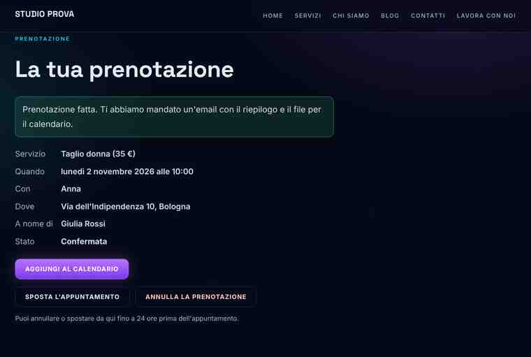

### Cosa riceve il cliente

- Subito: l'email **Prenotazione confermata**, con servizio, giorno, ora, indirizzo, il link **Aggiungi al
  calendario** (un file che il telefono apre nel calendario) e il pulsante per la sua pagina, dove può annullare o
  spostare. Se confermi tu a mano, prima riceve "Richiesta di prenotazione ricevuta".
- Il giorno prima: il **promemoria**.
- Se sposta o annulla: un'email che lo conferma. Anche tu ricevi un avviso.

Spostare e annullare dal sito si può fino al limite delle Impostazioni (24 ore prima, nell'esempio); dopo, la pagina gli
dice di telefonare. Annullando, il sito chiede "Vuoi davvero annullare?".

### L'agenda e le prenotazioni nel pannello

**Prenotazioni > Agenda** mostra la settimana, un giorno per colonna (al telefono uno sotto l'altro).

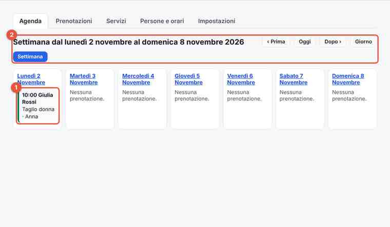

1. Ogni prenotazione, con ora, nome, servizio e persona. Un clic la apre.
2. **‹ Prima**, **Oggi** e **Dopo ›** cambiano settimana; **Giorno** mostra un giorno solo, con telefono, email e note.

**Prenotazioni > Prenotazioni** è l'elenco, con le linguette **Prossime**, **Da confermare**, **Passate**,
**Annullate**, **Tutte** e la ricerca per nome, email o telefono. Un clic apre la scheda:

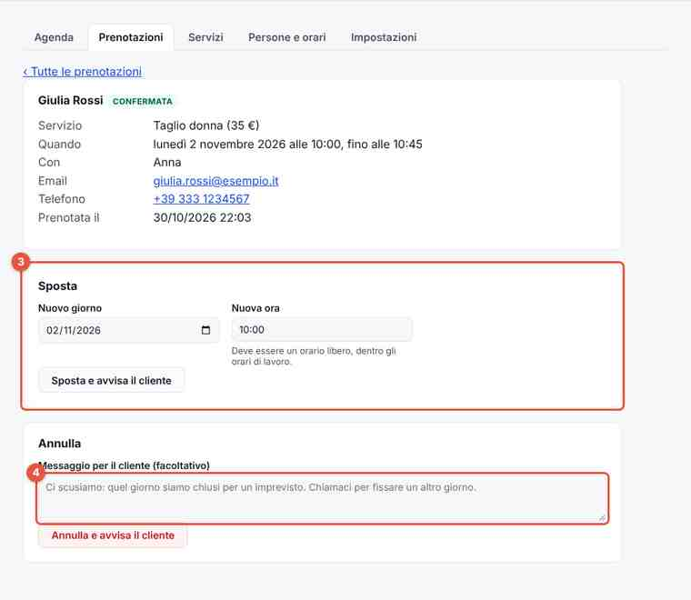

3. **Sposta**: nuovo giorno e nuova ora (deve essere un orario libero), poi **Sposta e avvisa il cliente**.
4. **Annulla**: un **Messaggio per il cliente** facoltativo ("Ci scusiamo: quel giorno siamo chiusi per un
   imprevisto"), poi **Annulla e avvisa il cliente**. Il messaggio arriva nella sua email.

In cima alla scheda, secondo il momento, compaiono anche **Conferma** (se le confermi a mano), **Non si è presentato**
(dopo l'ora dell'appuntamento; se l'hai premuto per sbaglio, **Si è presentato (era un errore)**) ed **Elimina i dati**
(per un appuntamento passato o annullato, se il cliente chiede di cancellare i suoi dati).

Un appuntamento confermato, passata l'ora, diventa da solo **Svolto**. Promemoria e appuntamenti svolti li fa il cron
frequente, ogni 5 minuti (capitolo 26): controlla in **Impostazioni > Log cron** che giri.

**Cosa non c'è ancora (beta).** Una prenotazione presa al telefono non si può scrivere dal pannello: per ora tienila
fuori dal sito, oppure prenota tu dal sito al posto del cliente (con la sua email, se vuole le email). Non ci sono
pagamenti né caparre online, servizi con più persone insieme, appuntamenti oltre la mezzanotte.

**Checklist**

- [ ] L'addon è acceso e nel menu c'è **Prenotazioni**.
- [ ] Ogni persona ha gli orari giusti e le sue ferie.
- [ ] Ogni servizio ha durata, pausa e "Chi lo fa".
- [ ] Impostazioni: anticipo, limite per annullare, email degli avvisi, indirizzo, chiusure dell'attività.
- [ ] La posta del sito funziona (capitolo 25).
- [ ] Il widget **Prenota** è in una pagina pubblicata, e la pagina è nel menu.
- [ ] Ho fatto una prenotazione di prova con la mia email: la conferma è arrivata e il file del calendario si apre.
- [ ] La prenotazione di prova è nell'Agenda; l'ho annullata dal link dell'email.

---

## 34. Eventi con iscrizione

**A cosa serve.** Serate, corsi, laboratori, visite guidate con i posti contati. Ogni evento ha la sua pagina sul sito,
con data, luogo, descrizione e il modulo per iscriversi. Chi si iscrive può prendere più posti (per sé e per un amico).
Quando i posti finiscono si entra in **lista d'attesa**: se qualcuno si cancella, il primo che aspetta entra da solo e
riceve l'email. Il giorno prima arriva il promemoria. Nel pannello vedi gli iscritti, segni le presenze, scarichi
l'elenco e scrivi a tutti.

**Esempio.** L'associazione "Colli Bolognesi" organizza una serata di degustazione il venerdì alle 21, nella sede di via
Rizzoli 1 a Bologna: 30 posti, al massimo 2 a persona, 15 € a testa. Le iscrizioni chiudono il giovedì sera.

Accendi l'addon (capitolo 32): nel menu compare **Eventi**, con **Eventi**, **Iscritti** e **Impostazioni**.

### Le impostazioni

Apri **Eventi > Impostazioni**:

- **Avvisi delle iscrizioni a**: l'email dell'associazione, "info@collibolognesi.it" (vuoto: l'indirizzo degli avvisi
  del sito);
- **Pagina dell'informativa privacy**;
- **Mandami un'email a ogni iscrizione e cancellazione**: spunta se vuoi saperlo subito;
- **Manda agli iscritti il promemoria il giorno prima**: lasciala spuntata;
- **Una frase in più nelle email di conferma**, per esempio "All'ingresso diciamo il tuo nome: non serve stampare niente".

Premi **Salva**.

### Scrivere l'evento

Apri **Eventi > Eventi** e premi **Aggiungi un evento**.

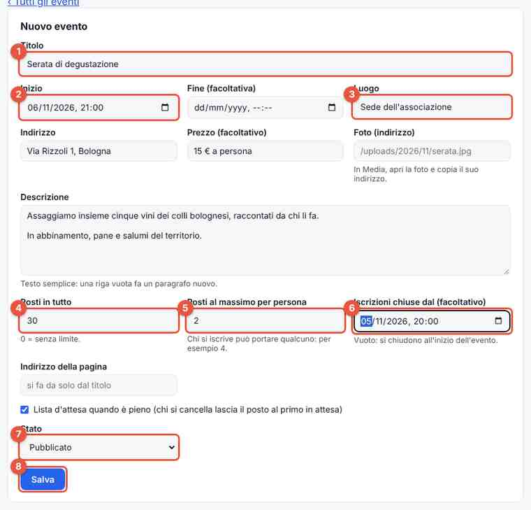

1. **Titolo**: "Serata di degustazione".
2. **Inizio**: il giorno e l'ora (21:00). **Fine** è facoltativa.
3. **Luogo**: "Sede dell'associazione"; accanto **Indirizzo** ("Via Rizzoli 1, Bologna"), **Prezzo** ("15 € a persona")
   e **Foto**: in Media apri la foto, copia il suo indirizzo e incollalo qui. **Descrizione**: testo semplice, una riga
   vuota fa un paragrafo nuovo.
4. **Posti in tutto**: 30 (0 = senza limite).
5. **Posti al massimo per persona**: 2.
6. **Iscrizioni chiuse dal**: il giovedì alle 20:00. Vuoto: si chiudono all'inizio dell'evento. Sotto lascia spuntata
   **Lista d'attesa quando è pieno**; l'**Indirizzo della pagina** si fa da solo dal titolo.
7. **Stato**: **Pubblicato**. Una **Bozza** sul sito non si vede; **Annullato** lo dice nella pagina e chiude le
   iscrizioni.
8. Premi **Salva**.

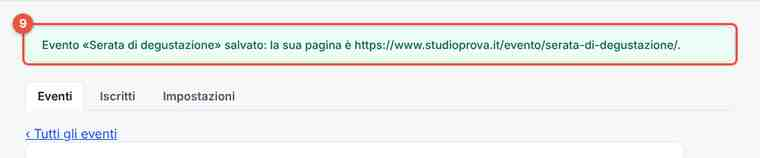

9. Il messaggio verde dice l'indirizzo della pagina dell'evento: `/evento/serata-di-degustazione/`.

### Sul sito

Per mostrare gli eventi in una pagina usa i widget del gruppo **Dal sito**:

- **Eventi con iscrizione**: l'elenco dei prossimi eventi, con i posti rimasti e il link **Iscriviti**;
- **Iscrizione all'evento**: il riquadro di un evento solo, con il modulo. In **Evento** scegli quale (vuoto: il
  prossimo).

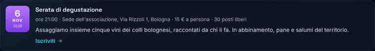

La pagina dell'evento ha data, luogo, prezzo, i posti che restano e il modulo:

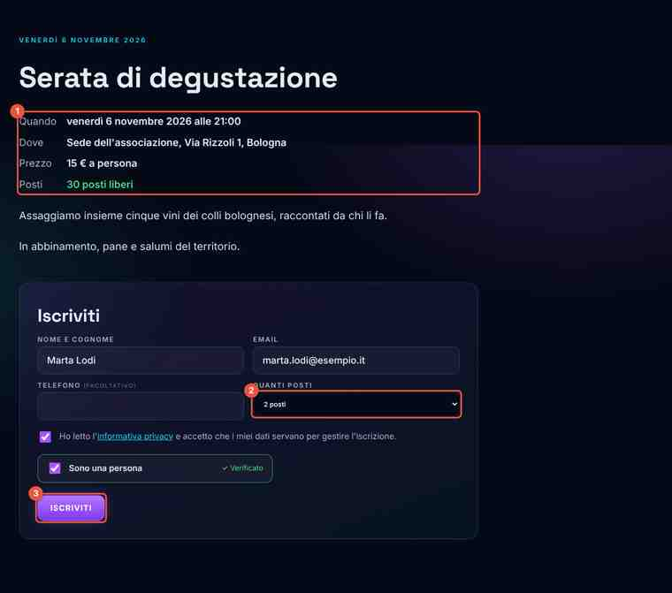

1. Il riquadro con **Quando**, **Dove**, **Prezzo** e **Posti**: "30 posti liberi", "Ultimo posto libero", oppure "Al
   completo" con la lista d'attesa.
2. **Quanti posti**: fino al massimo per persona.
3. Con nome, email, privacy e **Sono una persona**, si preme **Iscriviti**.

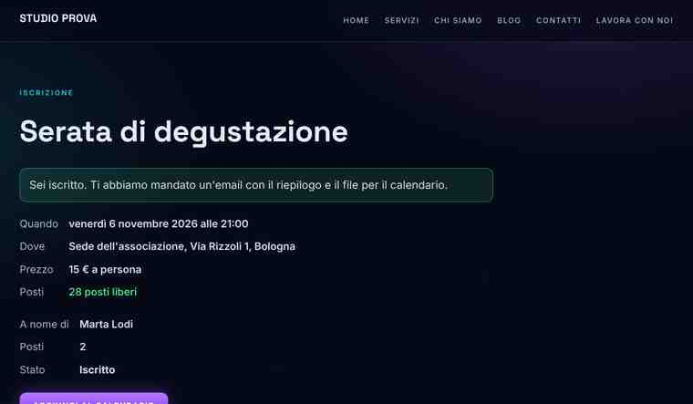

Chi si iscrive vede "Sei iscritto" e riceve l'email **Iscrizione confermata**, con il riepilogo, il link **Aggiungi al
calendario** e il pulsante per la sua pagina, da cui può cancellarsi (il suo posto va al primo in lista d'attesa). Se
l'evento è pieno riceve **Sei in lista d'attesa**, con il suo numero in fila; se si libera un posto, **Si è liberato un
posto: sei iscritto**. Il giorno prima, il promemoria.

Se qualcuno chiede più posti di quelli rimasti, il sito gli dice quanti ne restano. La stessa email non si iscrive due
volte allo stesso evento. Google legge da solo data, luogo e organizzatore dalla pagina dell'evento.

### Gli iscritti nel pannello

Apri **Eventi > Iscritti** e scegli l'evento nella tendina **Evento**.

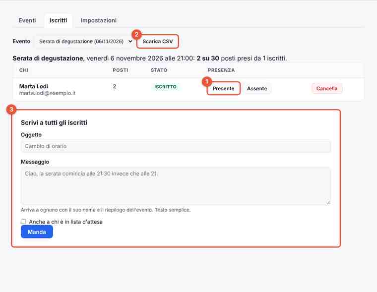

In alto: quanti posti sono presi ("2 su 30 posti presi da 1 iscritti"). Per ogni iscritto: posti, stato (Iscritto, In
lista d'attesa con il numero, Cancellato).

1. **Presente** e **Assente**: la sera dell'evento, per segnare chi è venuto. **Cancella** toglie un'iscrizione (alla
   persona arriva l'email, e chi aspetta entra).
2. **Scarica CSV**: l'elenco, da aprire con Excel.
3. **Scrivi a tutti gli iscritti**: **Oggetto** e **Messaggio** (testo semplice), poi **Manda**. Ognuno lo riceve con il
   suo nome e il riepilogo dell'evento. Spunta **Anche a chi è in lista d'attesa** se serve.

Se aumenti i **Posti in tutto** di un evento pieno, i primi in attesa entrano da soli e ricevono l'email: il messaggio
verde dice quanti. Un evento con iscritti non si elimina: mettilo **Annullato** e scrivi agli iscritti.

**Cosa non c'è ancora (beta).** Il pagamento dei posti online: il prezzo si scrive, si paga come sempre (all'ingresso,
con un bonifico). Non ci sono biglietti con il codice QR, eventi che si ripetono (ogni data è un evento a sé) né domande
in più nel modulo. Gli inviti a lasciare una recensione dopo un evento non partono da soli (capitolo 35).

**Checklist**

- [ ] L'addon è acceso e la posta del sito funziona.
- [ ] Impostazioni: email degli avvisi, promemoria.
- [ ] L'evento ha data e ora giuste, luogo e indirizzo, posti in tutto e per persona, chiusura, lista d'attesa, ed è
  **Pubblicato**.
- [ ] La pagina dell'evento si apre e dice i posti giusti.
- [ ] Il widget **Eventi con iscrizione** è in una pagina del menu.
- [ ] Mi sono iscritto con la mia email: la conferma è arrivata; mi sono cancellato e il posto è tornato.
- [ ] La sera dell'evento: **Iscritti**, **Presente** e **Assente**.

---

## 35. Raccolta recensioni

**A cosa serve.** Qualche giorno dopo il servizio i clienti ricevono un'email "Com'è andata?" con cinque stelle da
cliccare. Si apre una pagina del tuo sito dove lasciano le stelle e due righe. Le recensioni arrivano nel pannello: tu
le **approvi** o le rifiuti, puoi **rispondere**, e quelle approvate escono sul sito con il widget **Recensioni dal
sito**. A chi è contento (per esempio 4 o 5 stelle) il sito propone anche di lasciarla su Google.

Ogni link è personale, vale per una recensione sola e scade (30 giorni, si cambia). In fondo a ogni email c'è **Non
scrivermi più**: chi lo preme non riceve più inviti.

**Esempio.** Il centro estetico "Rosa" a Bologna vuole chiedere una recensione a due clienti affezionate, Giulia e
Paola, dopo un trattamento viso, e proporre Google a chi dà almeno 4 stelle.

Accendi l'addon (capitolo 32): nel menu compare **Recensioni**, con **Da approvare e approvate**, **Inviti** e
**Impostazioni**.

### Le impostazioni

Apri **Recensioni > Impostazioni**.

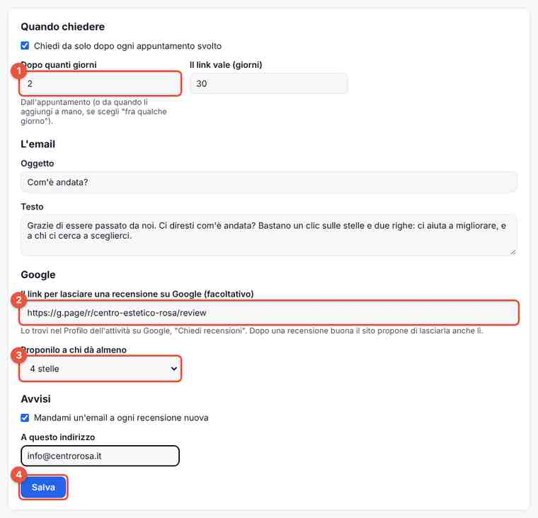

In cima, **Chiedi da solo dopo ogni appuntamento svolto**: con l'addon Prenotazioni acceso, ogni appuntamento svolto
prepara un invito (non per chi non si è presentato o ha annullato). Se Prenotazioni è spento, accanto c'è scritto.

1. **Dopo quanti giorni**: 2, dall'appuntamento. Accanto, **Il link vale (giorni)**: 30. Più sotto, **Oggetto** e
   **Testo** dell'email: c'è già un testo, riscrivilo con le tue parole.
2. **Il link per lasciare una recensione su Google**: lo trovi nel Profilo dell'attività su Google, "Chiedi
   recensioni". Comincia con `https://`.
3. **Proponilo a chi dà almeno**: 4 stelle. Sotto, **Mandami un'email a ogni recensione nuova** e **A questo
   indirizzo**.
4. Premi **Salva**.

### Chiedere a mano a dei clienti

Apri **Recensioni > Inviti**.

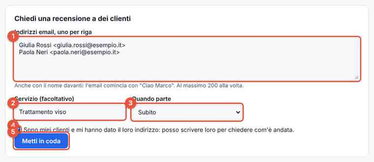

1. **Indirizzi email, uno per riga**. Puoi scrivere anche il nome: `Giulia Rossi <giulia.rossi@esempio.it>`, e l'email
   comincerà con "Ciao Giulia". Al massimo 200 alla volta.
2. **Servizio (facoltativo)**: "Trattamento viso". L'email chiede "Com'è andato Trattamento viso?".
3. **Quando parte**: **Subito** oppure **Fra 2 giorni**.
4. Spunta **Sono miei clienti e mi hanno dato il loro indirizzo**: si può scrivere solo a loro.
5. Premi **Metti in coda**. Il messaggio dice quanti inviti sono in coda e quali indirizzi sono stati saltati
   (sbagliati, già invitati, o persone che hanno chiesto di non ricevere queste email).

Gli inviti partono al prossimo giro del cron (ogni 5 minuti). Per mandarli subito:

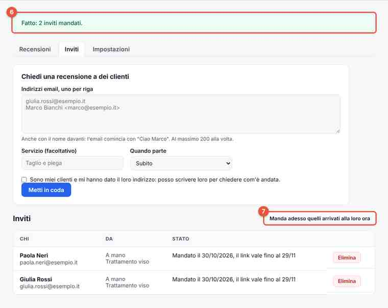

6. Il messaggio verde: "Fatto: 2 inviti mandati".
7. Il pulsante **Manda adesso quelli arrivati alla loro ora**, sopra l'elenco degli inviti.

L'elenco dice per ognuno: In coda (e quando parte), Mandato (e fino a quando vale il link), Recensione lasciata,
Annullato. Un invito in coda si può **Annullare**; uno non usato si può **Eliminare**.

### Cosa vede la cliente

L'email "Com'è andata?" ha cinque stelle: un clic su una stella apre la pagina del sito con quel voto già scelto.

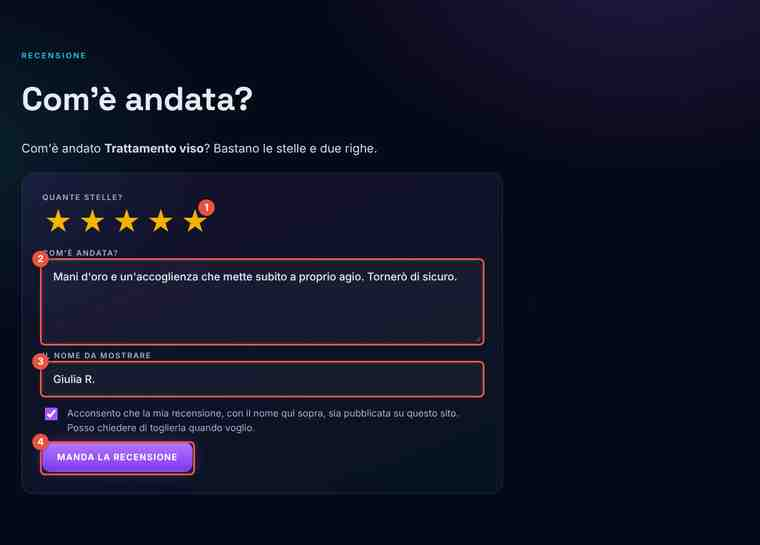

1. Le stelle, già scelte (si possono cambiare).
2. **Com'è andata?**: due righe.
3. **Il nome da mostrare**: il sito propone "Giulia R." (nome e iniziale). Sotto, il consenso alla pubblicazione.
4. **Manda la recensione**.

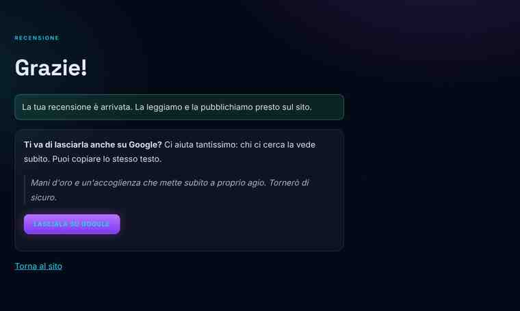

Con almeno 4 stelle, dopo il grazie compare "Ti va di lasciarla anche su Google?", con il suo testo da copiare e il
pulsante **Lasciala su Google**. Lo stesso link usato una seconda volta dice "Grazie, l'hai già lasciata"; un link
scaduto dice che è scaduto.

### Approvare, rispondere, rifiutare

Apri **Recensioni > Da approvare e approvate**. La linguetta dice quante aspettano; sotto ci sono **Da approvare**,
**Approvate**, **Rifiutate** e **Tutte**.

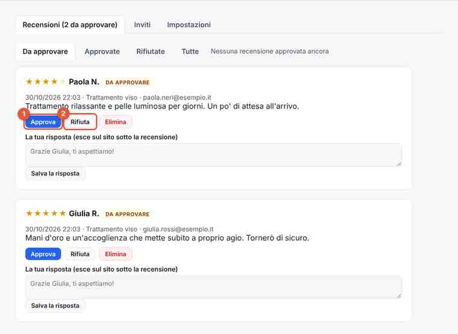

1. **Approva**: la recensione esce sul sito.
2. **Rifiuta**: non esce. **Elimina** la cancella (per esempio se chi l'ha scritta chiede di toglierla).

Sotto ogni recensione, **La tua risposta**: scrivila e premi **Salva la risposta**. Sul sito esce sotto la recensione,
con il nome del sito.

### Sul sito: il widget Recensioni dal sito

Nell'editor, gruppo **Marketing**, aggiungi **Recensioni dal sito** in una pagina (per esempio "Dicono di noi"). Il voto
medio con le stelle, le schede con stelle, testo, nome e mese, e sotto la tua risposta. Puoi scegliere quante mostrarne,
solo quelle da 4 stelle in su, le colonne, e il pulsante per Google.

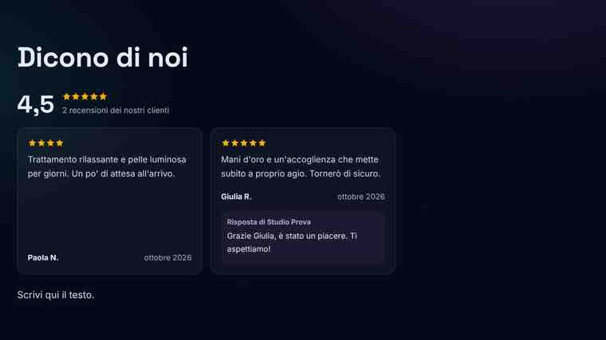

Le stelle non vanno nei dati per Google: Google non le mostra per le recensioni che un'attività raccoglie sul proprio
sito. (Il widget **Recensioni** del capitolo 8, scritto a mano, resta: questo è quello che si riempie da solo.)

**Cosa non c'è ancora (beta).** Gli inviti partono da soli solo dopo le prenotazioni (capitolo 33), non dopo gli eventi
(capitolo 34) o gli ordini della vetrina (capitolo 36): per quelli si usano gli **Inviti** a mano. Non si possono
allegare foto alle recensioni, né importare quelle di Google.

**Checklist**

- [ ] L'addon è acceso e la posta del sito funziona.
- [ ] Impostazioni: giorni, validità, testo dell'email, link di Google (https), avvisi.
- [ ] Con Prenotazioni acceso: **Chiedi da solo dopo ogni appuntamento svolto** è spuntata.
- [ ] Ho mandato un invito alla mia email: è arrivato, le stelle aprono la pagina.
- [ ] La recensione di prova è arrivata nel pannello; l'ho approvata e ho risposto.
- [ ] Il widget **Recensioni dal sito** è in una pagina pubblicata.

---

## 36. Vetrina prodotti

**A cosa serve.** Un piccolo negozio dentro il sito. I clienti guardano i prodotti, li mettono nel carrello e ti mandano
una **richiesta d'ordine**, con un numero. Tu la ricevi nel pannello e per email. Il cliente paga come preferisci tu:
bonifico, alla consegna o al ritiro, oppure con il tuo link di PayPal o di Stripe.

Il sito **non incassa da solo**: quando vedi il pagamento arrivato, segni l'ordine come **Pagato**. Così non servono
contratti con servizi di pagamento né chiavi segrete nel sito. I prezzi e i totali li calcola sempre il server: un
cliente non può cambiarli.

**Esempio.** Anna ha una bottega di ceramiche a Bologna, "Bottega Rossi". Vende tazze e grembiuli: spedizione a 7 €,
gratis sopra i 60 €, oppure ritiro in bottega. I clienti pagano con il bonifico o con PayPal.

Accendi l'addon (capitolo 32): nel menu, dopo **Media**, compare **Vetrina** con **Ordini**, **Prodotti**,
**Categorie** e **Impostazioni del negozio**.

### Le impostazioni del negozio

Apri **Vetrina > Impostazioni del negozio**.

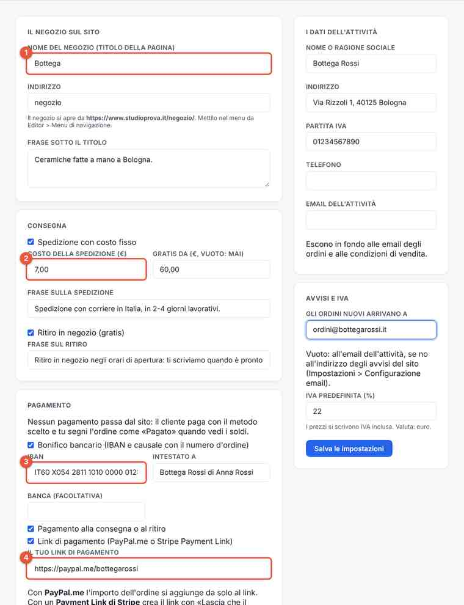

1. **Il negozio sul sito**: il **Nome del negozio** ("Bottega") è il titolo della pagina; l'**Indirizzo** resta
   `negozio`, e il negozio si apre da `www.tuosito.it/negozio/`. Sotto, la **Frase sotto il titolo**: "Ceramiche fatte a
   mano a Bologna."
2. **Consegna**: lascia spuntate **Spedizione con costo fisso** e **Ritiro in negozio (gratis)**. **Costo della
   spedizione**: 7,00; **Gratis da**: 60,00 (vuoto: mai). Nelle due frasi scrivi i tempi del corriere e dove e quando si
   ritira.
3. **Pagamento**, **Bonifico bancario**: l'**IBAN** (gli spazi si tolgono da soli) e **Intestato a**. Sotto, **Pagamento
   alla consegna o al ritiro**, se lo accetti.
4. **Link di pagamento (PayPal.me o Stripe Payment Link)**: spuntalo e incolla il tuo link, per esempio
   `https://paypal.me/bottegarossi`. Con PayPal.me l'importo dell'ordine si aggiunge da solo; con Stripe crea un Payment
   Link con "Lascia che il cliente scelga l'importo". Il link deve cominciare con `https://`.

Più in basso: le **Condizioni di vendita** (c'è un testo di partenza: completalo con chi vende, tempi di consegna,
recesso di 14 giorni, resi e garanzia; escono in `/negozio/condizioni/`), **I dati dell'attività** (nome, indirizzo,
partita IVA, telefono, email: escono in fondo alle email degli ordini), **Gli ordini nuovi arrivano a** e l'**IVA
predefinita**. I prezzi si scrivono IVA inclusa, in euro. Premi **Salva le impostazioni**: compare "Impostazioni del
negozio salvate". Se qualcosa non va (un IBAN sbagliato, un link senza https) la pagina lo dice in rosso e non salva.

### Le categorie

Apri **Vetrina > Categorie**. In **Nuova categoria** scrivi "Tazze" e premi **Aggiungi la categoria**; poi "Grembiuli".
Le categorie diventano i bottoni in cima al negozio; la **Posizione** decide l'ordine.

### I prodotti

Apri **Vetrina > Prodotti** e premi **+ Nuovo prodotto**. Una tazza scontata, con due foto e 3 pezzi:

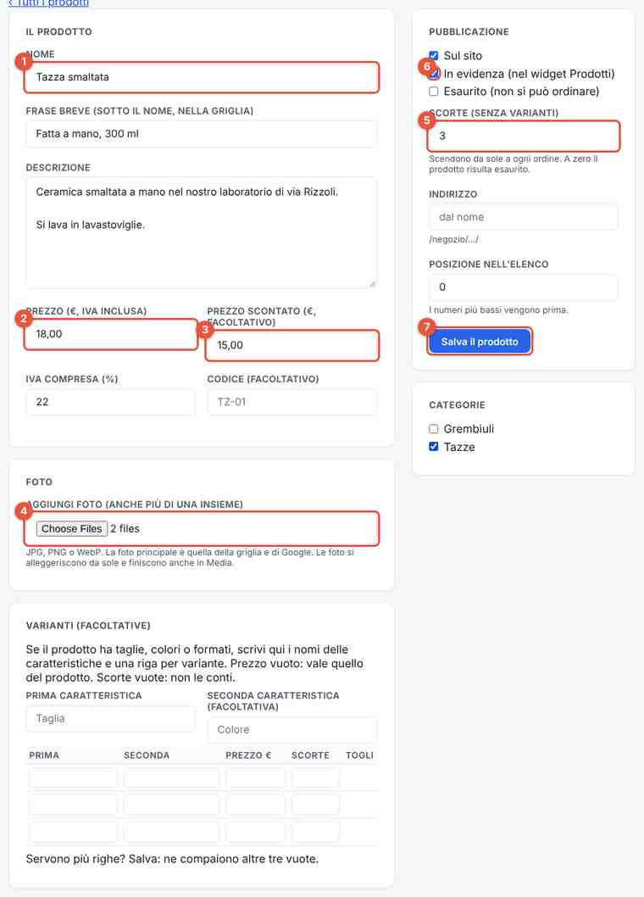

1. **Nome**: "Tazza smaltata". Sotto, la **Frase breve** ("Fatta a mano, 300 ml") e la **Descrizione**.
2. **Prezzo**: 18,00.
3. **Prezzo scontato**: 15,00. Sul sito il 18 esce barrato.
4. **Aggiungi foto**: scegli due foto insieme (JPG, PNG o WebP). Dopo il salvataggio le vedi in fila: **Principale**
   sceglie quella della griglia, **Togli** la toglie. Le foto si alleggeriscono da sole e finiscono anche in Media.
5. **Scorte**: 3. Scendono da sole a ogni ordine; a zero il prodotto risulta esaurito. Vuote: non le conti.
6. **In evidenza**: la tazza comparirà nel widget Prodotti. Sopra, **Sul sito** resta spuntato; più a destra, in
   **Categorie**, spunta "Tazze".
7. Premi **Salva il prodotto**.

Un grembiule con le taglie: nome "Grembiule da bottega", prezzo 25,00, una foto, categoria "Grembiuli". Nel riquadro
**Varianti**:

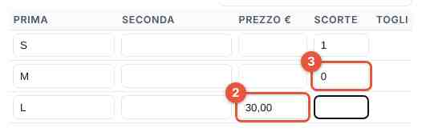

1. **Prima caratteristica**: "Taglia" (la seconda, per esempio "Colore", è facoltativa). Poi una riga per variante: S
   con scorte 1, M con scorte 0, L.
2. Il **prezzo** di una variante: la L costa 30,00. Vuoto vale il prezzo del prodotto.
3. Le **scorte** di una variante: la M è a 0, quindi esaurita.

Servono più righe? Salva: ne compaiono altre tre vuote. Un prodotto finito che non conti: spunta **Esaurito**, resta
visibile ma non si ordina. Per toglierlo dal sito senza cancellarlo, togli **Sul sito**.

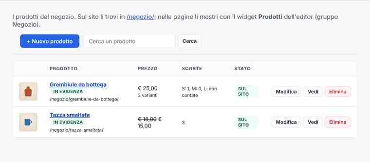

### Il negozio, come lo vede un cliente

`www.tuosito.it/negozio/`: il titolo, la frase, il pulsante **Carrello**, le categorie e la tendina **Ordina**.

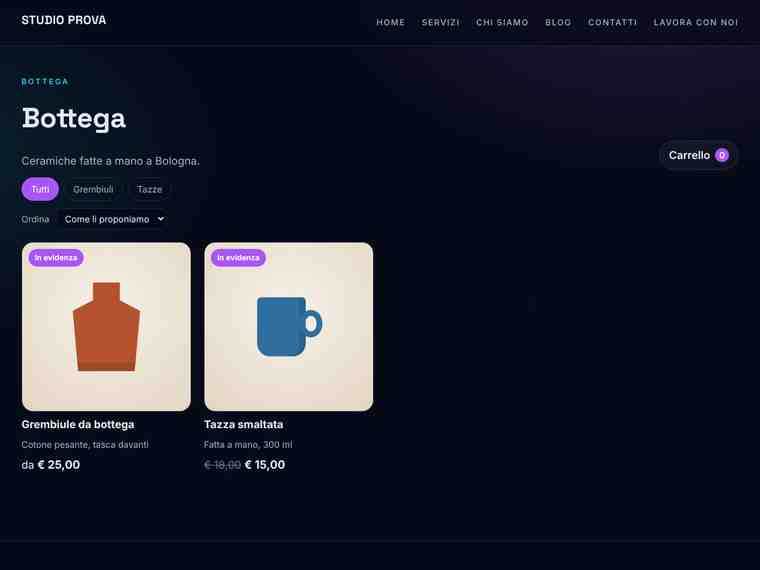

Un clic su un prodotto apre la sua pagina:

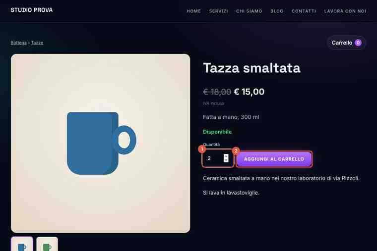

1. Foto, prezzo, disponibilità, la variante (se c'è) e la **quantità**.
2. **Aggiungi al carrello**.

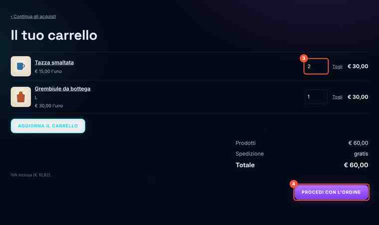

3. Nel carrello si cambiano le quantità (poi **Aggiorna il carrello**) o si toglie un prodotto (**Togli**). Il totale
   comprende la spedizione: qui è gratis, perché si arriva a 60 €.
4. **Procedi con l'ordine**.

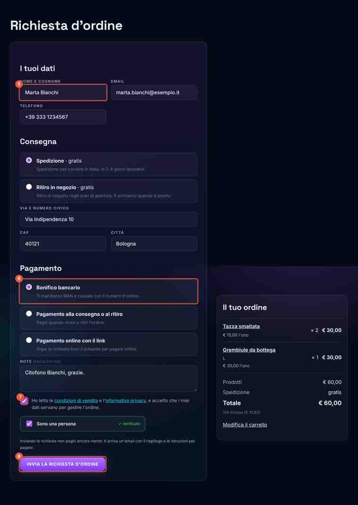

5. I dati del cliente; con **Spedizione** anche l'indirizzo (con **Ritiro in negozio** l'indirizzo sparisce e il totale
   cambia).
6. Il **pagamento**: Bonifico, alla consegna o al ritiro, oppure il link.
7. La spunta su condizioni di vendita e privacy, poi **Sono una persona**.
8. **Invia la richiesta d'ordine**.

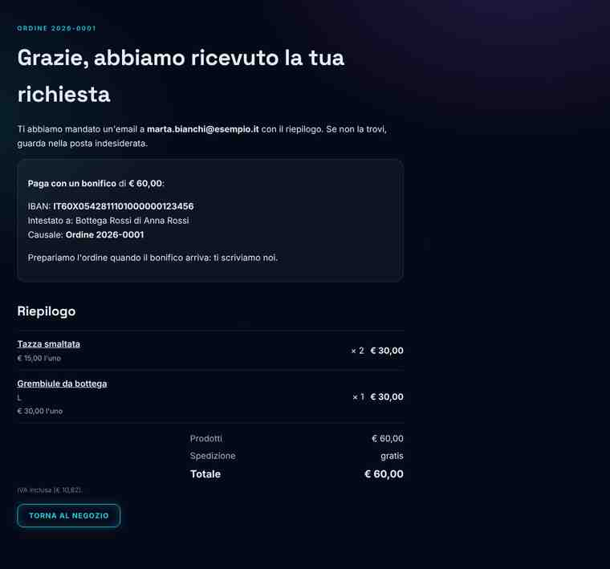

La pagina "Grazie, abbiamo ricevuto la tua richiesta" dà il numero (per esempio `2026-0001`) e come pagare: IBAN e
causale "Ordine 2026-0001", oppure il pulsante che apre PayPal con l'importo giusto. Il cliente riceve subito un'email con
il riepilogo e le istruzioni; tu ricevi l'avviso con i suoi dati (se rispondi all'avviso, la risposta va al cliente).

Il carrello non chiede di registrarsi. Il sito lo ricorda per 30 giorni con un cookie tecnico, solo da quando si
aggiunge un prodotto.

### Gestire gli ordini

Apri **Vetrina > Ordini**: in alto i filtri per stato con il numero di ordini (**Nuovo (1)**), poi la ricerca per nome,
email o numero. In Dashboard, nel riquadro **Richieste e form**, c'è anche il numero degli **ordini nuovi**.

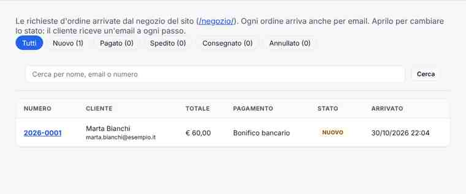

Un clic sul numero apre l'ordine: a sinistra prodotti, totali, cliente, indirizzo, pagamento e note; a destra **Cambia lo
stato**.

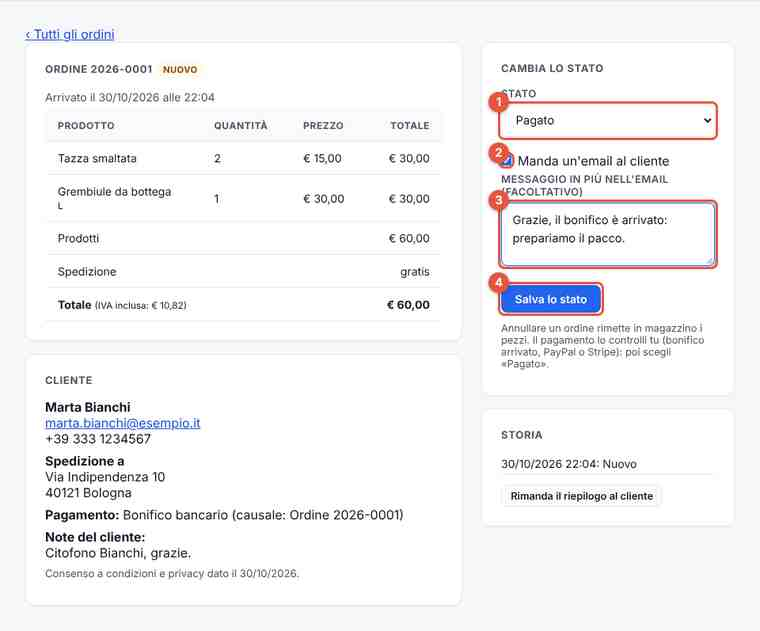

1. **Stato**: scegli il nuovo stato.
2. **Manda un'email al cliente**: lasciala spuntata.
3. **Messaggio in più nell'email** (facoltativo): "Grazie, il bonifico è arrivato", oppure il numero di spedizione del
   corriere.
4. **Salva lo stato**.

| Stato | Quando | Cosa legge il cliente |
|---|---|---|
| Nuovo | appena arrivato | riepilogo e come pagare |
| Pagato | hai visto il bonifico o il pagamento PayPal o Stripe | che il pagamento è arrivato |
| Spedito | il pacco è partito (o è pronto per il ritiro) | che l'ordine è partito, o che può venire a ritirarlo |
| Consegnato | è arrivato | che risulta consegnato |
| Annullato | non si fa più | che l'ordine è annullato |

Annullare un ordine **rimette in magazzino** i pezzi. Sotto, nella **Storia**, ogni cambio con data e ora; **Rimanda il
riepilogo al cliente** rimanda la prima email.

### I widget nell'editor

Gruppo **Negozio**: **Prodotti** (una griglia: in evidenza, di una categoria, gli ultimi arrivati o in offerta, quanti e
in quante colonne) e **Carrello** (l'icona con il numero di pezzi: mettila nell'header, in Editor > Header e footer). Per
il menu, aggiungi un link a `/negozio/` (capitolo 17).

**Cosa non c'è ancora (beta).** Il **pagamento con carta automatico**: il sito non incassa e non riceve la conferma da
PayPal o Stripe, il pagamento lo controlli tu e segni **Pagato**. Non ci sono ancora codici sconto, fatture, costi di
spedizione per peso o per zona, spedizioni fuori dall'Italia, account dei clienti con lo storico degli ordini (il
cliente ha il link del suo ordine nell'email). I prodotti non compaiono nella ricerca del sito.

**Checklist**

- [ ] La Vetrina è accesa e la posta del sito funziona: un ordine di prova ha portato le due email.
- [ ] Consegna, almeno un metodo di pagamento, IBAN o link controllati, indirizzo degli avvisi.
- [ ] Condizioni di vendita complete (recesso di 14 giorni, resi, tempi) e dati dell'attività con la partita IVA.
- [ ] Nella pagina Privacy un paragrafo sugli ordini: quali dati chiedi e perché.
- [ ] Ogni prodotto ha prezzo, almeno una foto, una categoria e le scorte (o vuote se non le conti).
- [ ] Il negozio è nel menu; il widget **Carrello** nell'header, se vuoi.
- [ ] Ho fatto un ordine di prova dal telefono e poi l'ho annullato (le scorte sono tornate).
- [ ] A ogni pagamento ricevuto: **Pagato**; a ogni spedizione: **Spedito**, con il numero del corriere.

---

## 37. Statistiche delle visite

**A cosa serve.** Sapere quante persone visitano il sito, quali pagine leggono, da dove arrivano (Google, Facebook, una
newsletter) e se usano il telefono o il computer. Le conta il sito stesso: **niente cookie, niente servizi esterni,
nessun indirizzo IP salvato**. Per questo non serve il banner dei cookie.

**Esempio.** Anna, di "Bottega Rossi", ha mandato la newsletter d'autunno con un link al sito e ha pubblicato un post su
Facebook. Vuole sapere quante persone sono arrivate da ognuno, e quali pagine guardano.

Accendi l'addon (capitolo 32): nel menu, subito sotto **Dashboard**, compare **Statistiche** con **Visite** e
**Impostazioni e privacy**. Da quel momento il sito conta: le visite di prima non ci sono.

**Tu non conti.** Le pagine che apri mentre sei entrato nel pannello (con lo stesso browser) non si contano, e nemmeno i
robot dei motori di ricerca, le anteprime dei link (WhatsApp, Facebook...) e le pagine che non esistono. Per veder
crescere i numeri, apri il sito dal telefono o da una finestra in incognito.

### Leggere le statistiche

Apri **Statistiche > Visite**.

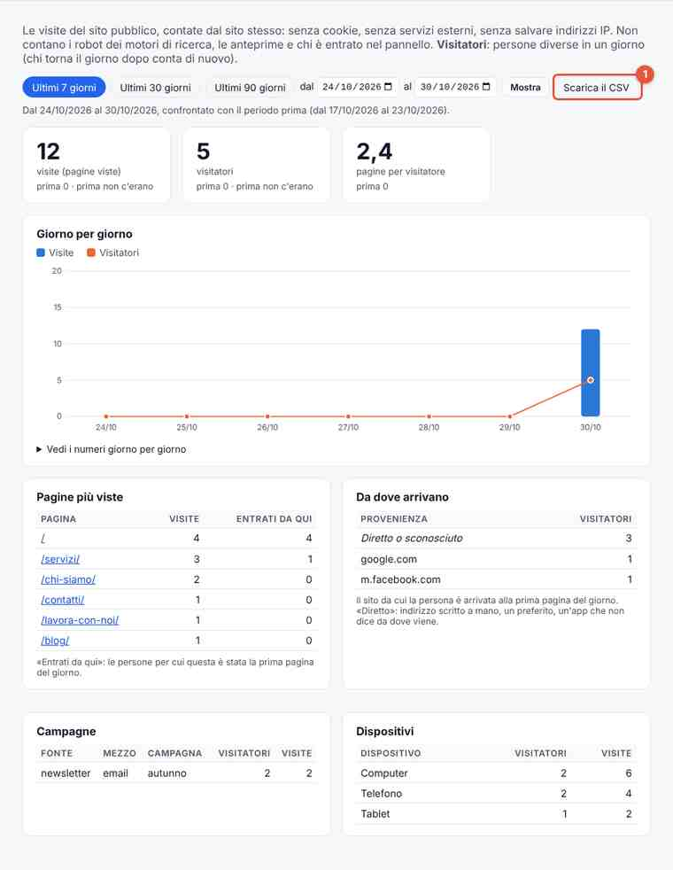

In alto il periodo: **Ultimi 7 giorni**, **Ultimi 30 giorni**, **Ultimi 90 giorni**, oppure le date in **dal** e **al**
con **Mostra**. Sotto, il periodo scelto e quello prima, con cui si confronta. Poi:

- **i tre numeri**: **visite** (le pagine aperte), **visitatori** (persone diverse, giorno per giorno: chi torna il
  giorno dopo conta di nuovo) e **pagine per visitatore**, ognuno con il numero del periodo prima;
- **Giorno per giorno**: le barre sono le visite, la linea i visitatori; **Vedi i numeri giorno per giorno** apre la
  tabella;
- **Pagine più viste**, con **Entrati da qui**: per quante persone quella è stata la prima pagina del giorno;
- **Da dove arrivano**: il sito da cui la persona è arrivata (google.com, m.facebook.com...). **Diretto o sconosciuto**:
  indirizzo scritto a mano, un preferito, un'app che non lo dice (WhatsApp, molte app di posta);
- **Campagne**: le visite arrivate da link con le etichette utm (qui sotto);
- **Dispositivi**: computer, telefono, tablet.

1. **Scarica il CSV** salva tutti i numeri del periodo in un file che si apre con Excel.

In **Dashboard**, nel riquadro **Richieste e form**, ci sono anche **visite oggi** e **visite, 7 giorni**.

### Quanto rende una newsletter o un post: i link con le etichette utm

Per riconoscere chi arriva dalla newsletter, aggiungi al link tre etichette:

`https://www.bottegarossi.it/?utm_source=newsletter&utm_medium=email&utm_campaign=autunno`

- `utm_source`: da dove (newsletter, facebook, instagram, volantino);
- `utm_medium`: il mezzo (email, social, qr);
- `utm_campaign`: il nome della campagna (autunno, natale-2026).

Nel riquadro **Campagne** compare la riga "newsletter, email, autunno" con le persone arrivate. Usa lettere, numeri e
trattini, senza spazi. Per un volantino con il codice QR: `utm_source=volantino&utm_medium=qr`.

### Impostazioni e privacy

Apri **Statistiche > Impostazioni e privacy**.

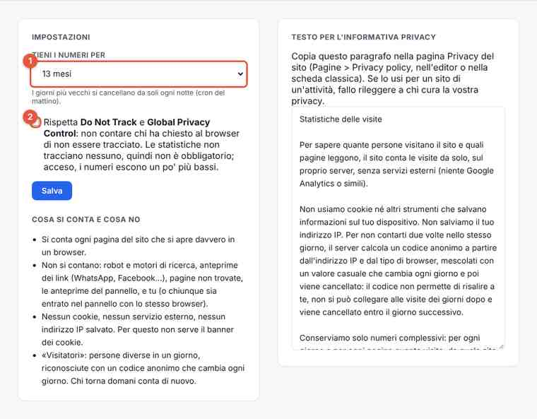

1. **Tieni i numeri per**: 3 mesi, 6 mesi, 13 mesi (va bene quasi sempre: confronti un anno con l'altro), 2 anni o 5
   anni. Ogni notte i giorni più vecchi si cancellano da soli.
2. **Rispetta Do Not Track e Global Privacy Control**: chi ha chiesto al browser di non essere tracciato non si conta.
   Non è obbligatorio (le statistiche non tracciano nessuno); acceso, i numeri escono un po' più bassi. Premi **Salva**.

A destra, il **Testo per l'informativa privacy**: un paragrafo già scritto che spiega cosa si conta e cosa no. Un clic
sul riquadro lo copia: incollalo nella pagina Privacy del sito. Se cambi le impostazioni, il testo cambia: copialo di
nuovo. Se il sito è di un'attività, fallo rileggere a chi cura la vostra privacy.

**Cosa non c'è.** Il paese e la città di chi visita (servirebbe un servizio esterno, per scelta no). Due persone dietro
la stessa rete (un ufficio) con lo stesso browser contano come una. Se il sito sta dietro una cache (una CDN), le pagine
servite dalla cache non si contano.

**Come fa a contare le persone senza cookie?** Per ogni visita il sito calcola un codice anonimo dall'indirizzo di rete
e dal browser, mescolati con un valore casuale che cambia ogni giorno e poi si cancella. Il codice serve solo a non
contare due volte la stessa persona nello stesso giorno: non si può risalire a chi è, e il giorno dopo è un altro.

**Checklist**

- [ ] Le Statistiche sono accese e nel menu c'è **Statistiche**.
- [ ] Ho aperto il sito dal telefono (fuori dal pannello) e la visita c'è.
- [ ] Ho scelto per quanto tenere i numeri, e se rispettare Do Not Track.
- [ ] Il testo per l'informativa è nella pagina Privacy del sito.
- [ ] I link di newsletter, social e volantini hanno le etichette utm.

---

## 38. Area riservata (membri)

**A cosa serve.** I visitatori del sito si creano un account: si iscrivono con la loro email, entrano con una password e
trovano pagine, articoli e file che gli altri non vedono. Sono **membri del sito**, non utenti del pannello: non possono
mai entrare nel pannello né cambiare il sito.

**Esempio.** Lo studio di yoga "Yoga Ponte" a Bologna vuole dare ai suoi soci una pagina "Sequenze da fare a casa" e il
"Calendario delle lezioni 2027" in PDF. Chi non è socio vede solo il titolo e l'invito a iscriversi.

Accendi l'addon (capitolo 32): nel menu, dopo **Utenti**, compare **Membri**, con **Elenco dei membri**, **Contenuti e
file riservati** e **Impostazioni**. Il sito ha da subito quattro indirizzi nuovi (al posto di `www.tuosito.it` metti il
tuo):

| Indirizzo | A cosa serve |
|---|---|
| `www.tuosito.it/accedi/` | entrare con email e password |
| `www.tuosito.it/iscriviti/` | crearsi un account (non c'è con "Solo su invito") |
| `www.tuosito.it/area-riservata/` | la pagina del membro: contenuti, file, profilo |
| `www.tuosito.it/password-dimenticata/` | scegliere una password nuova |

Se una tua pagina ha già uno di questi indirizzi, con l'addon acceso vince la pagina dell'area riservata.

### Chi può iscriversi

Apri **Membri > Impostazioni**.

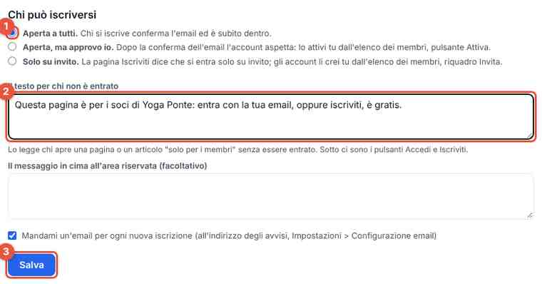

1. **Chi può iscriversi**: **Aperta a tutti** (chi si iscrive conferma l'email ed è subito dentro), **Aperta, ma approvo
   io** (dopo la conferma l'account aspetta che tu lo attivi) oppure **Solo su invito** (gli account li crei tu).
2. **Il testo per chi non è entrato**: la frase che legge chi apre una pagina riservata senza essere entrato. Per Yoga
   Ponte: "Questa pagina è per i soci di Yoga Ponte: entra con la tua email, oppure iscriviti, è gratis." Sotto, **Il
   messaggio in cima all'area riservata** (facoltativo) e **Mandami un'email per ogni nuova iscrizione**.
3. Premi **Salva**.

### Pagine, articoli e file solo per i membri

Prepara prima quello che vuoi riservare: la pagina "Sequenze da fare a casa" (scritta e pubblicata come le altre) e il
PDF del calendario, caricato in **Download** con la spunta **Riservato** (capitolo 22). Poi apri **Membri > Contenuti e
file riservati**.

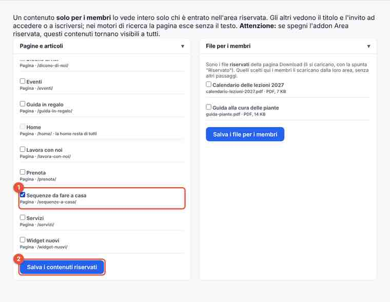

1. Nel riquadro **Pagine e articoli** spunta "Sequenze da fare a casa". La home non si può riservare.
2. Premi **Salva i contenuti riservati**.

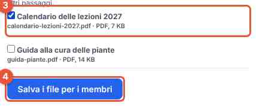

3. Nel riquadro **File per i membri** spunta il calendario (ci sono solo i file riservati di Download).
4. Premi **Salva i file per i membri**.

Chi non è entrato, aprendo la pagina, vede il titolo, la tua frase e i pulsanti **Accedi** e **Iscriviti**. Il testo no,
e nemmeno i motori di ricerca lo leggono.

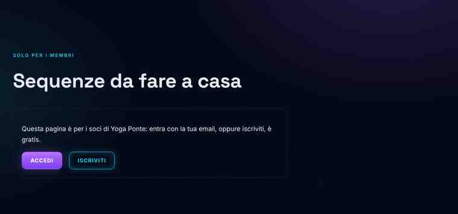

Chi preme Accedi e scrive email e password torna proprio a quella pagina, aperta.

> Se spegni l'addon, le pagine e gli articoli riservati tornano visibili a tutti.

### Mettere "Accedi" sul sito

Il modo più semplice è il widget **Accesso membri** (gruppo **Dal sito**), in una pagina o nell'header (Editor > Header
e footer). Qui è in una pagina "Area soci":

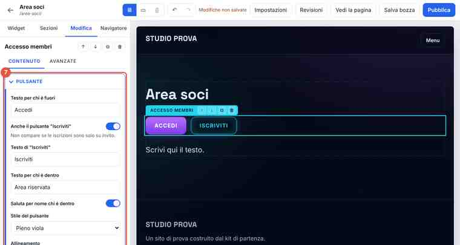

7. Nel pannello **Modifica** scegli i testi (**Testo per chi è fuori**, **Testo per chi è dentro**), se mostrare anche
   **Iscriviti**, se salutare per nome chi è dentro, lo stile del pulsante e l'allineamento. Poi **Pubblica**.

Chi è fuori vede **Accedi** (e **Iscriviti**, se le iscrizioni sono aperte); chi è dentro vede "Ciao, Chiara" e **Area
riservata**. In alternativa metti nel menu un link a `/accedi/` (capitolo 17).

### Come si iscrive un visitatore

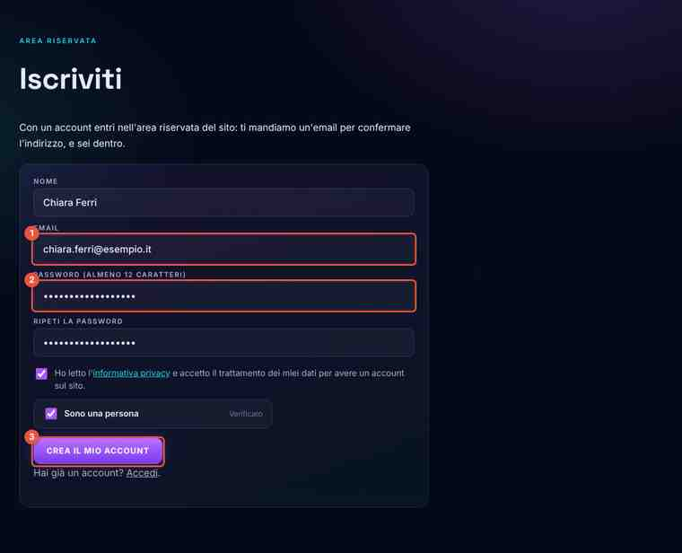

1. In `/iscriviti/` scrive nome ed **email**.
2. Sceglie una **password** di almeno 12 caratteri e la ripete; spunta la privacy e **Sono una persona**.
3. Preme **Crea il mio account**.

Compare "Controlla la tua email". Arriva l'email **Conferma la tua iscrizione**: preme il pulsante, poi **Confermo
l'iscrizione**, ed è dentro.

Nella sua area trova **Da leggere** (i contenuti riservati), **File da scaricare**, **Il mio profilo** ed **Esci**. Dal
profilo cambia il nome, l'email (conferma dal link che arriva al nuovo indirizzo), la password, oppure **Cancella il mio
account** (sparisce tutto). Se dimentica la password, **Password dimenticata?** nella pagina Accedi gli manda un link
valido 60 minuti.

Con **Aperta, ma approvo io**, dopo la conferma legge che l'iscrizione aspetta la tua approvazione, e a te arriva
l'email **Nuova iscrizione da approvare**.

### Gestire i membri

Apri **Membri > Elenco dei membri**: i filtri per stato (Attivi, In attesa, Sospesi...), la ricerca per nome o email, e
per ogni membro i pulsanti.

| Pulsante | Cosa fa |
|---|---|
| **Attiva** | attiva un account in attesa o sospeso; al membro arriva l'email "Il tuo account è attivo" |
| **Sospendi** | il membro non entra più, e se era dentro esce subito; i suoi dati restano |
| **Elimina** | cancella il membro e tutti i suoi dati (anche l'avanzamento nei corsi). Non si torna indietro |
| **Rimanda l'invito** | per chi è stato invitato e non ha ancora scelto la password |

**Invita una persona**: scrivi nome ed email e premi **Invita**. Le arriva un'email con il pulsante per scegliere la
password (vale 7 giorni): scelta la password, è dentro. Funziona con ogni tipo di iscrizione.

**Esporta**: **Scarica l'elenco (CSV)**, da aprire con Excel. Sono dati personali: tienili al sicuro. Il numero dei **Membri attivi** è anche in Dashboard, nel riquadro **Richieste e form**.

**Cosa non c'è ancora (beta).** Non si riserva un contenuto dalla sua scheda: si fa da **Contenuti e file riservati**.
Il titolo e il riassunto di un contenuto riservato restano visibili nella ricerca del sito, come nella pagina chiusa. Non
ci sono livelli diversi di membri (tutti vedono gli stessi contenuti riservati) né abbonamenti a pagamento.

**Checklist**

- [ ] La posta del sito funziona (capitolo 25): ai membri arrivano le email di conferma.
- [ ] L'addon è acceso e nel menu c'è **Membri**.
- [ ] Ho scelto chi può iscriversi e scritto il testo per chi non è entrato.
- [ ] Contenuti e file riservati sono spuntati e salvati; da una finestra in incognito vedo solo il titolo.
- [ ] Sul sito c'è un modo per arrivare ad Accedi (widget **Accesso membri** o voce di menu).
- [ ] Mi sono iscritto con un'email di prova: la conferma arriva, e dopo sono dentro.
- [ ] L'informativa privacy parla anche degli account del sito.

---

## 39. Corsi online

**A cosa serve.** Mettere sul sito dei corsi fatti di lezioni: testo, video e materiali da scaricare. Li seguono i
**membri** dell'area riservata (capitolo 38): ognuno vede quante lezioni gli mancano, riprende da dove era e, alla fine,
riceve un **certificato** con un codice che chiunque può verificare.

**Esempio.** Luca Neri, fotografo e formatore, mette online "Fotografia per cominciare": due moduli, tre lezioni brevi, una
scheda in PDF. Sara, una sua allieva, lo segue dal telefono e alla fine scarica il certificato.

Accendi l'addon (capitolo 32). I Corsi hanno bisogno dell'Area riservata, che si accende da sola:

Nel menu, dopo **Membri**, compare **Corsi**. Sul sito l'elenco dei corsi è a `www.tuosito.it/corsi/`.

### Creare il corso

Apri **Corsi**.

1. Nel riquadro **Nuovo corso** scrivi il titolo: "Fotografia per cominciare".
2. Premi **Crea il corso**. Il corso nasce in bozza, con un primo modulo vuoto, e si apre la sua pagina.

A sinistra, **Il corso**: **Titolo**, **Indirizzo**, **Descrizione** (due o tre frasi su cosa si impara), **Immagine**
(facoltativa: l'indirizzo di un'immagine di Media) e **Chi può seguirlo**: **Tutti i membri**, oppure **Solo i membri a
cui lo assegno**.

1. **Stato**: lascia **Bozza** finché il corso non è pronto, poi **Pubblicato**, e premi **Salva il corso**.

A destra, il **Programma**: un corso è fatto di **moduli** (i capitoli) e ogni modulo di **lezioni**.

2. Cambia il nome del primo modulo ("Le basi") e premi **Salva** accanto.
3. Sotto il modulo scrivi il titolo di una lezione ("La luce") e premi **Aggiungi lezione**: si apre la scheda della
   lezione.
4. Per un altro modulo ("Pratica"): **Nome del modulo nuovo**, poi **Aggiungi modulo**.

Le frecce **↑** e **↓** spostano moduli e lezioni, un posto alla volta: i membri seguono le lezioni in quest'ordine.
**Modifica** riapre una lezione, **Elimina** la toglie.

### Scrivere una lezione

1. **Testo della lezione**: si scrive in HTML semplice, `
...
` per un paragrafo, `<h2>...</h2>` per un titolo,
   `<b>...</b>` per il grassetto, `<ul><li>...</li></ul>` per un elenco. Puoi incollare il testo di un articolo. Script e
   codice pericoloso si tolgono da soli al salvataggio.
2. **Video**: l'**Indirizzo di YouTube o Vimeo** (copialo dalla barra del browser mentre guardi il video), oppure
   **Carica un video** (.mp4 o .webm, fino al limite del server scritto sotto: lo vede solo chi segue il corso).
3. **Materiali da scaricare**: spunta i file. Sono i file **riservati** di Download: lì si caricano, con la spunta
   Riservato.
4. **Durata** (facoltativa): "10 minuti". In **Dove sta** scegli anche il modulo.
5. Premi **Salva la lezione**. Con **Vedi sul sito**, in alto, la guardi come la vedrà un membro.

### Chi segue il corso

Con **Tutti i membri**, ogni membro trova il corso pubblicato. Con **Solo i membri a cui lo assegno**, nel riquadro **Chi
segue il corso** scegli il membro nella tendina **Assegna il corso a**, lascia la spunta per mandargli l'email e premi
**Assegna**: riceve "Hai un corso nuovo". **Togli** glielo toglie (il suo avanzamento resta, se glielo riassegni).

Per far entrare un allievo che non è ancora membro: **Membri > Elenco dei membri > Invita una persona** (capitolo 38).

### Cosa vede l'allieva

In `/corsi/` e nella sua area riservata, sotto **I miei corsi**, le schede dei corsi con la barra dell'avanzamento.

1. Nella pagina del corso, il programma con il segno sulle lezioni fatte e il pulsante **Inizia** (poi **Riprendi da
   dove eri**).

2. In ogni lezione il video, il testo e i **Materiali** da scaricare.
3. **Segna come completata e vai avanti**. Sotto, la barra: "1 lezioni fatte su 3 (33%)".

Chi non è entrato vede il programma (solo i titoli) e il pulsante **Accedi**.

### Il certificato

Finita l'ultima lezione: "Hai completato il corso" e il pulsante **Il tuo certificato**.

Il certificato ha il nome del membro, il corso, la data e un **codice di verifica** (per esempio `TGPE-S9FE-F4R9`). Si
stampa o si salva in PDF con **Stampa o salva in PDF**. Chi vuole controllarlo (un datore di lavoro, un cliente) apre
`www.tuosito.it/certificato/`, scrive il codice e legge "Certificato valido" con nome, corso e data.

### Seguire chi studia

Nella pagina del corso, riquadro **Chi segue il corso**: per ogni membro le lezioni fatte ("3 su 3 (100%)"), l'ultima
visita e il codice del certificato, se c'è.

Per mostrare i corsi in una pagina: nell'editor, gruppo **Dal sito**, il widget **Elenco corsi** (tutti i corsi
pubblicati, oppure solo quelli che chi guarda può seguire). Oppure un link a `/corsi/` nel menu.

**Cosa non c'è ancora (beta).** Il testo della lezione si scrive in HTML, non con l'editor visuale; lezioni e moduli si
spostano con le frecce, non trascinandoli. Non ci sono quiz né corsi a pagamento. Un video di YouTube o Vimeo lo vede
chiunque abbia il suo indirizzo su quei servizi: per un video davvero privato caricalo nel sito, o usa Vimeo con il
dominio limitato.

**Checklist**

- [ ] L'Area riservata funziona: iscrizione e accesso provati (capitolo 38).
- [ ] Il corso ha la descrizione, almeno un modulo e le lezioni nell'ordine giusto.
- [ ] Ogni lezione ha testo o video, e l'ho guardata con **Vedi sul sito**.
- [ ] I materiali sono riservati in Download e spuntati nelle lezioni.
- [ ] Il corso è **Pubblicato** e chi deve seguirlo può (tutti i membri, oppure assegnato).
- [ ] Con un membro di prova: Inizia, Segna come completata, Riprendi, certificato, verifica del codice.
- [ ] Il widget **Elenco corsi** (o un link a `/corsi/`) è in una pagina o nel menu.

---

## 40. Copia del sito altrove

**A cosa serve.** La **Copia del sito** (capitolo 29) fa uno zip di tutto il sito, ma se resta sullo stesso server,
quando il server si rompe la perdi insieme al sito. Con questo addon, **ogni notte** la copia parte da sola verso un altro
spazio: un altro hosting via FTP, un Nextcloud, uno spazio cloud con WebDAV.

Cosa ti serve: uno spazio di destinazione con nome utente e password (un FTP, spesso lo dà anche un altro hosting,
oppure WebDAV: Nextcloud, ownCloud, Koofr, pCloud...) e il cron del sito attivo (capitolo 26): è lui che ogni notte fa
partire la copia.

**Esempio.** Mario tiene le copie del sito sul Nextcloud della sua associazione: ne vuole quattordici, una per notte.

1. Nel Nextcloud: **Impostazioni personali > Sicurezza > Crea una password per le applicazioni**, con il nome "sito".
   Copiala.
2. Nel Nextcloud: **File**, poi **Impostazioni** in basso a sinistra: copia l'indirizzo **WebDAV**, per esempio
   `https://cloud.esempio.it/remote.php/dav/files/mario/`.

Accendi l'addon (capitolo 32): in **Impostazioni**, subito sotto Copia del sito, compare **Copia altrove**. Aprila.

### La destinazione

1. **Tipo**: FTP, **FTPS (FTP cifrato)**, SFTP o **WebDAV (Nextcloud e molti spazi cloud)**. Per Mario, WebDAV. Se
   accanto a un tipo c'è "non disponibile su questo server", il server del sito non ha quello che serve (per SFTP lo
   spiega la frase sotto: manca l'estensione ssh2).
2. **Indirizzo WebDAV**: quello copiato dal Nextcloud, con `https://`. Per FTP, FTPS e SFTP ci sono invece **Server**
   (per esempio `ftp.miobackup.it`, senza `ftp://` davanti) e **Porta** (21 per FTP e FTPS, 22 per SFTP).
3. **Nome utente** e, sotto, **Password**: per il Nextcloud, la password per le applicazioni.
4. **Cartella sulla destinazione**: "copie-sito". Se non c'è, si crea. Meglio una cartella solo per le copie.
5. **Quante copie tenere sulla destinazione**: 14. Le più vecchie si cancellano da sole; gli altri file della cartella
   mai.
6. Spunta **Manda una copia ogni notte**. **Tieni la copia anche su questo server** la lascia anche in Copia del sito.
7. Premi **Salva la destinazione**. Compare "Destinazione salvata. Adesso premi Prova la connessione".

La password si salva **cifrata** e non si mostra più: il campo resta vuoto, con scritto "Salvata: lasciala vuota per non
cambiarla". Per cambiarla scrivi quella nuova.

### Provare e mandare la prima copia

Nel riquadro **Adesso** premi **Prova la connessione**: il sito entra, apre la cartella, scrive un file piccolo e lo
cancella.

8. "Collegamento riuscito: la cartella si apre e si può scrivere". Se non va, il messaggio dice perché (per esempio
   "Accesso rifiutato: controlla nome utente e password", o che il server non risponde su quella porta): correggi,
   salva e riprova.

Poi premi **Manda una copia adesso** e conferma. Su un sito grande ci vuole qualche minuto: non chiudere la pagina.

9. "Copia mandata", con il peso e quante copie ci sono sulla destinazione. Nel Nextcloud, nella cartella "copie-sito",
   c'è lo zip (`copia-<data>-<ora>-altrove.zip`).

Da quella notte parte da sola, quando gira il cron.

### Il registro

Nel riquadro **Registro degli invii** c'è ogni prova e ogni invio: quando, cosa (Copia della notte, Copia mandata a
mano, Prova della connessione), **Riuscito** o **Non riuscito**, e i dettagli.

Se una notte l'invio non riesce, ti arriva l'email "La copia del sito non è partita", con il motivo, all'indirizzo degli
avvisi. La copia resta comunque sul server, in Impostazioni > Copia del sito.

### Rimettere il sito da una copia

Scarica lo zip dalla destinazione e caricalo in **Impostazioni > Copia del sito > Ripristina** (capitolo 29). Dopo un
ripristino su un'installazione nuova la password della destinazione va riscritta: per sicurezza la chiave che la decifra
non sta nella copia.

**Cosa non c'è ancora (beta).** **Google Drive e Dropbox** non ci sono: non parlano WebDAV e vogliono un collegamento a
parte. Chi usa Nextcloud, ownCloud, Koofr, pCloud o un FTP è coperto. SFTP c'è, ma è provato solo dove il server ha
l'estensione ssh2. Con FTPS i dati viaggiano cifrati ma il certificato del server non si controlla: per il massimo della
sicurezza, WebDAV su https.

**Checklist**

- [ ] Il cron del sito gira ogni notte (Log cron: l'ultimo giro è di stanotte).
- [ ] **Prova la connessione** dice "Collegamento riuscito".
- [ ] **Manda una copia adesso** ha funzionato e lo zip c'è sulla destinazione.
- [ ] **Manda una copia ogni notte** è spuntato.
- [ ] L'indirizzo degli avvisi è giusto, per sapere se una notte non va.
- [ ] Domani mattina il registro ha una riga "Copia della notte", Riuscito.
- [ ] La destinazione è uno spazio mio e protetto: la copia ha tutti i dati del sito.

---

## Problemi frequenti degli addon

| Problema | Cosa fare |
|---|---|
| Nel menu non trovo la voce di un addon | L'addon è spento: **Impostazioni > Addon > Accendi** (capitolo 32) |
| Ho spento un addon: ho perso i dati? | No: si riaccende e tornano tutti (capitolo 32) |
| Il widget Prenota dice che non ci sono orari liberi | Mancano persone con gli orari, servizi con "Chi lo fa", oppure è un giorno di chiusura o di ferie (capitolo 33) |
| Un cliente ha pagato ma l'ordine dice ancora Nuovo | Il sito non vede i pagamenti: apri l'ordine e segnalo **Pagato** (capitolo 36) |
| Le statistiche restano a zero | Sei entrato nel pannello con lo stesso browser: prova dal telefono o in incognito (capitolo 37) |
| Una pagina riservata è visibile a tutti | L'Area riservata è spenta, oppure la pagina non è spuntata in **Contenuti e file riservati** (capitolo 38) |
| La copia notturna non arriva sulla destinazione | Guarda il **Registro degli invii** e il Log cron; premi **Prova la connessione** (capitolo 40) |

---

## Checklist finale: prima di dire a tutti che il sito è online

- [ ] Il tipo di sito è **Definitivo** e i **Primi passi** sono tutti verdi.
- [ ] Ho riscritto tutti i testi d'esempio: home, Chi siamo, Servizi, Contatti, footer.
- [ ] Logo, icona del sito e colori sono i miei (Stile del sito).
- [ ] Ogni pagina importante è nel menu, e il menu funziona anche al telefono.
- [ ] I form arrivano: ne ho compilato uno dal sito.
- [ ] L'email di prova è arrivata e il cron gira.
- [ ] Il sito si apre in **https** e in Sicurezza non c'è niente di rosso.
- [ ] Il secondo fattore è attivo e i codici di recupero sono al sicuro.
- [ ] Le pagine principali hanno titolo e descrizione per Google.
- [ ] La pagina della privacy c'è ed è collegata nel footer e nei form.
- [ ] Ho fatto una copia del sito e l'ho scaricata sul mio computer.
- [ ] Ho aperto il sito dal telefono, come farebbe un cliente, e ho provato a fare quello che deve fare lui.
- [ ] Gli addon accesi (capitolo 32) sono solo quelli che uso, e ognuno ha la sua checklist fatta.

## Problemi frequenti

| Problema | Cosa fare |
|---|---|
| Ho cambiato una pagina ma sul sito non si vede | Nell'editor hai premuto Salva bozza: premi **Pubblica**. Se l'hai fatto, ricarica la pagina del sito |
| Il pannello ha i colori di prima dopo un aggiornamento | Ricarica con **Cmd + Maiusc + R** (Mac) o **Ctrl + Maiusc + R** (Windows) |
| Stamattina non è arrivata l'email "Oggi sul sito" | Quel giorno non usciva niente, o il cron non gira, o manca l'indirizzo degli avvisi (capitolo 21) |
| Ho fatto il riquadro in fondo agli articoli ma sul sito non c'è | Non l'hai pubblicato (nell'editor premi **Pubblica**) o è spento: Articoli > Aggiungi sempre alla fine, **Accendi** (capitolo 16) |
| Un articolo programmato non è uscito | Controlla data e ora nella scheda; controlla che il cron giri (Log cron) |
| Le email non arrivano | Configurazione email, email di prova; guarda lo spam (capitolo 25) |
| "Il file supera il limite di caricamento del server" | File troppo grande per l'hosting: rimpiccioliscilo o chiedi all'hosting di alzare il limite |
| Una pagina è sparita dal menu | Editor > Menu di navigazione: rimettila e premi Salva il menu |
| Ho rovinato una pagina | Editor > Revisioni: carica la versione di prima e pubblica |
| Ho rovinato lo stile del sito | Stile del sito > Cronologia, oppure Editor > Versioni |
| Un tema ha rotto il sito | Il sito torna da solo all'aspetto di base: in Editor > Temi vedi il motivo in rosso |
| Non riesco più a entrare | Link "password dimenticata"; codici di recupero; la riga di emergenza nel `config.local.php` per i casi estremi |
| Un form che dà un file: la persona dice che il file non è arrivato | Ha confermato l'email? Il file arriva dopo la conferma. Guarda in Download, **Chi l'ha ricevuto** (capitolo 22) |
| Le email partono in ritardo, a gruppi | È stato raggiunto il limite di email ogni ora o al giorno: le altre partono al giro dopo (capitolo 20) |
| Un iscritto non riceve più niente | Guarda il suo stato: **rimbalzato** vuol dire che il suo indirizzo non esiste più (capitolo 20) |
| Su Facebook o WhatsApp la pagina esce senza foto | Immagine social 1200 x 630 in JPG o PNG, scelta con **Scegli dai Media** (capitolo 23) |
