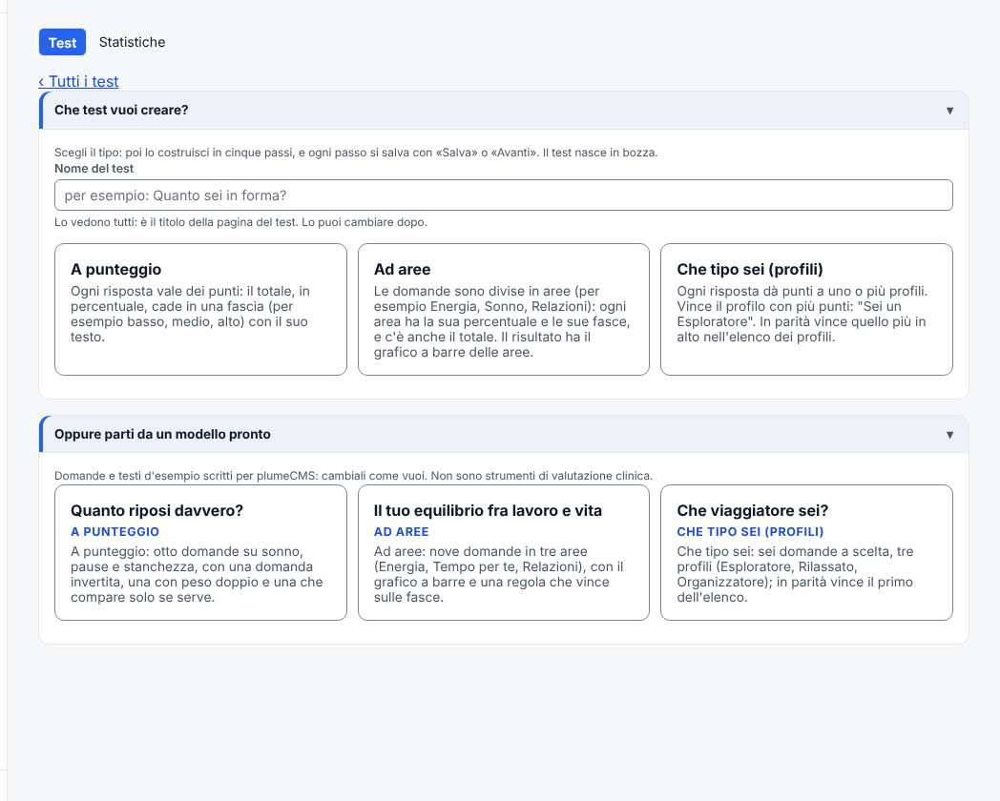
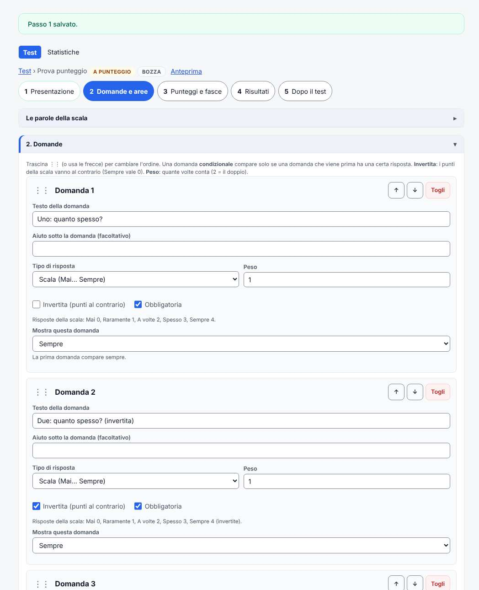
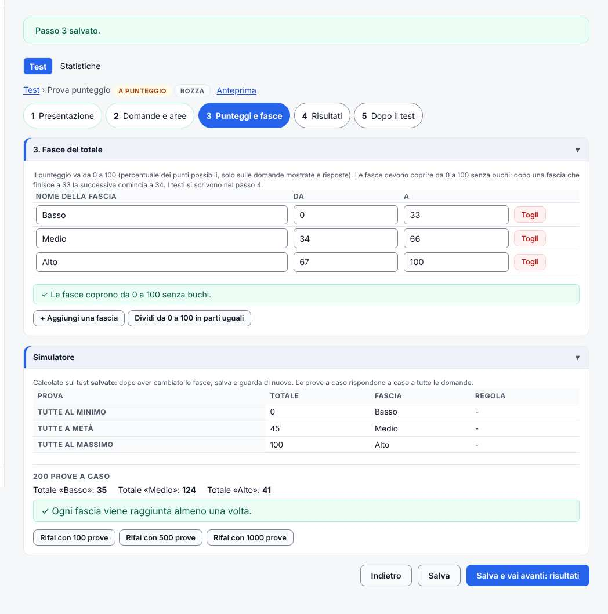
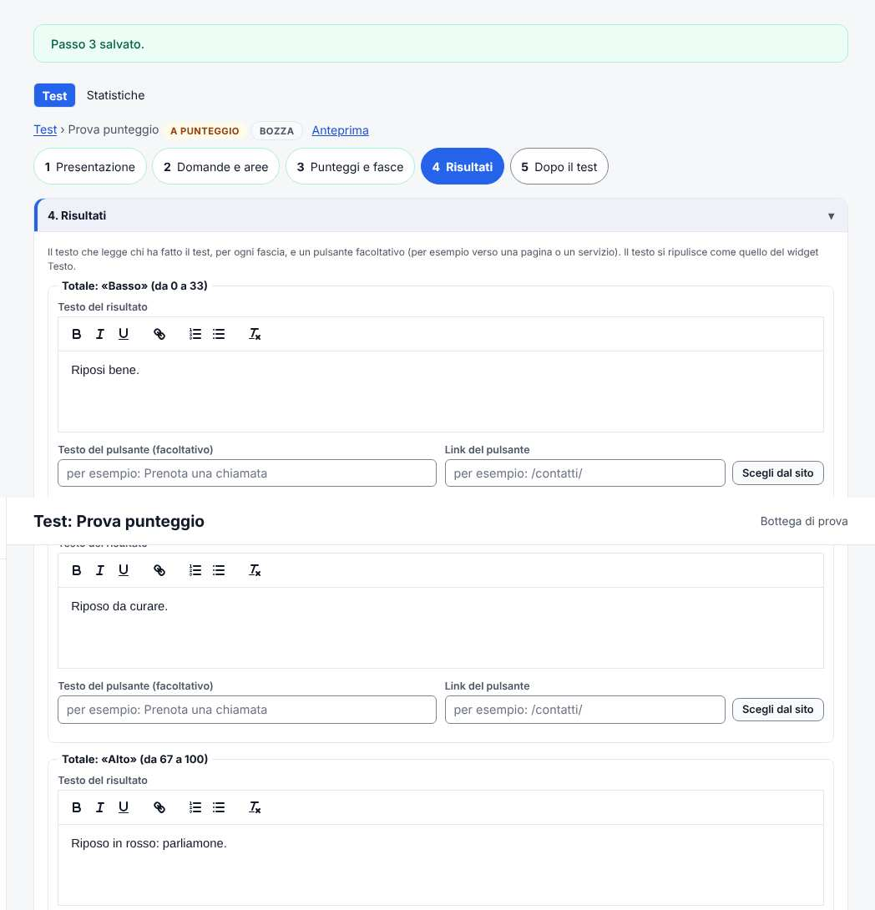
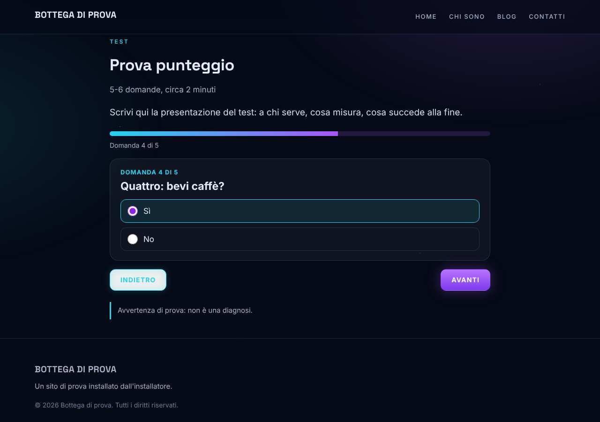
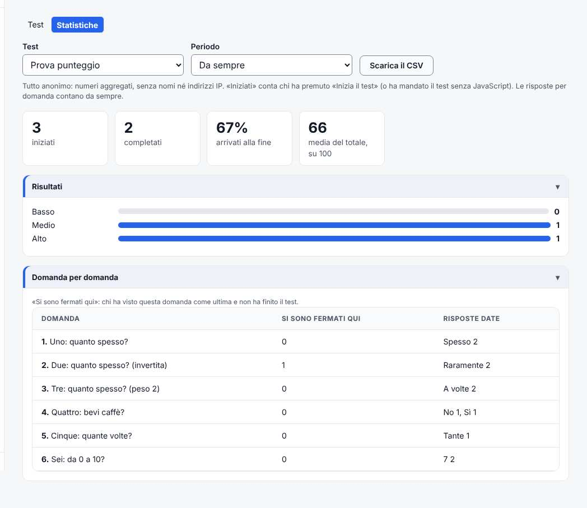

# Test e questionari

*Il capitolo del manuale d'uso dell'addon della 2.22.0. Il testo che va nel PDF è il capitolo 40 di `cms/docs/manuale-uso.md`: se cambia uno, si cambia anche l'altro.*

**A cosa serve.** Fare un test sul sito: chi lo fa risponde a una domanda per schermata e vede subito il risultato, con
un testo scritto da te e, se vuoi, un pulsante (per esempio "Prenota una chiamata"). Tre tipi:

- **A punteggio**: ogni risposta vale dei punti, il totale (da 0 a 100) cade in una **fascia** (Basso, Medio, Alto...);
- **Ad aree**: le domande sono divise in aree (Energia, Sonno, Relazioni...), ogni area ha il suo punteggio e le sue
  fasce, e il risultato ha il **grafico a barre** delle aree;
- **Che tipo sei** (profili): ogni risposta dà punti a uno o più profili, e vince quello con più punti ("Sei un
  Esploratore").

Chi ha fatto il test può farsi mandare il risultato per email e, a parte, iscriversi alla newsletter. Le risposte restano
**anonime**: il sito conserva solo il risultato, i punteggi e il giorno, mai il nome o l'indirizzo IP.

**Esempio.** Lo studio "Respiro" di Bologna, che insegna a gestire lo stress, vuole un test "Quanto riposi davvero?": otto
domande, tre fasce, e a chi esce "Riposo in rosso" un pulsante per prenotare una chiamata. Chi lascia l'email e si
iscrive alla newsletter riceve, nei giorni dopo, tre email pensate per il suo risultato.

Accendi l'addon (capitolo 31): nel menu compare **Test**, con **Test** e **Statistiche**. Solo l'amministratore lo vede.

### Creare il test

Apri **Test > Test** e premi **+ Nuovo test**.

1. Scrivi il **Nome del test**: "Quanto riposi davvero?".
2. Premi il tipo: **A punteggio**. Oppure, sotto, parti da uno dei **tre modelli pronti** (uno per tipo, con domande e
   testi d'esempio da cambiare): per l'esempio va bene "Quanto riposi davvero?".
3. Il test nasce **in bozza**: sul sito non si vede finché non lo pubblichi. Si apre la procedura in **cinque passi**,
   con la barra dei passi in alto: ogni passo si salva con **Salva** oppure con **Salva e vai avanti**.

### Passo 1: Presentazione

1. **Nome del test** e **Indirizzo della pagina**: la pagina sarà `/fai-il-test/quanto-riposi-davvero/`.
2. **Durata in minuti**: lascia 0 e la calcola il sito (circa 12 secondi a domanda). Sulla pagina si legge "8 domande,
   circa 2 minuti".
3. **Componi la presentazione con l'editor visuale**: la presentazione è il testo fra il titolo e il pulsante **Inizia
   il test**, e si scrive con l'editor visuale come una pagina (capitolo 9): testo, immagini, un video. Premi
   **Pubblica** nell'editor e torna alla scheda con la freccia in alto.
4. In **Testo semplice** c'è una presentazione breve: va nella descrizione per Google e per i social.

### Passo 2: Domande e aree

1. Premi **+ Aggiungi una domanda** e scrivi il **Testo della domanda**: "Ti svegli stanco anche dopo aver dormito le tue
   ore?". Sotto, se serve, un **Aiuto** ("Pensa alle ultime due settimane").
2. **Tipo di risposta**:
   - **Scala**: Mai, Raramente, A volte, Spesso, Sempre, che valgono da 0 a 4 (le parole e i punti li cambi in **Le parole
     della scala**, il riquadro sopra);
   - **Scelta singola**: le risposte le scrivi tu, ognuna con i suoi **Punti**;
   - **Sì o no**: due risposte, con i punti che decidi;
   - **Cursore da 0 a 10**: i punti sono il numero scelto.
3. **Invertita**: per le domande "al contrario". In "Durante il giorno ti senti pieno di energia?" la risposta buona è
   **Sempre**: spunta Invertita e Sempre vale 0, Mai vale 4.
4. **Peso**: quante volte conta la domanda. 2 = il doppio delle altre.
5. **Obbligatoria**: chi fa il test non va avanti senza rispondere.
6. **Mostra questa domanda**: **Sempre**, oppure **Solo se la domanda N ha risposta...**, e spunti una o più risposte.
   Esempio: "Quante volte a settimana bevi caffè dopo le quattro?" compare solo a chi alla domanda "Bevi caffè dopo le
   quattro?" ha risposto **Sì**. Una domanda condizionale può dipendere solo da una domanda che viene **prima**.
7. Per cambiare l'ordine trascina ⋮⋮, oppure usa le frecce ↑ ↓ (vanno anche con la tastiera). Se sposti una domanda
   condizionale sopra quella da cui dipende, la condizione si toglie e la pagina lo dice.
8. **Domande in ordine casuale**: ogni persona le vede in un ordine diverso; una condizionale resta subito dopo la sua.

In un test **ad aree**, prima delle domande c'è il riquadro **Aree**: aggiungile (+ **Aggiungi un'area**), e in ogni
domanda scegli la sua **Area**. In un test **a profili** c'è il riquadro **Profili**: aggiungili, e in ogni risposta
scrivi i **Punti** che dà a ogni profilo (per esempio "Cammino senza meta": 2 punti a Esploratore, 0 agli altri).
**L'ordine dei profili conta**: se due profili hanno gli stessi punti vince quello più in alto.

Premi **Salva e vai avanti**.

### Passo 3: Punteggi e fasce

Il punteggio va da 0 a 100: è la percentuale dei punti possibili, contando **solo le domande che la persona ha visto e
a cui ha risposto** (le condizionali che non le sono comparse non contano).

1. **Fasce del totale**: di partenza Basso (da 0 a 33), Medio (da 34 a 66), Alto (da 67 a 100). Cambia i nomi ("Riposo
   buono", "Riposo da curare", "Riposo in rosso") e, se vuoi, i numeri.
2. Le fasce devono coprire **da 0 a 100 senza buchi**: dopo una fascia che finisce a 33 la successiva comincia a 34.
   Sotto le fasce una riga verde dice "Le fasce coprono da 0 a 100 senza buchi"; se c'è un buco o una sovrapposizione,
   la riga diventa gialla e dice dove ("Fra Basso e Medio c'è un buco: da 34 a 35"). **Dividi da 0 a 100 in parti
   uguali** sistema i numeri da solo.
3. In un test ad aree, sotto ci sono le fasce di **ogni area**.
4. Il **Simulatore** calcola il risultato con tutte le risposte al minimo, a metà e al massimo, e con 200 prove a caso:
   se una fascia non esce mai lo dice ("La fascia Alto non viene mai raggiunta"). È calcolato sul test **salvato**: dopo
   un cambio premi **Salva** e guarda di nuovo. **Rifai con 1000 prove** ne fa di più.

### Passo 4: Risultati

1. Per ogni fascia (o profilo) scrivi il **Testo del risultato**: è quello che legge chi ha fatto il test. Si scrive come
   nel widget Testo: grassetto, corsivo, elenchi, link.
2. **Testo del pulsante** e **Link del pulsante**, facoltativi: "Prenota una chiamata", e il link con **Scegli dal sito**
   (cerca `contatti`).
3. In un test ad aree, ogni area ha i suoi testi (escono sotto il grafico) e ci sono le **Regole sul risultato**: una
   regola vince sulle fasce. Esempio: **+ Aggiungi una regola**, nome "Poca energia e poco tempo", **Vale quando tutte
   le condizioni sono vere (E)**, condizioni "Area Energia è in fascia Bassa" e "Area Tempo per te è in fascia Poco", e
   il suo testo. Le regole si guardano dalla prima: vale la prima che si avvera (le frecce cambiano l'ordine). Con
   **almeno una condizione (O)** basta una.
4. **Avvertenza**: di partenza "Questo test non è una diagnosi e non sostituisce il parere di un professionista.". Esce
   sotto le domande e sotto il risultato.

### Passo 5: Dopo il test, e Pubblica

1. **Offri il risultato per email**: sotto il risultato compare "Vuoi ricevere il risultato per email?", con l'email e
   la casella del **consenso**, che parte vuota. Un test sulla salute tratta un dato particolare: per questo il consenso
   è una casella sua.
2. **Iscrizione a una lista**: scegli la lista della newsletter (per esempio "Lettori del test"). Compare una seconda
   casella, separata, per iscriversi: arriva l'email per confermare, come nei form (doppia conferma).
3. **Automazioni**: il riquadro elenca le automazioni che usano questo test.
4. **Privacy**: il riquadro riassume cosa il sito conserva.
5. Premi **Salva**, poi **Pubblica il test**. Se qualcosa manca (le fasce hanno un buco, un'area senza domande, un
   profilo che nessuna risposta premia), il riquadro **Pubblica** lo elenca e il pulsante resta spento finché non lo
   sistemi.

### Sul sito

1. La pagina del test ha il titolo, "8 domande, circa 2 minuti", la presentazione e **Inizia il test**.
2. Le domande arrivano **una per schermata**, con la barra di avanzamento, **Indietro** e **Avanti**. Va anche con la
   tastiera: le frecce scelgono la risposta, Invio va avanti.
3. Se chi fa il test chiude la pagina a metà, al ritorno trova **Riprendi da dove eri** (le risposte restano solo nel
   suo browser).
4. Senza JavaScript il test funziona lo stesso: tutte le domande in una pagina, e le condizionali dicono "Rispondi solo
   se alla domanda 4 hai risposto «Sì»".

Il risultato ha il nome della fascia (o della regola, o del profilo), il punteggio su 100, il tuo testo, il grafico delle
aree (o dei profili), il pulsante e l'avvertenza. Il calcolo lo fa sempre il sito, mai il browser.

**Condividi il risultato**: un link con solo l'esito, firmato. Chi lo apre vede lo stesso risultato; se qualcuno cambia
anche una lettera del link, il sito risponde "Questo link non funziona". Il riquadro dell'email non c'è nel link
condiviso: si chiede entro due ore dal test, dalla pagina del risultato.

Per portare le persone al test usa il widget **Riquadro in evidenza** (gruppo Dal sito): con l'addon acceso ha la
tendina **Oppure porta a un test**. Oppure un link qualunque con **Scegli dal sito**: i test ci sono.

### Le automazioni dopo il test

In **Newsletter e form > Automazioni** crea un'automazione e, fra gli **Inneschi**, scegli **Completa un test**:

1. **Quale**: il test ("Quanto riposi davvero?").
2. **Con quale risultato**: Qualunque, oppure una fascia ("Totale: Riposo in rosso"), una fascia di un'area, un profilo,
   una regola.
3. Poi i passi come in ogni automazione (capitolo 20): email, attese, divisioni.

Parte per chi si iscrive dalla pagina del risultato, **dopo** aver confermato l'iscrizione. Così a chi è "in rosso"
mandi tre email sul riposo, a chi va bene una sola di saluto. Nella scheda del contatto, in **Cronologia**, c'è "Ha
completato il test «Quanto riposi davvero?»: Riposo in rosso (73 su 100)".

### Le statistiche

Apri **Test > Statistiche** e scegli il test e il periodo:

- **iniziati**, **completati** e quanti **arrivano alla fine**;
- **Risultati**: quante persone per fascia o profilo, e quante per regola;
- **Media per area** (o dei punti per profilo);
- **Domanda per domanda**: quanti **si sono fermati** a quella domanda, e quante volte è stata data ogni risposta;
- **Scarica il CSV**: gli stessi numeri, da aprire con Excel. Sono tutti numeri aggregati, senza persone.

**Cosa non c'è ancora.** Domande con più risposte da spuntare, immagini nelle risposte, un test diviso in pagine con
più domande per schermata, il pagamento per fare il test. Il risultato per email senza JavaScript (il riquadro
dell'email usa la casella "Sono una persona", che vuole JavaScript). Chi si fa mandare il risultato **senza** iscriversi
non entra nei Contatti: il suo indirizzo serve solo a mandare l'email.

**Checklist**

- [ ] L'addon è acceso; se offri il risultato per email, la posta del sito funziona (capitolo 25).
- [ ] Le domande hanno il tipo giusto; le invertite e i pesi sono quelli voluti; le condizionali dipendono da una
  domanda che viene prima.
- [ ] Le fasce coprono da 0 a 100 senza buchi (riga verde nel passo 3), anche quelle di ogni area.
- [ ] Il simulatore non dice "non viene mai raggiunta".
- [ ] Ogni fascia, area, profilo e regola ha il suo testo; i pulsanti portano alla pagina giusta.
- [ ] L'avvertenza c'è.
- [ ] Il test è **Pubblicato** e la sua pagina si apre; l'ho fatto io dal telefono fino al risultato.
- [ ] Il link condiviso apre lo stesso risultato.
- [ ] Con l'email: il risultato è arrivato; con la lista: è arrivata l'email per confermare.
- [ ] Il widget **Riquadro in evidenza** porta al test.

**Problemi frequenti**

| Problema | Cosa fare |
|---|---|
| Il pulsante **Pubblica il test** è spento | Il riquadro Pubblica elenca cosa manca: di solito un buco fra le fasce (passo 3) |
| Una domanda condizionale non compare mai | Controlla nel passo 2 quali risposte sono spuntate in "Una di queste risposte" |
| Il risultato esce sempre nella stessa fascia | Guarda il simulatore (passo 3): forse le fasce non sono adatte ai punti, o una domanda ha il peso troppo alto |
| L'automazione "Completa un test" non parte | Parte solo per chi si iscrive alla lista dalla pagina del risultato, dopo la conferma. Controlla anche che l'automazione sia **Attiva** |
| Chi apre il link condiviso non vede il riquadro dell'email | È voluto: l'email si chiede entro due ore dal test, dalla pagina del risultato |
| Ho cambiato una fascia e i vecchi link mostrano altro | Il link porta l'esito di allora; se la fascia non c'è più, resta il punteggio |
