# UX e UI del pannello (nucleo), novembre 2026

Data: 2026-11-01. Partenza: commit `b9be2f6` (plumeCMS 2.5.0). Campo: il pannello del nucleo (`cms/admin/`, senza l'editor
visuale, l'installatore, le pagine degli addon e il sito pubblico, che ha guardato un altro agente). Fogli toccati:
`cms/admin/assets/css/admin.css` e `aspetti.css`, più poche righe in pagine del pannello.

Metodo: sito di prova installato col kit Attività, otto addon accesi, 57 pagine del menu e delle schede fotografate nei
quattro aspetti (Aria, Cosmo, Bottega, Lavagna) a 1280 e 390 px, guardate a occhio; poi la prova nuova
`prove/prova-ux-pannello.js` che misura nel browser contrasti, bordi dei campi, fasce dei titoli e scorrimento di lato.
Prima delle correzioni la prova dava **773 su 1175**: 136 riquadri senza fascia, 64+ campi con il bordo sotto 3:1,
segnaposto sotto 4,5:1 in Cosmo e Lavagna, la versione illeggibile in Bottega.

## La richiesta di Danilo (SEO e AEO > Motori di ricerca, aspetto scuro)

> "I titoli delle varie sezioni devono avere uno sfondo diverso, così che siano facilmente identificabili e la schermata
> diventi meno confusionaria. Rendere più identificabili anche i campi di testo, i campi con pulsante sfoglia."

Cosa confondeva: titolo del riquadro ("VERIFICA DELLA PROPRIETÀ") ed etichetta del campo ("GOOGLE SEARCH CONSOLE") erano
lo stesso oggetto: maiuscoletto, grigio, stessa misura. I campi avevano un bordo `--border` a 1,3:1 sul riquadro: in Cosmo
il campo si vedeva solo per il testo d'esempio.

Cosa è cambiato, in tutto il pannello e non solo in SEO:

1. **Il titolo di ogni riquadro è una fascia**: fondo `--testata` diverso dal corpo, striscia d'accento a sinistra, linea
   sotto, testo pieno (12,7:1 in Cosmo, 15,8:1 in Aria). Vale per il primo `h2`/`h3` dei riquadri di tutte le pagine
   (`.form-card`, `.seo-card`, `.agg-card`, `.cs-card`, `.db-scatola`...; anche quando il riquadro è un `<form>` che
   comincia con i campi nascosti) e per le testate che c'erano già (`.sc-scatola`, `.mn-scatola`, `.wg-gruppo`).
2. **Le etichette dei campi** sono in carattere normale, a colore pieno, un gradino sotto la fascia. I sottotitoli dentro
   un riquadro (per esempio "Crawler delle intelligenze artificiali") restano in maiuscoletto piccolo con una riga sopra.
3. **I campi** hanno il bordo `--bordo-campo`, almeno 3:1 sul riquadro e sul fondo in tutti e quattro gli aspetti
   (Aria 3,72, Bottega 4,05, Cosmo 4,23, Lavagna 4,36), il fondo `--campo` un poco più scuro del riquadro negli aspetti
   scuri, il bordo più scuro al passaggio del mouse e, al fuoco, un contorno pieno dell'accento (prima: un alone al 28%).
   La regola vince anche sui bordi scritti in linea nelle pagine (anche degli addon).
4. **Scegli un file**: `::file-selector-button` ha l'aspetto di un pulsante del pannello, dentro un riquadro tratteggiato;
   accanto il browser scrive il nome del file scelto ("Nessun file selezionato" finché non si sceglie). Nessun JavaScript.

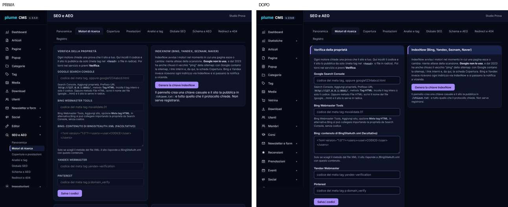
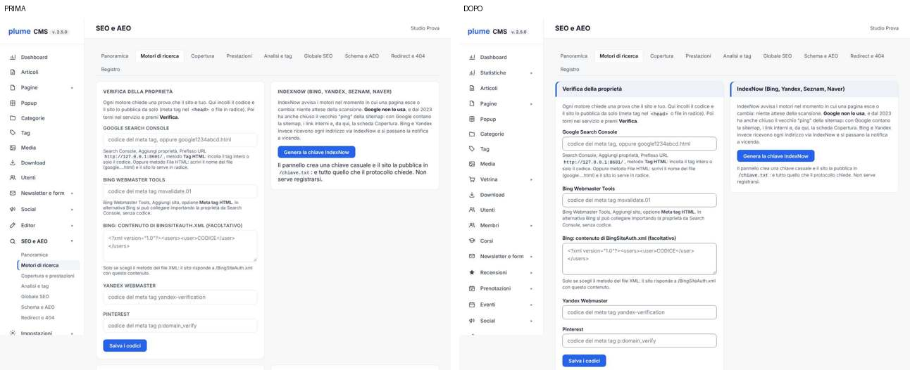
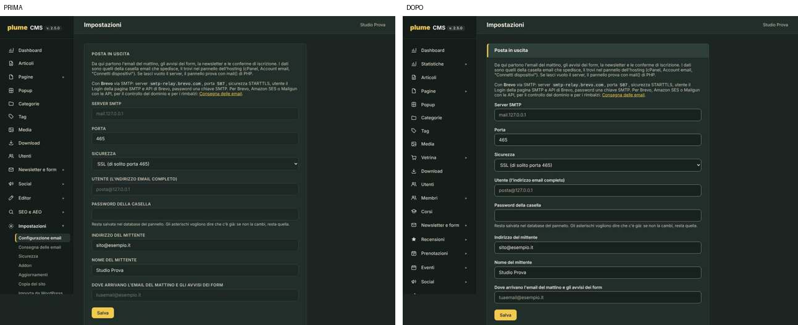
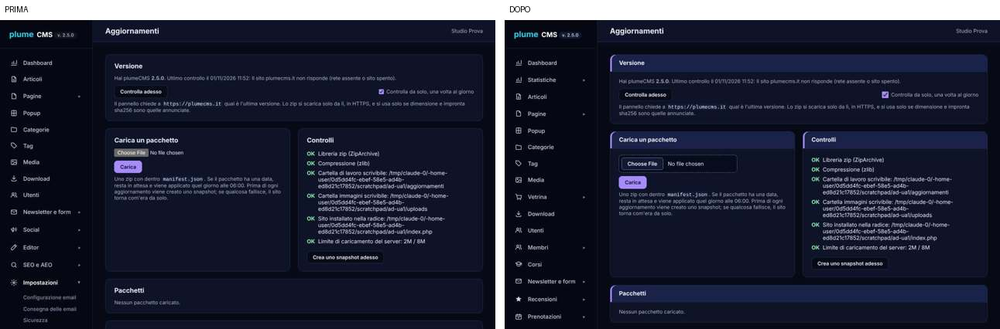

Variabili nuove in `aspetti.css` (una per aspetto): `--testata`, `--testata-testo`, `--bordo-campo`, `--segnaposto`;
`--campo` cambia in Cosmo (`#070c1c`) e Lavagna (`#19221f`).

## Problemi trovati

Gravità: alta = chi usa sbaglia o non vede; media = rallenta o confonde; bassa = rifinitura. Commit: C1 `27752f6`,
C2 `4756d7d`, C3 `802451b`, C4 `107a8d0`, C5 il commit di questo documento.

| n. | Gravità | Dove | Cosa confonde chi usa | Criterio | Correzione | Commit |
|---|---|---|---|---|---|---|
| 1 | alta | Tutti i riquadri (34 per aspetto: SEO, Impostazioni, Aggiornamenti, Dashboard, Copia del sito, Log cron...) | Il titolo del riquadro non si distingue dalle etichette: la pagina sembra un elenco piatto | Nielsen 8 (estetica e gerarchia), WCAG 1.3.1 | Fascia del titolo con fondo, accento e linea | C1 |
| 2 | alta | Etichette `.form-group label` | In maiuscoletto grigio sembrano titoli di sezione | Nielsen 4 (coerenza) | Carattere normale, colore pieno | C1 |
| 3 | alta | Ogni campo di testo, tendina, area di testo | Bordo a 1,24:1 (Aria), 1,33 (Cosmo), 1,34 (Bottega), 1,37 (Lavagna): il campo non si vede | WCAG 1.4.11 (3:1) | `--bordo-campo` da 3,7 a 4,4:1 | C1, C4 |
| 4 | alta | Barra laterale in Bottega, "v. 2.5.0" | Grigio del contenuto sul marrone della barra: 1,9:1, illeggibile | WCAG 1.4.3 | Colori della barra | C1 |
| 5 | media | Testo d'esempio dei campi in Cosmo (4,11:1) e Lavagna (3,30:1) | Si legge a fatica | WCAG 1.4.3 | `--segnaposto` 6,1 e 6,6:1, più tenue del testo scritto | C1 |
| 6 | media | Scelta file: Aggiornamenti, Copia del sito, Media, Download, Temi, Newsletter > Importa, Impostazioni dell'editor, Colori delle infografiche | Pulsante grigio del sistema, senza bordo, "Choose File" piccolo: non sembra una cosa da toccare | Nielsen 4, WCAG 1.4.11 | Pulsante del pannello in un riquadro tratteggiato | C1 |
| 7 | media | Fuoco dei campi | Alone al 28% di trasparenza, quasi invisibile negli aspetti scuri | WCAG 2.4.7, 2.4.13 | Contorno pieno di 2 px dell'accento | C1 |
| 8 | media | Pulsanti secondari (`.btn-secondary`) in Cosmo e Lavagna | Bordo `--border` quasi invisibile: "Salva la chiave" sembra un'etichetta | Nielsen 4, WCAG 1.4.11 | Bordo `--bordo-campo`, accento al passaggio | C1 |
| 9 | bassa | SEO > IndexNow e altri: `p.hint` fuori da `.form-group` | Il testo d'aiuto era grande come il testo principale | Gerarchia visiva | `.hint` piccolo e tenue ovunque | C1 |
| 10 | media | Bordi scritti in linea: Newsletter (iscritti, liste, importa), Categorie (ricerca), Media (indirizzo sotto la foto), Prenotazioni (ricerca) | Gli stessi campi invisibili del punto 3, sfuggiti alla regola generale | WCAG 1.4.11 | `--bordo-campo` nel codice e `!important` nella regola | C1, C4 |
| 11 | media | Barra in alto a 390 px (Aggiornamenti, Impostazioni...) | Versione su due righe, titolo e nome dell'utente si toccano | Nielsen 8 | Titolo con i puntini, nome su una riga, versione senza a capo | C2 |
| 12 | media | Pulsante del menu al telefono | Senza nome: il lettore di schermo dice "trigramma"; non dice se il menu è aperto | WCAG 4.1.2 | `aria-label`, `aria-expanded` aggiornato da `pannello.js`, 44x44 px | C2 |
| 13 | media | Sicurezza > Stato | L'esito è solo un pallino colorato; in Bottega verde e grigio sono quasi uguali | WCAG 1.4.1 | Un segno nel pallino (spunta, !, x, i) e un nome per i lettori di schermo | C2 |
| 14 | bassa | Newsletter > Campagne | Il titolo sta in una riga con "+ Nuova campagna": restava senza fascia | Nielsen 4 | La riga intera diventa la fascia | C2 |
| 15 | bassa | Margine laterale del contenuto a 390 px | 32 px per parte: righe corte, molto a capo | Gerarchia, telefono | 16 px | C2 |
| 16 | media | Accesso: errore | "Credenziali non valide." è gergo; il messaggio non viene annunciato | Nielsen 9, WCAG 4.1.3 | "Nome utente o password non corretti. Controlla le maiuscole e riprova.", `role=alert` | C3 |
| 17 | media | Accesso: campi | Bordo 1,6:1, etichette grigie | WCAG 1.4.11 | Bordo `--bordo-campo`, contorno al fuoco | C3 |
| 18 | bassa | Messaggi del pannello (verde, rosso, giallo in cima alla pagina) | I lettori di schermo non li annunciano | WCAG 4.1.3 | `role=alert` per gli errori, `role=status` per gli altri | C3 |
| 19 | bassa | Finestre Scegli dai Media e Scegli dal sito | Stesso bordo debole dei campi | WCAG 1.4.11 | Bordo e fuoco come gli altri campi | C3 |
| 20 | bassa | Tutte le pagine, con la tastiera | Prima del contenuto bisogna attraversare circa 25 voci del menu | WCAG 2.4.1 | "Vai al contenuto", visibile al primo Tab | C4 |
| 21 | bassa | Categorie e Tag senza voci | "Niente qui." non dice cosa fare | Nielsen 9 e 10 | "Ancora nessuna categoria: aggiungi la prima con il riquadro qui accanto." (e il caso della ricerca vuota) | C5 |

Schermate prima e dopo, oltre a quelle sopra:

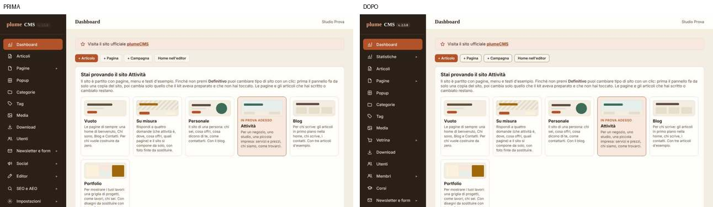
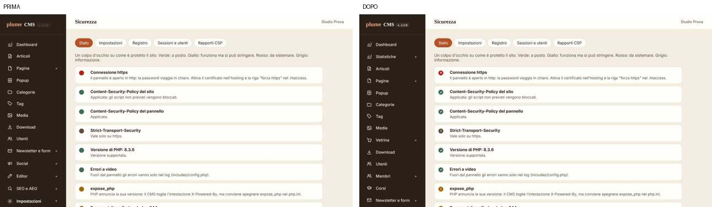
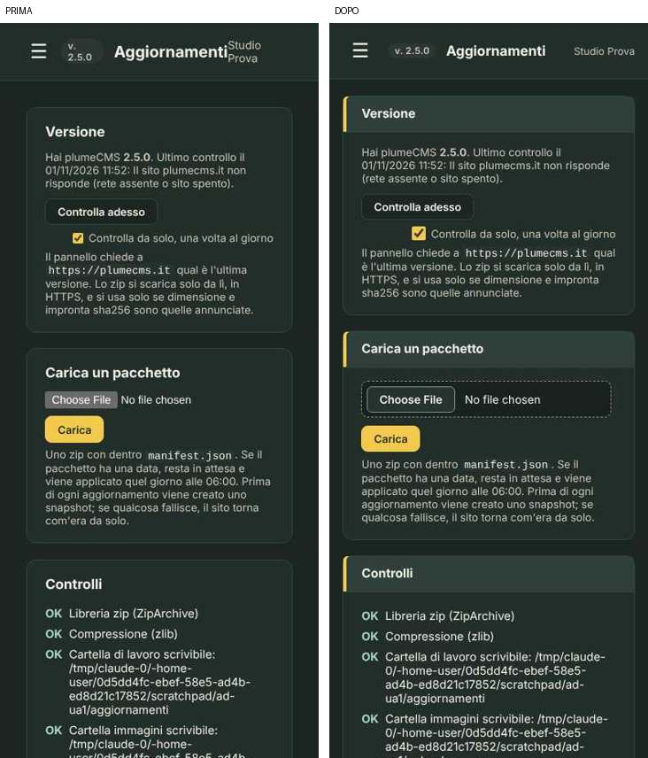

## Decisi da Danilo (1 novembre 2026): tutti e dieci, fatti

Danilo ha scelto tutti i punti che erano "da decidere", più tre ritocchi segnalati dall'altro agente. Secondo giro, partito
da `26daddb`.

| n. | Punto | Cosa è cambiato | Commit |
|---|---|---|---|
| 1 | Editor > Temi, "Attiva" accanto ad "attivo" | Il pulsante dice **Usa questo tema** (anche "poi Usa questo tema" nel messaggio). Aggiornati `prova-pannello-temi.js`, `prova-temi-nuovi.js`, manuale d'uso e manuale dei temi (solo testo) | `03032d7`, `69d807b` |
| 2 | "Aggiungi articolo" lascia bozze vuote | Il giro del mattino (`cron_bozze_vuote()` in `includes/cron.php`) mette nel cestino le bozze nate da più di un giorno con il titolo e l'indirizzo dati dal pannello, senza testo, mai salvate dalla scheda e senza versioni dell'editor oltre a "creato dall'editor". Riga nel Log cron, voce nell'elenco di cosa fa il cron, paragrafo nel manuale d'uso. Prova nuova `prova-bozze-vuote.js` | `10845e1` |
| 3 | Articoli, "Pillar e cluster" e "Parole · KW" | Il filtro compare solo se c'è almeno un pillar (o se è già in uso); colonna "Parole e parola chiave" con l'aiuto al passaggio; senza parola chiave "nessuna parola chiave" al posto di "0% · 0%" in rosso | `fb6e542` |
| 4 | Configurazione email conteneva il sito | Due schede in `impostazioni.php`: **Configurazione email** (solo la posta) e **Sito** (`?scheda=sito`), voce Sito nel menu. I vecchi indirizzi `#indirizzo-sito` e `#firma-sito` portano alla scheda Sito (`data-spostato` in `pannello.js`; senza JavaScript un link) | `7d8a7bd` |
| 5 | Service account in SEO | Passi e casella della chiave in un riquadro che si apre: aperto finché il collegamento non c'è, chiuso dopo ("Rifai il collegamento o sostituisci la chiave"); "Salva la chiave" primario quando manca; sottotitolo prima del modulo della proprietà. Niente tolto | `bc73ef2` |
| 6 | Download, aiuto lungo | Solo markup: i tre paragrafi d'aiuto in `
` "Come funzionano indirizzi, versioni e file riservati" (`admin/scaricabili.php`, righe 137 e 145). Nient'altro nella pagina | `81e754b` |
| 7 | Conferme del browser | `pannello.js`: ogni `data-conferma` apre una finestra del pannello (`role="alertdialog"`), il pulsante che conferma ripete l'azione ed è rosso (`.btn-pericolo`) se distrugge; fuoco dentro (su Annulla se distrugge), Esc e clic fuori annullano, il fuoco torna al pulsante. Chiesta nella fase di cattura, così i gestori della pagina partono solo dopo il sì. Senza `<dialog>` resta `confirm()`, senza JavaScript i form vanno come prima. Le prove usano `prove/conferme-pannello.js` | `7f611d6` |
| 8 | Tabelle al telefono | Ogni tabella semplice del pannello (testata di almeno tre colonne, righe senza celle unite) sotto 640 px diventa una scheda per riga, con il nome della colonna sopra ogni valore. Utenti e Categorie in una colonna sotto 760 px (la tabella degli utenti finiva in una striscia di pochi pixel) | `aad9263` |
| 9 | Dashboard, "Stai provando il sito" | `
` aperto alla prima visita di ogni amministratore (impostazione `dashboard_tipo_sito_visto_<id>`), poi chiuso; si apre con un clic o con `#tipo-sito` nell'indirizzo (dopo un cambio di kit torna aperto) | `7f611d6` |
| 10 | Utenti, ultimo accesso | "oggi alle 12:17", "ieri alle 9:05", il giorno della settimana, poi la data (`utenti_quando()`), su una riga | `fb6e542` |

Ritocchi dell'altro agente, fatti in `64e4c01`: freccina dei gruppi del menu a colore pieno (prima 3,3:1); contorno del
fuoco di 2 px dell'accento su pulsanti, link, schede e summary in tutto il pannello, pagine degli addon comprese; segnaposto
che sembravano valori scritti come esempio ("per esempio mail.tuosito.it", "per esempio copie-del-sito"); tolto lo stile in
linea della ricerca in `cms/addon/prenotazioni/includes/admin-elenco.php`. In più (`4b80b80`): "esci da tutti" in Utenti era
un pulsante grigio del browser.

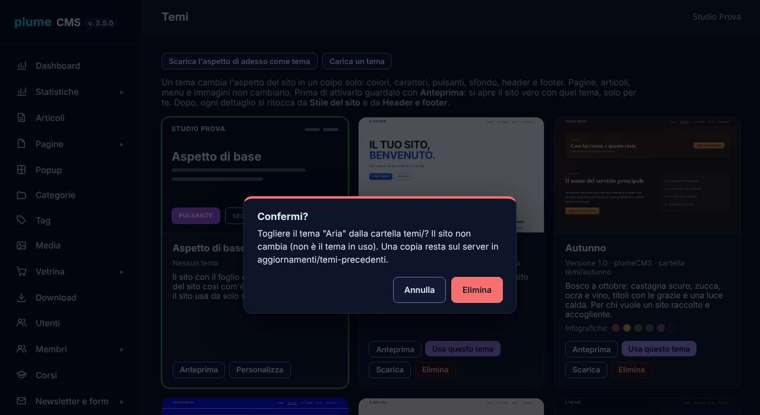
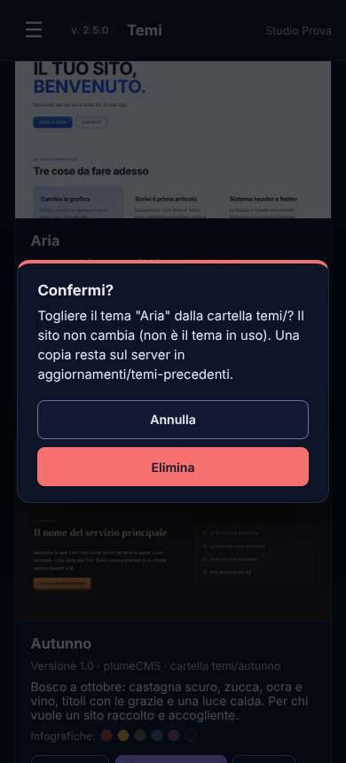
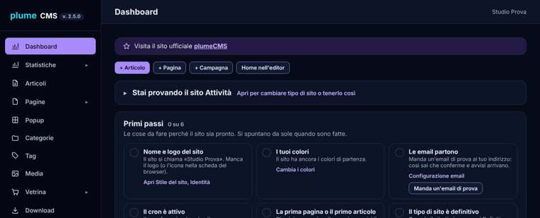
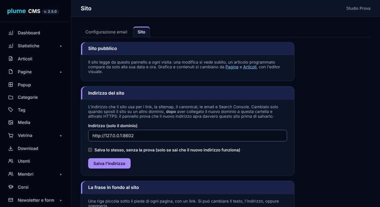
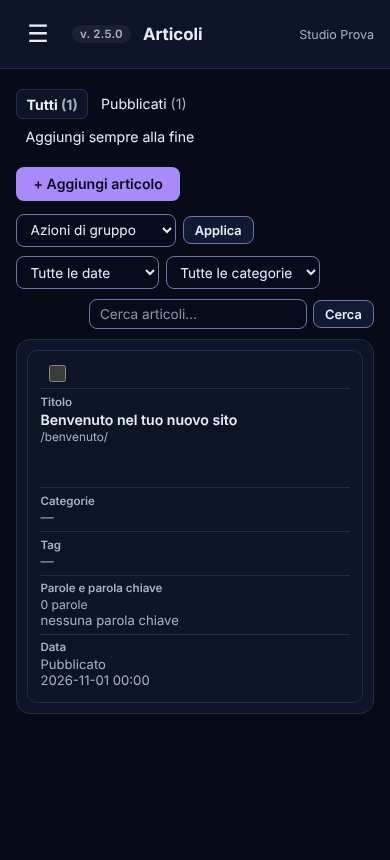
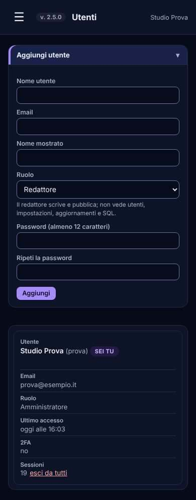

Da sapere per le schermate del manuale d'uso: la dashboard ha ora il riquadro del tipo di sito chiuso dopo la prima visita
(`tools/manuale-uso-schermate.js` ora apre `index.php#tipo-sito` per la foto 02, non rilanciato), le conferme sono la
finestra del pannello, Impostazioni ha le schede Configurazione email e Sito.

## Segnalazioni per le parti dell'altro agente

- `cms/addon/prenotazioni/includes/admin-elenco.php:114`: la ricerca aveva il bordo in linea `var(--border)` (1,16:1). Tolto nel
  secondo giro (classe `search-input`).
- `--campo` cambia in Cosmo e Lavagna: `cms/admin/assets/editor/editor.css` lo usa due volte, i campi dell'editor in quegli
  aspetti escono un poco più scuri.
- `.btn-secondary` ha ora il bordo `--bordo-campo`: vale anche nelle pagine degli addon (voluto, più leggibile).
- Le fasce dei titoli valgono anche per `.sc-scatola` (fogli `contenuti.css`), usata dalle pagine degli addon.

## Prove

| Prova | Esito |
|---|---|
| `prove/prova-ux-pannello.js` (nuova), quattro aspetti, 1280 e 390 px, senza addon | prima (codice di `b9be2f6`) 773/1175, dopo 1207/1207 |
| la stessa con gli otto addon accesi (pagine degli addon comprese) | 1667/1667 |
| `prove/prova-pannello-telefono.js` `LARGHEZZA=390` e `LARGHEZZA=768`, otto addon accesi | 72/72 e 72/72 (rifatta dopo C5) |
| `prove/prova-install.js` in radice, dallo zip di `tools/cms-pacchetto.py` (che controlla la sintassi) | 37/37 |
| `prove/foto-sito.js` prima (pannello di `b9be2f6`) e dopo, stesso database, `quanto-foto.py` | 20 foto, nessuna differenza |
| `php -n -d short_open_tag=1 -l` sui PHP toccati, `node --check` su `pannello.js` e sulla prova | senza errori |

La prova nuova: `node prove/prova-ux-pannello.js <base> <utente> <password> [aspetti] [filtro pagine]`. Sceglie ogni aspetto
da Il mio accesso (come una persona), apre le pagine del menu e alcune schede, e misura: testi almeno 4,5:1 (3:1 i grandi),
bordi dei campi almeno 3:1 sul fondo intorno, segnaposto almeno 4,5:1, titoli dei riquadri in una fascia con fondo diverso
e testo almeno 4,5:1, il pulsante della scelta file, niente scorrimento di lato a 390 px; alla fine rimette Aria.
Limite: misura i colori pieni (salta i fondi a gradiente e gli elementi trasparenti) e guarda le pagine con i dati del kit.

### Secondo giro (codice dei dieci punti, `4b80b80`)

| Prova | Esito |
|---|---|
| `php -n -d short_open_tag=1 -l` e `node --check` su ogni file toccato; zip di `tools/cms-pacchetto.py` (340 file, 1927 KB) | a posto |
| `prove/prova-ux-pannello.js`, quattro aspetti, otto addon accesi, con i controlli nuovi della finestra di conferma | 1694/1694 |
| `prove/prova-ux-editor.js` (sito Attività con gli addon e la pagina `/addon-tutti/`, copia non installata per l'installatore) | 71/71 |
| `prove/prova-pannello-telefono.js` a 390 e 768 px, otto addon accesi (una voce in più: Sito) | 73/73 e 73/73 |
| `prove/prova-install.js` in radice, dallo zip | 37/37 |
| `prove/prova-addon-tutti.js` su un sito Attività | 70/70 (sul sito appena installato dallo zip senza kit 69/70: manca la pagina `/servizi/` del kit, non dipende da questo lavoro) |
| `tools/sicurezza-prova.js` con `CMS_DIR` (prefisso del pannello vuoto), poi svuotata `cms_sicurezza_tentativi` | 250/250; saltati burnout, newsletter firmata (senza `SEGRETO`), WordPress cattivo (senza `FINTO_WP`) e i due della 1.7.0 su un sito non su misura |
| `prova-pannello-temi.js`, `prova-temi-nuovi.js` | 32/32, 451/451 |
| `prova-firma.js`, `prova-indirizzo-sito.js` (due controlli nuovi: vecchio indirizzo, Configurazione email senza i riquadri del sito) | 14/14, 12/12 |
| `prova-seo-service-account.js` (il controllo dell'etichetta guarda dentro il riquadro chiuso) | 8/8 |
| `prova-bozze-vuote.js` (nuova) | 11/11 |
| `prova-tipo-sito.js` (sito Portfolio, dashboard aperta con `#tipo-sito`), `prova-su-misura.js`, `prova-kit.js` portfolio | 39/39, 34/34, 34/34 |
| `prove/foto-sito.js` prima e dopo sullo stesso database con gli otto addon, `quanto-foto.py` | 20 foto: 19 identiche, `cerca-tel` scarto massimo 1 livello su 255 e nessun pixel oltre 2 (rumore dei caratteri) |

Le prove che accettavano `confirm()` con `p.on('dialog', ...)` (40 in `prove/` più `tools/sicurezza-prova.js` e
`tools/manuale-uso-schermate.js`) ora passano da `prove/conferme-pannello.js`: stesso gestore, stessi `accept()` e
`dismiss()`, ma premendo i pulsanti della finestra del pannello. Le prove che ascoltano i dialoghi per scoprire un `alert()`
iniettato (attacchi) restano come erano. Non rilanciate in questo giro: le altre 30 prove convertite (la conversione è
meccanica, la provano le dieci rilanciate qui sopra) e `tools/manuale-uso-schermate.js`.

## Principi applicati (per le regole globali di interfaccia)

1. Tre livelli di testo, distinti da più di una cosa: **fascia** (titolo del riquadro: fondo, accento, grassetto),
   **sottotitolo** (maiuscoletto piccolo tenue con una riga sopra), **etichetta** (carattere normale, colore pieno).
   Mai due livelli con lo stesso stile.
2. Ogni contorno che dice "qui si scrive o si tocca" (campo, tendina, scelta file, pulsante secondario) almeno 3:1 sul
   fondo intorno, in ogni aspetto. I riquadri decorativi possono restare tenui.
3. Fuoco: contorno pieno di 2 px dell'accento, mai solo un alone trasparente, mai `outline:none` senza un sostituto.
4. Il colore non è mai l'unico segnale: stati con segno o parola (pallini, distintivi, messaggi).
5. Ogni colore nuovo nasce come variabile in `aspetti.css`, con il valore nei quattro aspetti e il contrasto misurato.
6. Le regole generali stanno in `admin.css` dentro `.admin-content` (o `.login-box`), così l'editor e il sito non cambiano;
   pesano abbastanza da vincere sulle regole delle pagine, e per i bordi anche sugli stili in linea.
7. Messaggi in parole di chi usa il pannello, con il passo successivo ("aggiungi la prima con il riquadro qui accanto").
8. Al telefono: margine di 16 px, niente a capo nella barra in alto, bersagli di almeno 44 px.
9. Accessibilità di base in ogni pagina: "Vai al contenuto", pulsanti con un nome, messaggi annunciati (`role`).
